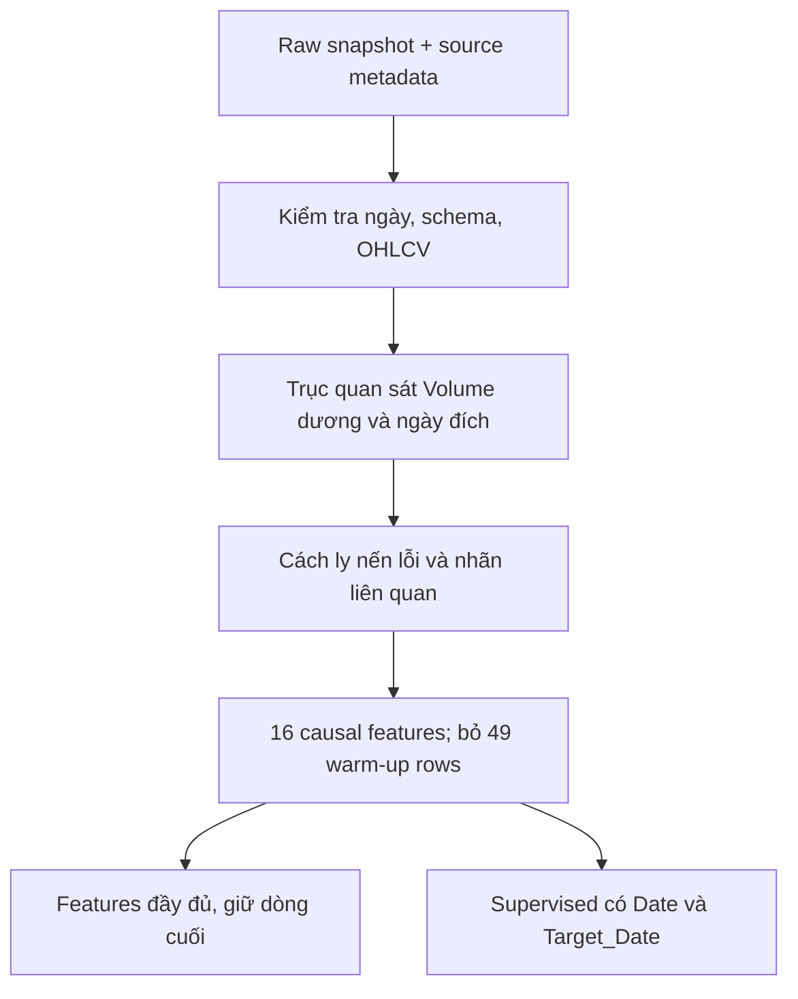
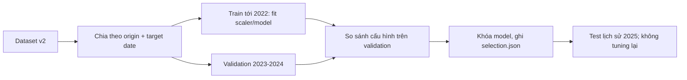
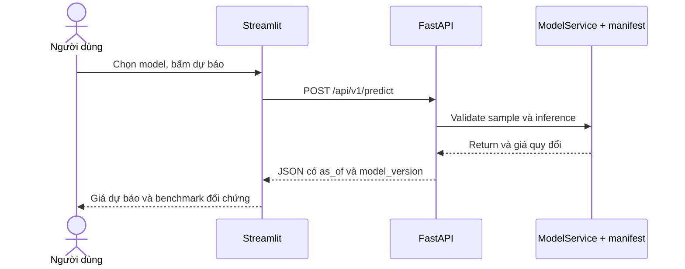

# FPT Stock Forecasting

**Đồ án Máy học · Phân tích FPT và dự báo một quan sát kế tiếp**

Một pipeline v2 dùng chung trên local và Google Colab: **snapshot có hash → EDA/features → training/benchmark → artifact theo manifest → FastAPI → Streamlit**.


## 1. Phạm vi và kết quả

- Chỉ dự báo **FPT.VN**, dữ liệu điều chỉnh giai đoạn 2018–2025.
- Mục tiêu: `log(Close[t+1] / Close[t])`; quy đổi giá bằng `Close[t] * exp(predicted_return)`.
- LSTM lookback 30 là model ML dùng demo. **Train Mean** có RMSE validation thấp nhất toàn bộ nhóm; hai vai trò được hiển thị riêng.
- Không dùng Hit Rate lịch sử như xác suất đúng của từng dự báo. LSTM chỉ cải thiện RMSE test nhẹ và có MAE cao hơn zero-return.
- Năm 2025 đã được xem trong các lần thử, nên ghi là test lịch sử sử dụng lại; chưa chứng minh lợi thế tổng quát hay lợi nhuận giao dịch.

[Kết quả và giới hạn](docs/TRAINING_RESULTS.md)

## 2. Chạy trên máy local

```powershell
python -m venv venv
.\venv\Scripts\Activate.ps1
python -m pip install -r requirements.txt

# Phục hồi đúng snapshot đã chốt, không tải lại Yahoo.
python -m src.data.snapshot

# Backend: load model/scaler một lần, Swagger tại /docs.
python -m uvicorn src.api.main:app --host 127.0.0.1 --port 8000
```

Trong terminal thứ hai:

```powershell
.\venv\Scripts\Activate.ps1
python -m streamlit run src/app/streamlit_app.py
```

- API/Swagger: `http://127.0.0.1:8000/docs`.
- UI: `http://127.0.0.1:8501`. Giao diện lấy dữ liệu và gọi dự báo qua HTTP, không tự load model.
- Model/scaler canonical nhỏ được version cùng repo để clone xong có thể demo. Không dùng alias `best_lstm_model.keras` cũ.
- UI hiển thị ngày dữ liệu cuối; snapshot đến 31/12/2025, **không phải giá trực tiếp**.

## 3. API mẫu

```json
{"ticker":"FPT.VN","model":"LSTM","price_basis":"provider_adjusted_ohlc"}
```

```powershell
Invoke-RestMethod -Method Post -Uri http://127.0.0.1:8000/api/v1/predict -ContentType application/json -Body (Get-Content -Raw examples/predict_latest.json)
```

| Endpoint | Chức năng |
| --- | --- |
| `GET /health` | Sẵn sàng, phiên bản, ngày dữ liệu |
| `GET /api/v1/models` | Model demo và model thắng validation |
| `GET /api/v1/fpt/history` | Lịch sử giá điều chỉnh |
| `GET /api/v1/metrics` | Benchmark, split và giới hạn |
| `POST /api/v1/predict` | Nhận sample/tham số, trả JSON dự báo |

`observations` tùy chọn nhận các dòng `date/open/high/low/close/volume` của giá đã điều chỉnh. LSTM 30 cần ít nhất 79 quan sát hợp lệ; lịch sử dài hơn giúp các chỉ báo đệ quy như RSI/ATR ổn định hơn. Muốn lặp lại chính xác prediction snapshot thì dùng toàn bộ lịch sử hợp lệ, hoặc bỏ `observations` để dùng feature store chuẩn.

Input sai ticker, thiếu lịch sử, volume/giá không hợp lệ hoặc origin trước thời kỳ chốt cấu hình bị từ chối. Không fit scaler khi inference; không cần biết giá tương lai. Chưa xác minh lịch HOSE nên API không tự gán ngày đích giả.

## 4. Dữ liệu và thứ tự xử lý



| Phần | Số lượng |
| --- | ---: |
| Raw | 2.088 dòng |
| Volume = 0 / nến OHLC lỗi | 147 / 1 dòng |
| Quan sát hợp lệ | 1.940 dòng |
| Features | 1.891 dòng, 16 đầu vào |
| Supervised | 1.889 mẫu |

Raw giữ nguyên bất thường; không ffill/bfill giá. `excluded_rows.csv` ghi dòng và lý do. Chưa đối soát độc lập lịch HOSE/corporate actions; T+1 là quan sát khối lượng dương kế tiếp trong nguồn. Giá điều chỉnh tải năm 2026 chưa phải snapshot point-in-time được kiểm chứng.

Chỉ `FEATURE_COLUMNS` là X; không dùng Date/Close/Target_Date/Target_Return làm đầu vào. Nhóm features gồm return và lag, momentum, volatility, SMA distance, RSI, ATR/range theo tỷ lệ và volume. Tỷ lệ không bảo đảm tính dừng.

Không cần tải thêm rổ mã; market proxy cũ đã loại. Nếu nghiên cứu market context về sau, chỉ thêm khi có nguồn rõ ràng và ablation trên development.

## 5. Training và lựa chọn



Mọi model dùng cùng 1.087 mẫu train, 493 validation, 248 test và tối thiểu 60 quan sát context. Cửa sổ LSTM bao gồm ngày dự báo; scaler chỉ fit trên train. Zero-return không phát hướng nên Hit Rate N/A, không gán 50%.

```powershell
python -m src.models.experiment --epochs 40 --seed 42
python -m unittest discover -s tests -v
```

Mỗi lượt có `models/experiments/<run_id>/manifest.json`, model/scaler và báo cáo riêng. `models/latest_experiment.json` trỏ lượt đang dùng; `models/reference_experiment.json` khóa CPU reference để so với Colab. Không ghép weights và scaler giữa các lượt. XGBoost lưu bằng native JSON (`save_model`/`load_model`) để chuyển giữa Windows và Colab; không dùng pickle cho XGBoost.

## 6. Colab: đúng code GitHub, đúng snapshot

[Mở notebook training trên Colab](https://colab.research.google.com/github/PhucTruong11/FPT_Stock_Forecasting/blob/feature/train-model/notebooks/02_train_deep_learning_fpt.ipynb)

1. Mở notebook mới từ link GitHub, không chạy bản cũ trong Drive.
2. Setup clone vào `/content/FPT_Stock_Forecasting_portable_v2`, cài `requirements-colab.txt` và phục hồi ZIP snapshot có hash. Nếu thư viện đã load đổi phiên bản, restart session rồi Run all lại.
3. Có thể dùng GPU Pro; nguồn dữ liệu và công thức giữ nguyên. **Không tải Yahoo lại để so với CPU**.
4. Cuối notebook tự so với CPU reference: hash, code, config, split, seed, phiên bản và sai số. Cùng phiên bản chưa bảo đảm bitwise giống trên CPU/GPU.
5. Ngưỡng RMSE lệch tương đối 5% là kiểm tra kỹ thuật, không phải kiểm định thống kê. Phần LSTM so đúng lookback 30 của reference, kể cả GPU chọn lookback khác trên validation.
6. Kết quả/weights Colab được nén tại `/content/fpt-colab-<run_id>.zip`; tải xuống để lưu. Không ghi đè CPU reference hoặc chọn lại theo test.

```powershell
python -m src.models.compare_runs --candidate models/experiments/<colab_run_id> --output reports/colab_comparison.json
```

## 7. Notebook và kiến trúc ứng dụng

| Notebook | Nội dung |
| --- | --- |
| `01_eda_fpt.ipynb` | Chất lượng nguồn, giá/return, phân phối và tương quan train |
| `02_train_deep_learning_fpt.ipynb` | Baseline/LSTM, validation selection, artifact và Colab comparison |
| `03_evaluate_fpt_benchmark.ipynb` | Nạp lại artifact, kiểm tra hash/metrics, phân tích lỗi |
| `04_demo_fpt_dashboard.ipynb` | Demo offline từ manifest; UI chính là Streamlit |



## 8. Cấu trúc

```text
data/{raw,interim,processed}/       # Working CSV/metadata
data/snapshots/                    # ZIP snapshot chuẩn được version trong Git
docs/                             # Review và kết quả thực nghiệm
examples/predict_latest.json
src/data/                         # Download, validation, snapshot, feature inputs
src/features/build_features.py
src/models/                       # Experiment, comparison, inference
src/api/main.py
src/app/streamlit_app.py
notebooks/                        # 01 -> 04
models/experiments/<run_id>/       # Model/scaler/manifest
models/{latest,reference}_experiment.json
reports/experiments/<run_id>/      # Metrics, predictions, plots, environment
reports/verification/             # Kiểm tra API/UI thật
tests/                            # Data, modeling, snapshot và HTTP contracts
```

Muốn thu thập snapshot mới, chạy downloader/build như một nghiên cứu riêng; snapshot v2 không tự bị thay khi clone/train. Các file model/biểu đồ alias cũ và notebook Top10 đã được dọn khỏi luồng làm việc.

## 9. Kiểm chứng và giới hạn

36 unit test đã qua. Bốn notebook chạy từ đầu; API model thật khớp inference offline; sample OHLCV đầy đủ khớp snapshot prediction; Streamlit đã thử dự báo LSTM và Train Mean qua HTTP. Tất cả dùng manifest v2.

Chưa có walk-forward/feature-group ablation, lịch HOSE/corporate actions độc lập hoặc backtest thực thi giao dịch. Đây là demo nghiên cứu hoàn chỉnh về luồng, không phải hệ thống giao dịch sản xuất.

Tham khảo: [review ban đầu](docs/PROJECT_REVIEW.md), [kết quả CPU và giới hạn](docs/TRAINING_RESULTS.md), [TensorFlow determinism](https://www.tensorflow.org/api_docs/python/tf/config/experimental/enable_op_determinism).

## 10. Nhật ký train và bằng chứng

Xem [TRAINING_HISTORY.md](docs/TRAINING_HISTORY.md) để đọc quá trình thay đổi, cấu hình, chỉ số, kết quả Colab và giới hạn của so sánh. Mỗi run giữ manifest, predictions và metrics riêng. Cập nhật nhật ký sau lượt train bằng `python -m src.models.training_history`; lệnh này không train lại hoặc chọn model theo test.

Lượt Colab T4 đã chạy đủ 8 cell và model JSON/Keras đã nạp lại trên Windows. LSTM gần như trùng CPU; XGBoost RMSE lệch nhỏ nên báo cáo giữ trạng thái `protocol_match_numeric_difference`.
