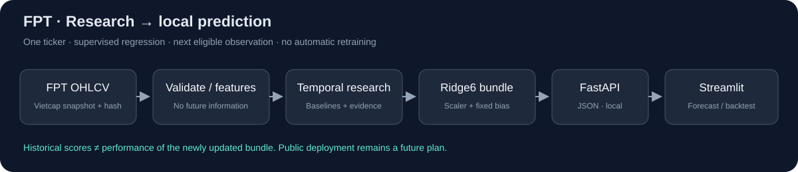
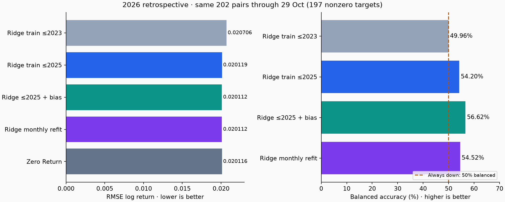

# FPT Stock Forecasting

**Phân tích và dự báo lợi suất, giá đóng cửa quan sát kế tiếp của cổ phiếu FPT bằng học máy.** Đồ án gồm notebook nghiên cứu, REST API FastAPI và dashboard Streamlit gọi API.

Hiện chốt **Ridge với 6 feature lợi suất, alpha 100, cửa sổ train 3 năm** làm hướng chính. Demo local mặc định `Ridge+bias60`; giữ Ridge chưa hiệu chỉnh và Zero Return để đối chứng. LSTM được giữ trong thực nghiệm lịch sử. Chưa chứng minh lợi thế dự báo tương lai ổn định.

Đối chứng train cuối01/11 đã so3năm/5năm/toàn bộ từ2018 trên cùng ngày: validation walk-forward2022–2025 chọn3năm, nhưng lợi thế RMSE chỉ0,10–0,17% và CI chứa0. Năm2026 đã xem chỉ dùng chẩn đoán; toàn bộ lịch sử có lợi ở vài chỉ số nhiều phiên nhưng chưa vượt baseline. Ba candidate tới29/10 được lưu riêng, không thay API; tái fit3y khớp đúng SHA của weights đang chạy. Bảng/biểu đồ và kết luận ở [TRAINING_HISTORY.md](TRAINING_HISTORY.md).



## Chạy demo trên máy

Mở hai terminal tại thư mục repo, dùng môi trường đã cài dependencies:

```powershell
# Terminal 1: API, chỉ lắng nghe trên máy local
.\venv\Scripts\python.exe -m uvicorn src.api.main:app --host 127.0.0.1 --port 8000
```

```powershell
# Terminal 2: dashboard gọi API
.\venv\Scripts\python.exe -m streamlit run src/app/streamlit_app.py --server.address 127.0.0.1 --server.port 8501
```

- Dashboard: [http://127.0.0.1:8501](http://127.0.0.1:8501)
- Swagger / thử JSON: [http://127.0.0.1:8000/docs](http://127.0.0.1:8000/docs)
- Dữ liệu bundle local dừng ở **29/10/2026**, nguồn Vietcap. Không tự download khi mở app.
- Bundle train nhãn đến 29/10/2026 chỉ dùng cho quan sát tiếp theo; không dùng nó chấm lại quá khứ rồi gọi là ngoài mẫu.
- Chưa deploy công khai, chưa tự retrain hoặc tự thay model.

Đổi địa chỉ backend nếu cần bằng biến môi trường `FPT_API_URL`. UI không load weights hoặc tự tính prediction. Môi trường mới có thể cài `requirements-local.txt` để chạy demo nhẹ, hoặc `requirements.txt` để nghiên cứu đầy đủ, gồm TensorFlow/XGBoost.

```powershell
python -m venv venv
.\venv\Scripts\python.exe -m pip install -r requirements-local.txt
```

Bundle phục vụ local được lưu cùng code, giữ nguyên bytes để kiểm tra SHA256 sau clone. Xem [model đang dùng và model nghiên cứu](#model-đang-dùng-và-model-nghiên-cứu) trước khi thay artifact hoặc bàn giao cho thành viên khác.

## Model đang dùng và model nghiên cứu

### Bộ đang phục vụ API/dashboard

**API hiện nạp bộ `ridge6_20261029` tại `models/local_demo/ridge6_20261029/`, mặc định dùng `Ridge+bias60`.** Cấu hình chính là Ridge alpha 100, 6 feature lợi suất, cửa sổ train 3 năm; nhãn train và snapshot Vietcap đến **29/10/2026**.

Luồng nạp model hiện tại:

```text
src/api/main.py
  → LocalRidgeService trong src/models/local_demo.py
  → models/local_demo.json
  → models/local_demo/ridge6_20261029/manifest.json
  → kiểm tra hash và nạp ridge.pkl, calibration.json, raw.csv, backtest.csv.gz
```

| Thành phần trong bundle | Vai trò |
| --- | --- |
| `ridge.pkl` | Pipeline **StandardScaler → Ridge** đã fit; chứa cả scaler và weights |
| `calibration.json` | Bias và các residual đã có nhãn, dùng hiệu chỉnh dự báo và mô phỏng band |
| `raw.csv` | Snapshot OHLCV Vietcap FPT để dựng feature/context; không phải giá realtime |
| `backtest.csv.gz` | Forecast của **model lịch sử** cho trang Đối chứng; không dùng bundle cuối tháng 10 chấm ngược quá khứ |
| `manifest.json` | Version, cấu hình, cutoff và SHA256 các artifact; được kiểm tra khi khởi động API |

Ba lựa chọn ở trang Dự báo có quan hệ như sau:

| Lựa chọn | Cách sử dụng | Vai trò |
| --- | --- | --- |
| **Ridge+bias60** | Dùng `ridge.pkl` và hiệu chỉnh bias từ calibration; khi recursive, bias chỉ cộng bước đầu | Mặc định của demo hiện tại |
| Ridge | Dùng **cùng file weights/scaler**, bỏ hiệu chỉnh bias | Đối chứng với bản hiệu chỉnh |
| Zero Return | Giả định return bằng 0, giữ giá origin; không có weights riêng hoặc band residual của Ridge | Baseline so sánh |

Vì vậy, đây **không phải ba model được train độc lập**. LSTM/XGBoost không được nạp để dự báo tương lai trong API hiện tại; LSTM ở trang Đối chứng dùng forecast lịch sử đã lưu. Cấu hình band recursive nằm riêng tại `configs/recursive_band_calibration.json`.

### Các bộ giữ để nghiên cứu và tái lập

| Vị trí | Nội dung / mục đích | API có dùng để dự báo hiện tại? |
| --- | --- | --- |
| `models/experiments/20261025T124951351761Z/` | CPU reference v2: baseline, Linear Regression, Ridge, XGBoost và LSTM; kèm manifest, scaler và các cấu hình đã thử | Không |
| `models/experiments/20261025T132243824425Z/` | Lượt Colab/GPU đối chiếu với CPU reference trên cùng dữ liệu, split và cấu hình | Không |
| `models/research/` | Weights của các study sau đó: robustness, nguồn dữ liệu, window train, Ridge refinement, bias/recency, classifier/selective và gap/thân nến | Không nạp trực tiếp; bộ được chọn đã đóng gói riêng vào `local_demo/` |
| `models/research/final-window_20261101T014607720130Z/` | Đối chứng train cuối: 3 năm, 5 năm và toàn bộ từ 2018; giữ candidate riêng, không tự thay bundle đang chạy | Không |

`experiments/` và `research/` được giữ để tái lập, so sánh và giải thích quyết định chọn model, kể cả những lượt không cải thiện. Các study dùng model, nguồn và cohort khác nhau; không lấy metric của chúng gắn cho bundle serving hiện tại.

### Ba file trỏ model cần phân biệt

| File trỏ | Đích hiện tại | Ai sử dụng? |
| --- | --- | --- |
| `models/local_demo.json` | `models/local_demo/ridge6_20261029/` | **API/dashboard đang chạy** |
| `models/latest_experiment.json` | `models/experiments/20261025T124951351761Z/` | Pipeline v2 cũ và công cụ nghiên cứu/tái lập |
| `models/reference_experiment.json` | Cùng CPU reference `20261025T124951351761Z` | Đối chứng với bản reference đã khóa |

Tên `latest_experiment.json` thuộc pipeline cũ: **không có nghĩa đó là model mới nhất đang phục vụ**, và sửa file này không thay model của API hiện tại. Khi team làm API/UI, dùng bundle `local_demo/` và các endpoint hiện có; khi nghiên cứu, đọc manifest/protocol của study tương ứng.

`models/research/` được gitignore nên clone repo không tự có toàn bộ weights nghiên cứu trên máy tác giả. Nếu cần tái chạy một study, phải bàn giao đúng artifact và kiểm tra hash của study đó. `src.models.local_demo` có thể đóng gói từ artifact research đã có; lệnh không train/download và từ chối ghi đè một version.

## Bài toán và input/output

Đây là **học có giám sát, cụ thể là hồi quy**:

- Input Ridge tại origin `t`: `Log_Return`, `Return_Lag_1`, `Return_Lag_2`, `Return_Lag_5`, `Return_5`, `Return_20`, đều chỉ dùng dữ liệu đến sau đóng cửa `t`.
- Nhãn: `y_t = log(Close_next / Close_t)` của quan sát hợp lệ kế tiếp.
- Output: log return, phần trăm lợi suất và `Close_t × exp(predicted_log_return)`.
- Giá là giá điều chỉnh của nhà cung cấp, không phải giá khớp lệnh live.

Ridge nhận **vector 6 feature**, không phải chuỗi 60 phiên. LSTM đối chứng v2 dùng **30 quan sát × 16 feature**; 60 là một lookback từng thử và là context chung để đối chiếu một số benchmark. Ridge tối ưu squared error có phạt L2; LSTM v2 dùng Huber, không mặc định mọi model đều train bằng MSE.

```mermaid
flowchart LR
    S[Snapshot FPT OHLCV có hash] --> Q[Kiểm tra ngày, giá, volume và nến]
    Q --> F[Feature nhân quả và nhãn next observation]
    F --> T[Temporal train / validation / evaluation]
    T --> B[Baseline + Ridge + model đối chứng]
    B --> E[Metric cùng ngày + dự báo từng origin + decision]
    E --> P[Bundle local đã chọn, không train trong request]
    P --> A[FastAPI JSON]
    A --> U[Streamlit]
```



Xem [kiến trúc và khái niệm ML](ARCHITECTURE.md) để phân biệt supervised, classification, clustering, split, leakage và drift.

## Nguồn dataset

| Nguồn | Vai trò |
| --- | --- |
| [Yahoo Finance — FPT.VN](https://finance.yahoo.com/quote/FPT.VN/history/) | Pipeline gốc tải bằng yfinance, `auto_adjust=True`; giữ làm reference |
| [Vietcap — FPT](https://trading.vietcap.com.vn/iq/company?ticker=FPT&tab=overview&isIndex=false) | Nguồn nghiên cứu mới, bundle Ridge local và nhãn đánh giá 2026 |
| KBS | Kiểm tra chéo nguồn trong audit; không thêm mã khác làm feature |

Vietcap được lấy bằng POST `https://trading.vietcap.com.vn/api/chart/OHLCChart/gap-chart`, body gồm `timeFrame`, `symbols:["FPT"]`, `to`, `countBack`. Snapshot gốc, request, response và hash ở [evaluation 2026](reports/evaluation_2026/20261030T014012158951Z/acquisition.json). Không coi việc mở endpoint bằng GET là cách tải dataset.

Không forward-fill ngày lễ, không điền giá giả, không loại biến động thật chỉ để tăng điểm. Audit nguồn không chứng nhận lịch HOSE hoặc lịch sử point-in-time. `data/raw/` và hai pointer experiment cũ vẫn giữ để tái lập; demo local dùng bundle riêng, tránh ghi đè reference.

## Kết quả và cách đọc

Cùng **202 cặp Vietcap năm 2026 đến 29/10**, 197 actual khác 0:

| Model lịch sử | RMSE log return ↓ | Hit (%) | Balanced (%) |
| --- | ---: | ---: | ---: |
| Ridge train đến cuối 2025 | 0,0201191 | 50,76 | 54,20 |
| Ridge đó + bias nhân quả | 0,0201116 | 60,91 | 56,62 |
| Zero Return | 0,0201157 | N/A | N/A |

Nguồn: [recency/bias metrics](reports/recency_bias/20261030T022440928507Z/metrics.csv). Đây là **backtest hồi cứu của model lịch sử**, không phải điểm của bundle cập nhật đến 29/10. Bias trong backtest cập nhật từ nhãn đã biết; bias của bundle demo được đóng băng. Lợi thế RMSE so Zero Return rất nhỏ; CI mô tả chưa chứng minh edge ổn định. Luôn đoán giảm cũng đạt 59,39% Hit và 50% balanced trên cùng tập.



[Nhật ký training có biểu đồ](TRAINING_HISTORY.md) ghi cả lượt tốt hơn, kém hơn và lỗi export, cùng bằng chứng. Không so trực tiếp điểm khác nguồn/tập ngày, không gọi các năm đã xem là holdout mới.

## Dashboard và API local

Dashboard **FPT Forecast Studio** có 4 mục: tổng quan OHLCV, dự báo, đối chứng và hành trình model. Phương pháp/lộ trình nằm trong ba tài liệu gốc. Có tải JSON/CSV. LSTM xuất hiện trong cohort chung 104 cặp tháng 6–10, dùng forecast đã lưu; không âm thầm train/load lại LSTM khi mở dashboard.

**Chọn ngày đích:** vào Dự báo → Chọn ngày, chọn một ngày từ hôm nay tới một tháng sau. Lịch bị giới hạn thêm bởi tối đa 23 bước ngày làm việc từ snapshot; dữ liệu quá cũ sẽ rút ngắn khoảng hoặc từ chối. Cuối tuần chuyển sang weekday kế tiếp, ngày chọn và ngày đích thực hiện được hiển thị riêng; chưa xác minh nghỉ lễ HOSE. Đường xám nối snapshot tới trước khoảng yêu cầu cũng là mô phỏng, không phải giá hôm nay đã quan sát. Đường xanh kéo tới ngày đích, có bảng từng bước và xuất CSV/JSON.

**Phân tích đường dự báo:** thêm cột tăng/giảm từng bước, biểu đồ thay đổi tích lũy so origin kèm band, các thẻ biên tại ngày đích và đồ thị độ rộng band theo thời gian. Dữ liệu lấy từ cùng response dự báo; có công tắc ẩn/hiện. Return từng bước được đổi từ log return bằng `exp(r) − 1`; band không phải xác suất tăng/giảm hoặc giới hạn lỗ.

**Giải thích dự báo:** dưới biểu đồ giá có mục “Hiểu cách model dự báo”, gồm 3 sơ đồ: lịch sử → 6 feature → scaler/Ridge → giá; vòng lặp nhiều bước; residual bootstrap → vùng kịch bản. Ví dụ tính giá lấy trực tiếp từ kết quả đang xem; nội dung đổi theo Ridge hiệu chỉnh, Ridge thô hoặc Zero Return. Có thể thu gọn cả mục.

**Tổng quan/phân tích:** chọn khung 1 tháng / 3 tháng / 6 tháng / 1 năm / 3 năm / toàn bộ, đồ thị nến hoặc Close, bật/tắt SMA20/50/200 và Bollinger20. Có khối lượng, RSI14, MACD12–26/Signal9, gap/thân nến, ATR14, drawdown, phân bố return và heatmap tháng; công thức/cỡ mẫu được chú thích. Chỉ báo tính trên toàn bộ lịch sử rồi mới thu khung để không mất warm-up. Có công tắc ẩn phân tích chi tiết và tải bảng chỉ báo. Đây là phân tích mô tả snapshot, không thêm feature hoặc train lại Ridge, không gán tỷ lệ phiên tăng thành accuracy và không dùng Bollinger thay band dự báo.

Trang dự báo chọn **hôm nay, ngày mai, 1 tuần hoặc 1 tháng**. Model vẫn chỉ được train cho h=1. Từ bước thứ hai, API cập nhật 6 feature từ chính Close dự báo và chạy Ridge tiếp: đây là **mô phỏng recursive chưa kiểm định riêng**, không phải model tháng đã train. Ngày chỉ bỏ cuối tuần, chưa trừ nghỉ lễ HOSE. Chọn hôm nay/ngày mai rơi cuối tuần sẽ dời sang ngày làm việc dự kiến kế tiếp; tuần/tháng lấy các weekday trong khung lịch. Giới hạn 23 bước từ origin, từ chối khi snapshot quá cũ.

Vùng P10–P90 là residual block-bootstrap mô tả (512 đường, block5, seed cố định). Bản `recursive-ridge6-v4` giữ bias ở bước 1, từ bước 2 dùng Ridge thô; center residual như v3 và bổ sung cấu hình độ rộng cho h5/h22. **Hệ số active hiện là1×**: calibration cố định/rolling đã thử nhưng chưa đạt điều kiện để nới band. Không thay dự báo điểm hoặc bảo đảm coverage80%. Đã backtest chính hàm forecast trên121origin lịch sử, tách62origin đến sau để chấm calibration: Ridge+bias coverage h5=74,19%, h22=67,74%; chưa hơn baseline về RMSE. Xem [TRAINING_HISTORY.md](TRAINING_HISTORY.md), gồm cả thử nghiệm5/21 cũ và5/22 mới, khác cohort nên không so trực tiếp. Đây không phải điểm của bundle đang phục vụ;5/22quan sát cũng khác tuần/tháng theo lịch. Zero Return không được gắn vùng sai số của Ridge. Bấm “hôm nay” không chứng minh forecast phát trước phiên. Chi tiết và tiêu chí chốt1–2model: [ARCHITECTURE.md, mục Forecast Studio](ARCHITECTURE.md#forecast-studio).

| Endpoint | Chức năng |
| --- | --- |
| `GET /health` | Version, default model, cutoff train và ngày snapshot |
| `GET /api/v1/models` | Các model local có thể gọi |
| `POST /api/v1/predict` | `{}` dùng snapshot; hoặc gửi OHLCV điều chỉnh đầy đủ |
| `POST /api/v1/forecast` | `horizon: today/tomorrow/week/month/custom`; custom cần `target_date: YYYY-MM-DD`, trả đường giá và giới hạn |
| `GET /api/v1/fpt/history` | Lịch sử snapshot |
| `GET /api/v1/fpt/ohlcv` | OHLCV thật cho biểu đồ nến và khối lượng |
| `GET /api/v1/data-quality` | Chất lượng snapshot, feature allowlist và caveats |
| `GET /api/v1/backtest?scope=full_2026` | Metric và forecast cùng 202 cặp |
| `GET /api/v1/backtest?scope=jun_oct_2026&month=2026-10` | Cùng ngày trong tháng, có LSTM reference |
| `GET /api/v1/training-history` | Các giai đoạn và evidence |

```powershell
Invoke-RestMethod http://127.0.0.1:8000/api/v1/predict -Method Post -ContentType 'application/json' -Body '{"model":"Ridge+bias60"}'
```

Input custom cần ít nhất 51 OHLCV hợp lệ để vượt warm-up builder hiện tại, đơn vị VND, cùng basis điều chỉnh xuyên suốt chuỗi. Chỉ nhận ngày đã qua, không nhận nến ngày hiện tại/tương lai. Origin phải từ cutoff train/calibration trở đi. API không xác nhận được nguồn hoặc basis do caller khai báo; không tự suy ra ngày đích theo lịch sàn.

## Cấu trúc thư mục và vai trò

Cây dưới đây mô tả cấu trúc hiện tại; các thư mục study trong `research/` và `reports/` được rút gọn. Không đổi tên hoặc di chuyển artifact đã có manifest/hash.

```text
Stock_Prediction_Project/
├── README.md                          Hướng dẫn chạy, model đang dùng và bản đồ project
├── TRAINING_HISTORY.md                Nhật ký train/đối chứng, kết quả và biểu đồ
├── ARCHITECTURE.md                    Khái niệm ML, contract và luồng hệ thống
├── requirements-local.txt            Dependencies chạy API/dashboard nhẹ
├── requirements-colab.txt            Môi trường tái lập training trên Colab
├── requirements.txt                  Dependencies nghiên cứu đầy đủ
├── .streamlit/config.toml            Cấu hình giao diện Streamlit
├── configs/                          Giao thức nghiên cứu + chính sách band đang dùng
├── data/
│   ├── raw/                          Dữ liệu nguồn của pipeline Yahoo v2
│   ├── interim/                      Feature và metadata trước ghép nhãn
│   ├── processed/                    Mẫu có nhãn và các hàng bị loại
│   ├── snapshots/                    Snapshot v2 công khai dạng ZIP + manifest/hash
│   └── backups/                      Phiên bản cũ có giá trị nghiên cứu; gitignored
├── src/
│   ├── data/                         Download, kiểm tra dữ liệu, snapshot và audit nguồn
│   ├── features/                     Feature/nhãn nhân quả và ablation gap/thân nến
│   ├── models/
│   │   ├── local_demo.py             Đóng gói/nạp bundle Ridge đang phục vụ
│   │   ├── forecast_path.py          Inference recursive và residual bootstrap
│   │   └── ...                       Training, evaluation, nghiên cứu và dựng báo cáo
│   ├── api/main.py                   FastAPI; nạp LocalRidgeService, trả JSON
│   └── app/
│       ├── streamlit_app.py          Entry point dashboard; gọi HTTP API
│       ├── dashboard_views.py        Bốn trang chính
│       ├── analysis_view.py          Giao diện phân tích lịch sử FPT
│       ├── market_analysis.py        Tính chỉ báo mô tả từ OHLCV
│       ├── forecast_analytics.py     Biểu đồ phân tích response dự báo
│       ├── forecast_explainer.py     Sơ đồ giải thích cách dự báo
│       ├── theme.py                  Style và biểu đồ dùng chung
│       └── check_studio.py           Kiểm tra UI với API local đang chạy
├── models/
│   ├── local_demo.json               Pointer được API hiện tại sử dụng
│   ├── local_demo/ridge6_20261029/    BUNDLE ĐANG CHẠY: weights/scaler + data + calibration
│   ├── experiments/                  REFERENCE CŨ: CPU và lượt Colab đối chứng
│   │   ├── 20261025T124951351761Z/
│   │   └── 20261025T132243824425Z/
│   ├── research/                     WEIGHTS NGHIÊN CỨU theo study/run; gitignored
│   ├── latest_experiment.json        Pointer pipeline v2 cũ; không chọn model API hiện tại
│   └── reference_experiment.json     Pointer CPU reference để tái lập
├── notebooks/                        Bốn notebook EDA, training và đối chứng; xem bảng dưới
├── reports/
│   ├── training_history/             Timeline, metric tổng hợp và ghi chú nghiên cứu
│   ├── verification/                 Bằng chứng kiểm tra artifact, API/UI và portability
│   ├── maintenance/                  Nhật ký dọn dẹp và archive hỗ trợ cũ
│   └── ...                           Evidence theo study: protocol, metric, forecast,
│                                     biểu đồ, input/source snapshot và quyết định
├── docs/assets/                      Ảnh flow và biểu đồ dùng trong ba tài liệu gốc
├── examples/predict_latest.json      Ví dụ input JSON cho API hiện tại
├── tests/                            Kiểm tra dữ liệu, thời gian, model và API
└── venv/                             Môi trường Python local; gitignored
```

**Phân biệt ba nhóm:** `src/models/` là **code**, `models/` là **artifact đã train/đóng gói**, còn `reports/` là **kết quả và bằng chứng nghiên cứu**. Dữ liệu phục vụ demo nằm trong bundle `models/local_demo/.../raw.csv`; các CSV ở `data/` chủ yếu phục vụ pipeline/reference nghiên cứu. Team chạy demo chỉ cần môi trường local, code API/UI, bundle serving và những báo cáo mà dashboard đọc; tái lập training cần thêm dữ liệu/config/artifact của đúng study.

## Bốn notebook cần dùng

| Notebook | Mục đích |
| --- | --- |
| [01 · EDA](notebooks/01_eda_fpt.ipynb) | Chất lượng và khám phá snapshot dữ liệu gốc |
| [02 · Training](notebooks/02_train_deep_learning_fpt.ipynb) | Huấn luyện baseline/LSTM v2, phục vụ phần xây model của môn học; không tự promote sang API |
| [05 · Hành trình](notebooks/05_training_journey_fpt.ipynb) | Toàn bộ quá trình, CPU/Colab, đối chứng nguồn/window/Ridge, classifier/selective và gap/body |
| [06 · Dự báo và giá thật](notebooks/06_compare_predictions_jun_oct_2026.ipynb) | So model lịch sử trên cùng ngày đích, phóng to theo tháng |

Giữ số notebook cũ để ổn định tham chiếu. Đánh giá v2 và demo UI cũ đã được thay bằng hành trình/đối chứng và Streamlit; hai notebook classifier/gap riêng được gom vào phần 11–12 của notebook05. CSV/JSON và source snapshot của mọi nghiên cứu vẫn giữ để tái lập, không giữ thêm bản notebook trùng chức năng.

## Kiểm chứng và kế hoạch tiếp

Đã chạy **141 unit tests** sau đối chứng train cuối;16fit mới/18điều kiện đều có reload/hash kiểm tra. API/UI vẫn giữ bundle trước đó; Studio đã được kiểm tra4mục/4khung ở lượt tích hợp gần nhất. [Kiểm chứng đối chứng window cuối](reports/final_window_comparison/20261101T014607720130Z/verification.json), [backtest/calibration](reports/horizon_calibration/20261101T012415194582Z/adaptive/verification.json), [kiểm chứng v3 trước](reports/recursive_bootstrap/20261101T011353369474Z/verification.json). Bộ kiểm thử nghiên cứu đầy đủ cần `requirements.txt`; `requirements-local.txt` dành cho chạy inference/UI.

Sau mở rộng lịch chọn ngày/phân tích: **149 unit tests đạt**, UI kiểm tra 4 preset, ngày tự chọn min/max/rỗng, khung phân tích ngắn/toàn bộ và lớp chỉ báo bật/tắt. Lượt này 0 fit, giữ nguyên bundle đã chốt; [biên bản dashboard](reports/verification/dashboard_custom_date_20261101.json).

```powershell
.\venv\Scripts\python.exe -m unittest discover -s tests -v
.\venv\Scripts\python.exe -m src.models.training_review
```

Lệnh thứ hai chỉ dựng biểu đồ/timeline từ evidence đã lưu, không retrain. Hướng dẫn forward ledger: [ARCHITECTURE.md, mục Forward ledger](ARCHITECTURE.md#forward-ledger). Dự báo bấm trên dashboard **không tự ghi thành bằng chứng forward**.

Kế hoạch tương lai: thu forecast trước target và chấm khi có nhãn; xem xét drift, acceptance gate và rollback; sau khi local ổn mới chọn host, đóng gói dependencies và deploy API/UI. `h=5`, regime clustering, xác suất/selective tốt hơn chỉ là các thí nghiệm đề xuất, chưa có trong bản chính. Lượt bàn giao GitHub ngày 31/10/2026 đưa code, bundle phục vụ và báo cáo lên GitHub và đã merge vào main; nhánh local làm việc hiện tại là `feature/train-model`. Chưa deploy public. Các nhật ký ghi “không commit/push” phản ánh trạng thái tại thời điểm nghiên cứu trước yêu cầu bàn giao này.

## Ba tài liệu duy nhất

- [README.md](README.md): cách chạy, nguồn và hiện trạng sản phẩm.
- [TRAINING_HISTORY.md](TRAINING_HISTORY.md): quá trình train, đối chứng và các kết luận có biểu đồ.
- [ARCHITECTURE.md](ARCHITECTURE.md): khái niệm ML, data/feature contract, recursive forecast và forward ledger.

Chi tiết báo cáo cũ được gom thành [research_notes.json](reports/training_history/research_notes.json); giữ nguyên hash/nội dung gốc. File CSV/JSON, input/source ZIP và outputs notebook là evidence, không phải dữ liệu rác. Các Markdown cũ có thể xem lại từ Git history, không giữ thêm thư mục tài liệu archive.
