# FPT Stock Forecasting

**Phân tích và dự báo lợi suất, giá đóng cửa quan sát kế tiếp của cổ phiếu FPT bằng học máy.** Đồ án gồm notebook nghiên cứu, REST API FastAPI và dashboard Streamlit gọi API.

Hiện chốt **Ridge với 6 feature lợi suất, alpha 100, cửa sổ train 3 năm** làm hướng chính. Demo local mặc định `Ridge+bias60`; giữ Ridge chưa hiệu chỉnh và Zero Return để đối chứng. LSTM được giữ trong thực nghiệm lịch sử. Chưa chứng minh lợi thế dự báo tương lai ổn định.


## Chạy demo trên máy

Mở hai terminal tại thư mục repo, dùng môi trường đã cài dependencies:

```powershell
# Terminal 1: API, chỉ lắng nghe trên máy local
.\venv\Scripts\python.exe -m uvicorn src.api.main:app --host 127.0.0.1 --port 8000
```

```powershell
# Terminal 2: dashboard gọi API
.\venv\Scripts\python.exe -m streamlit run src/app/streamlit_app.py --server.address 127.0.0.1 --server.port 8501
```

- Dashboard: [http://127.0.0.1:8501](http://127.0.0.1:8501)
- Swagger / thử JSON: [http://127.0.0.1:8000/docs](http://127.0.0.1:8000/docs)
- Dữ liệu bundle local dừng ở **29/10/2026**, nguồn Vietcap. Không tự download khi mở app.
- Bundle train nhãn đến 29/10/2026 chỉ dùng cho quan sát tiếp theo; không dùng nó chấm lại quá khứ rồi gọi là ngoài mẫu.
- Chưa deploy công khai, chưa tự retrain hoặc tự thay model.

Đổi địa chỉ backend nếu cần bằng biến môi trường `FPT_API_URL`. UI không load weights hoặc tự tính prediction. Môi trường mới có thể cài `requirements-local.txt` để chạy demo nhẹ, hoặc `requirements.txt` để nghiên cứu đầy đủ, gồm TensorFlow/XGBoost.

```powershell
python -m venv venv
.\venv\Scripts\python.exe -m pip install -r requirements-local.txt
```

Bundle phục vụ local được lưu cùng code: `models/local_demo.json` và toàn bộ `models/local_demo/ridge6_20261029/`, gồm Ridge weights nhỏ, scaler trong Pipeline, calibration và snapshot. Các file bundle được giữ nguyên bytes để kiểm tra SHA256 sau clone. `models/research/` vẫn gitignored; muốn tái chạy kiểm chứng cần những weights nghiên cứu cũ thì chuyển chúng riêng. `src.models.local_demo` có thể đóng gói lại từ artifact research đã có; lệnh không train/download và từ chối ghi đè một version.

## Bài toán và input/output

Đây là **học có giám sát, cụ thể là hồi quy**:

- Input Ridge tại origin `t`: `Log_Return`, `Return_Lag_1`, `Return_Lag_2`, `Return_Lag_5`, `Return_5`, `Return_20`, đều chỉ dùng dữ liệu đến sau đóng cửa `t`.
- Nhãn: `y_t = log(Close_next / Close_t)` của quan sát hợp lệ kế tiếp.
- Output: log return, phần trăm lợi suất và `Close_t × exp(predicted_log_return)`.
- Giá là giá điều chỉnh của nhà cung cấp, không phải giá khớp lệnh live.

Ridge nhận **vector 6 feature**, không phải chuỗi 60 phiên. LSTM đối chứng v2 dùng **30 quan sát × 16 feature**; 60 là một lookback từng thử và là context chung để đối chiếu một số benchmark. Ridge tối ưu squared error có phạt L2; LSTM v2 dùng Huber, không mặc định mọi model đều train bằng MSE.

```mermaid
flowchart LR
    S[Snapshot FPT OHLCV có hash] --> Q[Kiểm tra ngày, giá, volume và nến]
    Q --> F[Feature nhân quả và nhãn next observation]
    F --> T[Temporal train / validation / evaluation]
    T --> B[Baseline + Ridge + model đối chứng]
    B --> E[Metric cùng ngày + dự báo từng origin + decision]
    E --> P[Bundle local đã chọn, không train trong request]
    P --> A[FastAPI JSON]
    A --> U[Streamlit]
```



Xem [kiến trúc và khái niệm ML](ARCHITECTURE.md) để phân biệt supervised, classification, clustering, split, leakage và drift.

## Nguồn dataset

| Nguồn | Vai trò |
| --- | --- |
| [Yahoo Finance — FPT.VN](https://finance.yahoo.com/quote/FPT.VN/history/) | Pipeline gốc tải bằng yfinance, `auto_adjust=True`; giữ làm reference |
| [Vietcap — FPT](https://trading.vietcap.com.vn/iq/company?ticker=FPT&tab=overview&isIndex=false) | Nguồn nghiên cứu mới, bundle Ridge local và nhãn đánh giá 2026 |
| KBS | Kiểm tra chéo nguồn trong audit; không thêm mã khác làm feature |

Vietcap được lấy bằng POST `https://trading.vietcap.com.vn/api/chart/OHLCChart/gap-chart`, body gồm `timeFrame`, `symbols:["FPT"]`, `to`, `countBack`. Snapshot gốc, request, response và hash ở [evaluation 2026](reports/evaluation_2026/20261030T014012158951Z/acquisition.json). Không coi việc mở endpoint bằng GET là cách tải dataset.

Không forward-fill ngày lễ, không điền giá giả, không loại biến động thật chỉ để tăng điểm. Audit nguồn không chứng nhận lịch HOSE hoặc lịch sử point-in-time. `data/raw/` và hai pointer experiment cũ vẫn giữ để tái lập; demo local dùng bundle riêng, tránh ghi đè reference.

## Kết quả và cách đọc

Cùng **202 cặp Vietcap năm 2026 đến 29/10**, 197 actual khác 0:

| Model lịch sử | RMSE log return ↓ | Hit (%) | Balanced (%) |
| --- | ---: | ---: | ---: |
| Ridge train đến cuối 2025 | 0,0201191 | 50,76 | 54,20 |
| Ridge đó + bias nhân quả | 0,0201116 | 60,91 | 56,62 |
| Zero Return | 0,0201157 | N/A | N/A |

Nguồn: [recency/bias metrics](reports/recency_bias/20261030T022440928507Z/metrics.csv). Đây là **backtest hồi cứu của model lịch sử**, không phải điểm của bundle cập nhật đến 29/10. Bias trong backtest cập nhật từ nhãn đã biết; bias của bundle demo được đóng băng. Lợi thế RMSE so Zero Return rất nhỏ; CI mô tả chưa chứng minh edge ổn định. Luôn đoán giảm cũng đạt 59,39% Hit và 50% balanced trên cùng tập.


[Nhật ký training có biểu đồ](TRAINING_HISTORY.md) ghi cả lượt tốt hơn, kém hơn và lỗi export, cùng bằng chứng. Không so trực tiếp điểm khác nguồn/tập ngày, không gọi các năm đã xem là holdout mới.

## Dashboard và API local

Dashboard **FPT Forecast Studio** có 4 mục: tổng quan OHLCV, dự báo, đối chứng và hành trình model. Phương pháp/lộ trình nằm trong ba tài liệu gốc. Có tải JSON/CSV. LSTM xuất hiện trong cohort chung 104 cặp tháng 6–10, dùng forecast đã lưu; không âm thầm train/load lại LSTM khi mở dashboard.

Trang dự báo chọn **hôm nay, ngày mai, 1 tuần hoặc 1 tháng**. Model vẫn chỉ được train cho h=1. Từ bước thứ hai, API cập nhật 6 feature từ chính Close dự báo và chạy Ridge tiếp: đây là **mô phỏng recursive chưa kiểm định riêng**, không phải model tháng đã train. Ngày chỉ bỏ cuối tuần, chưa trừ nghỉ lễ HOSE. Chọn hôm nay/ngày mai rơi cuối tuần sẽ dời sang ngày làm việc dự kiến kế tiếp; tuần/tháng lấy các weekday trong khung lịch. Giới hạn 23 bước từ origin, từ chối khi snapshot quá cũ.

Vùng P10–P90 là residual block-bootstrap mô tả (512 đường, block5, seed cố định), không bảo đảm coverage80%. Zero Return không được gắn vùng sai số của Ridge. Bấm “hôm nay” không chứng minh forecast phát trước phiên. Chi tiết và tiêu chí chốt1–2model: [ARCHITECTURE.md, mục Forecast Studio](ARCHITECTURE.md#forecast-studio).

| Endpoint | Chức năng |
| --- | --- |
| `GET /health` | Version, default model, cutoff train và ngày snapshot |
| `GET /api/v1/models` | Các model local có thể gọi |
| `POST /api/v1/predict` | `{}` dùng snapshot; hoặc gửi OHLCV điều chỉnh đầy đủ |
| `POST /api/v1/forecast` | `horizon: today/tomorrow/week/month`, trả đường giá, kịch bản và metadata giới hạn |
| `GET /api/v1/fpt/history` | Lịch sử snapshot |
| `GET /api/v1/fpt/ohlcv` | OHLCV thật cho biểu đồ nến và khối lượng |
| `GET /api/v1/data-quality` | Chất lượng snapshot, feature allowlist và caveats |
| `GET /api/v1/backtest?scope=full_2026` | Metric và forecast cùng 202 cặp |
| `GET /api/v1/backtest?scope=jun_oct_2026&month=2026-10` | Cùng ngày trong tháng, có LSTM reference |
| `GET /api/v1/training-history` | Các giai đoạn và evidence |

```powershell
Invoke-RestMethod http://127.0.0.1:8000/api/v1/predict -Method Post -ContentType 'application/json' -Body '{"model":"Ridge+bias60"}'
```

Input custom cần ít nhất 51 OHLCV hợp lệ để vượt warm-up builder hiện tại, đơn vị VND, cùng basis điều chỉnh xuyên suốt chuỗi. Chỉ nhận ngày đã qua, không nhận nến ngày hiện tại/tương lai. Origin phải từ cutoff train/calibration trở đi. API không xác nhận được nguồn hoặc basis do caller khai báo; không tự suy ra ngày đích theo lịch sàn.

## Cấu trúc

```text
configs/                 Giao thức thí nghiệm có version
src/data/                Tải, hợp đồng dữ liệu, snapshot và audit nguồn
src/features/            Builder canonical và ablation nghiên cứu
src/models/              Training, evaluation, evidence và inference local
src/api/main.py          Backend FastAPI
src/app/streamlit_app.py Dashboard gọi HTTP API
notebooks/               EDA, training, benchmark và quan sát nghiên cứu
models/experiments/      Artifact reference cũ
models/research/         Artifact nghiên cứu, gitignored
models/local_demo/       Bundle Ridge tự chứa cho local
reports/                 Evidence từng study; không xóa kết quả âm
docs/assets/             Ảnh flow và biểu đồ được ba tài liệu sử dụng
tests/                  Kiểm tra dữ liệu, thời gian, model, API
```

## Bốn notebook cần dùng

| Notebook | Mục đích |
| --- | --- |
| [01 · EDA](notebooks/01_eda_fpt.ipynb) | Chất lượng và khám phá snapshot dữ liệu gốc |
| [02 · Training](notebooks/02_train_deep_learning_fpt.ipynb) | Huấn luyện baseline/LSTM v2, phục vụ phần xây model của môn học; không tự promote sang API |
| [05 · Hành trình](notebooks/05_training_journey_fpt.ipynb) | Toàn bộ quá trình, CPU/Colab, đối chứng nguồn/window/Ridge, classifier/selective và gap/body |
| [06 · Dự báo và giá thật](notebooks/06_compare_predictions_jun_oct_2026.ipynb) | So model lịch sử trên cùng ngày đích, phóng to theo tháng |

Giữ số notebook cũ để ổn định tham chiếu. Đánh giá v2 và demo UI cũ đã được thay bằng hành trình/đối chứng và Streamlit; hai notebook classifier/gap riêng được gom vào phần 11–12 của notebook05. CSV/JSON và source snapshot của mọi nghiên cứu vẫn giữ để tái lập, không giữ thêm bản notebook trùng chức năng.

## Kiểm chứng và kế hoạch tiếp

Đã chạy **124 unit tests** sau dọn tài liệu; Studio đã được kiểm tra 4 mục, 4 khung dự báo và đổi model/cohort/tháng với API thật. [Bằng chứng Studio](reports/verification/forecast_studio_20261030/checks.json), [lượt tích hợp local trước](reports/verification/local_ridge_demo/checks.json). Bộ kiểm thử nghiên cứu đầy đủ cần `requirements.txt`; `requirements-local.txt` dành cho chạy inference/UI.

```powershell
.\venv\Scripts\python.exe -m unittest discover -s tests -v
.\venv\Scripts\python.exe -m src.models.training_review
```

Lệnh thứ hai chỉ dựng biểu đồ/timeline từ evidence đã lưu, không retrain. Hướng dẫn forward ledger: [ARCHITECTURE.md, mục Forward ledger](ARCHITECTURE.md#forward-ledger). Dự báo bấm trên dashboard **không tự ghi thành bằng chứng forward**.

Kế hoạch tương lai: thu forecast trước target và chấm khi có nhãn; xem xét drift, acceptance gate và rollback; sau khi local ổn mới chọn host, đóng gói dependencies và deploy API/UI. `h=5`, regime clustering, xác suất/selective tốt hơn chỉ là các thí nghiệm đề xuất, chưa có trong bản chính. Lượt bàn giao GitHub ngày 31/10/2026 đưa code, bundle phục vụ và báo cáo lên GitHub và đã merge vào main; nhánh local làm việc hiện tại là `feature/train-model`. Chưa deploy public. Các nhật ký ghi “không commit/push” phản ánh trạng thái tại thời điểm nghiên cứu trước yêu cầu bàn giao này.

## Ba tài liệu duy nhất

- [README.md](README.md): cách chạy, nguồn và hiện trạng sản phẩm.
- [TRAINING_HISTORY.md](TRAINING_HISTORY.md): quá trình train, đối chứng và các kết luận có biểu đồ.
- [ARCHITECTURE.md](ARCHITECTURE.md): khái niệm ML, data/feature contract, recursive forecast và forward ledger.

Chi tiết báo cáo cũ được gom thành [research_notes.json](reports/training_history/research_notes.json); giữ nguyên hash/nội dung gốc. File CSV/JSON, input/source ZIP và outputs notebook là evidence, không phải dữ liệu rác. Các Markdown cũ có thể xem lại từ Git history, không giữ thêm thư mục tài liệu archive.
