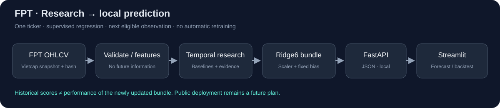
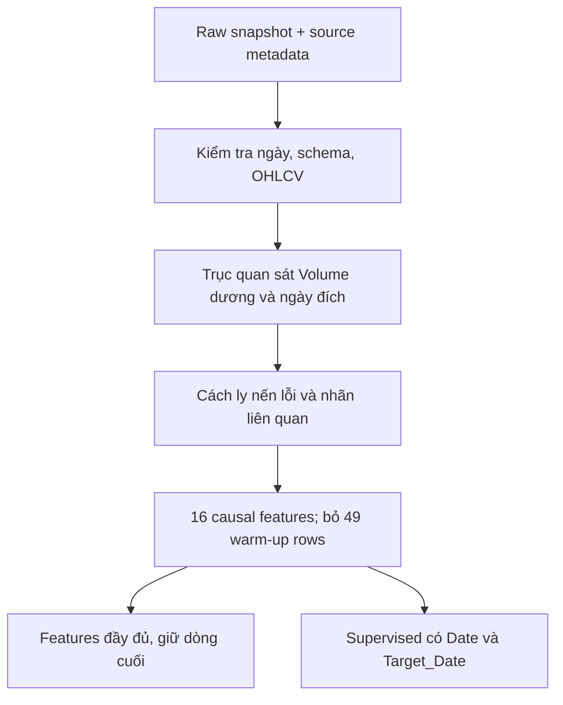
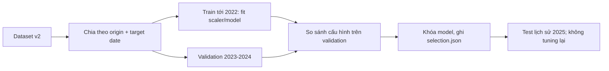
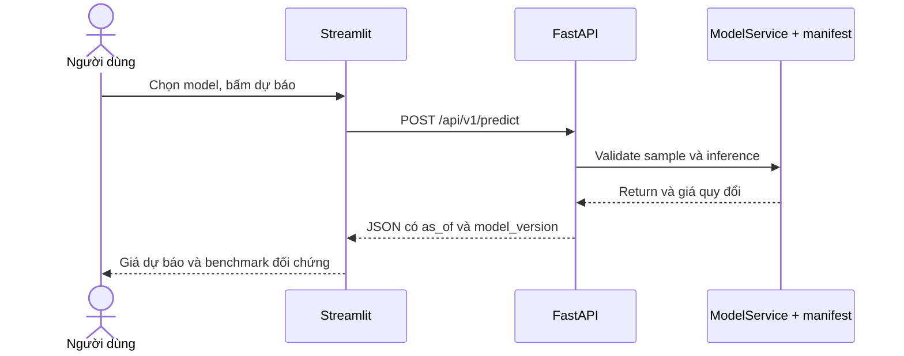

# FPT Stock Forecasting

**Đồ án Máy học · Phân tích FPT và dự báo một quan sát kế tiếp**

Một pipeline v2 dùng chung trên local và Google Colab: **snapshot có hash → EDA/features → training/benchmark → artifact theo manifest → FastAPI → Streamlit**.



## 1. Phạm vi và kết quả

- Chỉ dự báo **FPT.VN**, dữ liệu điều chỉnh giai đoạn 2018–2025.
- Mục tiêu: `log(Close[t+1] / Close[t])`; quy đổi giá bằng `Close[t] * exp(predicted_return)`.
- LSTM lookback 30 là model ML dùng demo. **Train Mean** có RMSE validation thấp nhất toàn bộ nhóm; hai vai trò được hiển thị riêng.
- Không dùng Hit Rate lịch sử như xác suất đúng của từng dự báo. LSTM chỉ cải thiện RMSE test nhẹ và có MAE cao hơn zero-return.
- Năm 2025 đã được xem trong các lần thử, nên ghi là test lịch sử sử dụng lại; chưa chứng minh lợi thế tổng quát hay lợi nhuận giao dịch.

[Kết quả và giới hạn](docs/TRAINING_RESULTS.md)

**Audit nguồn 29/10/2026:** Yahoo có 56 ngày volume=0 nhưng Vietcap và KBS cùng ghi nhận giao dịch; riêng 2025 có nhiều bất đồng giá theo ngày. [Báo cáo và bằng chứng](reports/data_audits/20261029T135735663765Z/REPORT.md) đề xuất Vietcap cho snapshot nghiên cứu v3. Đã train đối chứng nghiên cứu ở mục 13; snapshot/model phục vụ v2 hiện vẫn giữ nguyên, chưa có bằng chứng accuracy ngoài mẫu tăng.

## 2. Chạy trên máy local

```powershell
python -m venv venv
.\venv\Scripts\Activate.ps1
python -m pip install -r requirements.txt

# Phục hồi đúng snapshot đã chốt, không tải lại Yahoo.
python -m src.data.snapshot

# Backend: load model/scaler một lần, Swagger tại /docs.
python -m uvicorn src.api.main:app --host 127.0.0.1 --port 8000
```

Trong terminal thứ hai:

```powershell
.\venv\Scripts\Activate.ps1
python -m streamlit run src/app/streamlit_app.py
```

- API/Swagger: `http://127.0.0.1:8000/docs`.
- UI: `http://127.0.0.1:8501`. Giao diện lấy dữ liệu và gọi dự báo qua HTTP, không tự load model.
- Model/scaler canonical nhỏ được version cùng repo để clone xong có thể demo. Không dùng alias `best_lstm_model.keras` cũ.
- UI hiển thị ngày dữ liệu cuối; snapshot đến 31/12/2025, **không phải giá trực tiếp**.

## 3. API mẫu

```json
{"ticker":"FPT.VN","model":"LSTM","price_basis":"provider_adjusted_ohlc"}
```

```powershell
Invoke-RestMethod -Method Post -Uri http://127.0.0.1:8000/api/v1/predict -ContentType application/json -Body (Get-Content -Raw examples/predict_latest.json)
```

| Endpoint | Chức năng |
| --- | --- |
| `GET /health` | Sẵn sàng, phiên bản, ngày dữ liệu |
| `GET /api/v1/models` | Model demo và model thắng validation |
| `GET /api/v1/fpt/history` | Lịch sử giá điều chỉnh |
| `GET /api/v1/metrics` | Benchmark, split và giới hạn |
| `POST /api/v1/predict` | Nhận sample/tham số, trả JSON dự báo |

`observations` tùy chọn nhận các dòng `date/open/high/low/close/volume` của giá đã điều chỉnh. LSTM 30 cần ít nhất 79 quan sát hợp lệ; lịch sử dài hơn giúp các chỉ báo đệ quy như RSI/ATR ổn định hơn. Muốn lặp lại chính xác prediction snapshot thì dùng toàn bộ lịch sử hợp lệ, hoặc bỏ `observations` để dùng feature store chuẩn.

Input sai ticker, thiếu lịch sử, volume/giá không hợp lệ hoặc origin trước thời kỳ chốt cấu hình bị từ chối. Không fit scaler khi inference; không cần biết giá tương lai. Chưa xác minh lịch HOSE nên API không tự gán ngày đích giả.

## 4. Dữ liệu và thứ tự xử lý



| Phần | Số lượng |
| --- | ---: |
| Raw | 2.088 dòng |
| Volume = 0 / nến OHLC lỗi | 147 / 1 dòng |
| Quan sát hợp lệ | 1.940 dòng |
| Features | 1.891 dòng, 16 đầu vào |
| Supervised | 1.889 mẫu |

Raw giữ nguyên bất thường; không ffill/bfill giá. `excluded_rows.csv` ghi dòng và lý do. Chưa đối soát độc lập lịch HOSE/corporate actions; T+1 là quan sát khối lượng dương kế tiếp trong nguồn. Giá điều chỉnh tải năm 2026 chưa phải snapshot point-in-time được kiểm chứng.

Chỉ `FEATURE_COLUMNS` là X; không dùng Date/Close/Target_Date/Target_Return làm đầu vào. Nhóm features gồm return và lag, momentum, volatility, SMA distance, RSI, ATR/range theo tỷ lệ và volume. Tỷ lệ không bảo đảm tính dừng.

Không cần tải thêm rổ mã; market proxy cũ đã loại. Nếu nghiên cứu market context về sau, chỉ thêm khi có nguồn rõ ràng và ablation trên development.

## 5. Training và lựa chọn



Mọi model dùng cùng 1.087 mẫu train, 493 validation, 248 test và tối thiểu 60 quan sát context. Cửa sổ LSTM bao gồm ngày dự báo; scaler chỉ fit trên train. Zero-return không phát hướng nên Hit Rate N/A, không gán 50%.

```powershell
python -m src.models.experiment --epochs 40 --seed 42
python -m unittest discover -s tests -v
```

Mỗi lượt có `models/experiments/<run_id>/manifest.json`, model/scaler và báo cáo riêng. `models/latest_experiment.json` trỏ lượt đang dùng; `models/reference_experiment.json` khóa CPU reference để so với Colab. Không ghép weights và scaler giữa các lượt. XGBoost lưu bằng native JSON (`save_model`/`load_model`) để chuyển giữa Windows và Colab; không dùng pickle cho XGBoost.

## 6. Colab: đúng code GitHub, đúng snapshot

[Mở notebook training trên Colab](https://colab.research.google.com/github/PhucTruong11/FPT_Stock_Forecasting/blob/feature/train-model/notebooks/02_train_deep_learning_fpt.ipynb)

1. Mở notebook mới từ link GitHub, không chạy bản cũ trong Drive.
2. Setup clone vào `/content/FPT_Stock_Forecasting_portable_v2`, cài `requirements-colab.txt` và phục hồi ZIP snapshot có hash. Nếu thư viện đã load đổi phiên bản, restart session rồi Run all lại.
3. Có thể dùng GPU Pro; nguồn dữ liệu và công thức giữ nguyên. **Không tải Yahoo lại để so với CPU**.
4. Cuối notebook tự so với CPU reference: hash, code, config, split, seed, phiên bản và sai số. Cùng phiên bản chưa bảo đảm bitwise giống trên CPU/GPU.
5. Ngưỡng RMSE lệch tương đối 5% là kiểm tra kỹ thuật, không phải kiểm định thống kê. Phần LSTM so đúng lookback 30 của reference, kể cả GPU chọn lookback khác trên validation.
6. Kết quả/weights Colab được nén tại `/content/fpt-colab-<run_id>.zip`; tải xuống để lưu. Không ghi đè CPU reference hoặc chọn lại theo test.

```powershell
python -m src.models.compare_runs --candidate models/experiments/<colab_run_id> --output reports/colab_comparison.json
```

## 7. Notebook và kiến trúc ứng dụng

| Notebook | Nội dung |
| --- | --- |
| `01_eda_fpt.ipynb` | Chất lượng nguồn, giá/return, phân phối và tương quan train |
| `02_train_deep_learning_fpt.ipynb` | Baseline/LSTM, validation selection, artifact và Colab comparison |
| `03_evaluate_fpt_benchmark.ipynb` | Nạp lại artifact, kiểm tra hash/metrics, phân tích lỗi |
| `04_demo_fpt_dashboard.ipynb` | Demo offline từ manifest; UI chính là Streamlit |



## 8. Cấu trúc

```text
data/{raw,interim,processed}/       # Working CSV/metadata
data/snapshots/                    # ZIP snapshot chuẩn được version trong Git
docs/                             # Review và kết quả thực nghiệm
examples/predict_latest.json
src/data/                         # Download, validation, snapshot, feature inputs
src/features/build_features.py
src/models/                       # Experiment, comparison, inference
src/api/main.py
src/app/streamlit_app.py
notebooks/                        # 01 -> 04
models/experiments/<run_id>/       # Model/scaler/manifest
models/{latest,reference}_experiment.json
reports/experiments/<run_id>/      # Metrics, predictions, plots, environment
reports/verification/             # Kiểm tra API/UI thật
tests/                            # Data, modeling, snapshot và HTTP contracts
```

Muốn thu thập snapshot mới, chạy downloader/build như một nghiên cứu riêng; snapshot v2 không tự bị thay khi clone/train. Các file model/biểu đồ alias cũ và notebook Top10 đã được dọn khỏi luồng làm việc.

## 9. Kiểm chứng và giới hạn

59 unit test đã qua, gồm 9 test audit nguồn và 8 test căn cohort/nhãn/context cho đối chứng training. Bốn notebook đã chạy từ đầu trong đợt v2; API model thật khớp inference offline; sample OHLCV đầy đủ khớp snapshot prediction; Streamlit đã thử dự báo LSTM và Train Mean qua HTTP. Các kiểm chứng model/UI đó dùng manifest v2.

Đã có rolling-origin/feature-group ablation hồi cứu ở mục 11 và đối chiếu ba nguồn ở mục 12. Lịch HOSE/corporate actions chưa được chứng nhận; chưa có backtest thực thi giao dịch. Đây là demo nghiên cứu về luồng; kết quả v2 cần đọc cùng các bất đồng dữ liệu đã phát hiện.

Tham khảo: [review ban đầu](docs/PROJECT_REVIEW.md), [kết quả CPU và giới hạn](docs/TRAINING_RESULTS.md), [TensorFlow determinism](https://www.tensorflow.org/api_docs/python/tf/config/experimental/enable_op_determinism).

## 10. Nhật ký train và bằng chứng

Xem [TRAINING_HISTORY.md](docs/TRAINING_HISTORY.md) để đọc quá trình thay đổi, cấu hình, chỉ số, kết quả Colab và giới hạn của so sánh. Mỗi run giữ manifest, predictions và metrics riêng. Cập nhật nhật ký sau lượt train bằng `python -m src.models.training_history`; lệnh này không train lại hoặc chọn model theo test.

Lượt Colab T4 đã chạy đủ 8 cell và model JSON/Keras đã nạp lại trên Windows. LSTM gần như trùng CPU; XGBoost RMSE lệch nhỏ nên báo cáo giữ trạng thái `protocol_match_numeric_difference`.

## 11. Nghiên cứu độ ổn định và retraining

Đợt 29/10/2026 chạy 3 fold thời gian, 3 seed cho XGBoost/LSTM và 3 nhóm feature: 63 model train, 156 hàng metrics. Xem [báo cáo đối chứng](reports/robustness/20261029T131205702813Z/REPORT.md) và [chỉ mục các đợt nghiên cứu](reports/robustness/studies.json).

LSTM returns-only có mean-fold RMSE thấp hơn full 16 features khoảng 0,66%, nhưng vẫn chưa vượt Zero-Return nhất quán; chưa promote model mới. Đây là kiểm tra hồi cứu, không phải holdout chưa từng xem. Model và pointer dùng cho API/UI giữ nguyên.

```powershell
python -m src.models.robustness --config configs/robustness_v1.json
python -m src.models.robustness_report --reload-artifacts
```

Mỗi study có protocol đăng ký trước train, source snapshot, hashes, metrics/predictions, seed stability và quyết định giữ/thay. Research weights nằm local trong `models/research/` và được Git ignore; báo cáo, predictions và bằng chứng kiểm tra được lưu trong repository. Lệnh trên tạo một study và weights mới theo cùng protocol; không tái tạo nguyên byte hoặc ID cũ. Muốn nạp lại đúng checkpoint cũ cần giữ thư mục weights tương ứng; bản clone GitHub chỉ có báo cáo và bằng chứng đã lưu. Không dùng weights nghiên cứu trực tiếp cho API.

Xem [bài toán supervised regression, vòng lặp drift/retrain và các lựa chọn deploy](docs/ML_WORKFLOW_AND_DEPLOYMENT.md). Tài liệu cloud được kiểm tra ngày 29/10/2026; chưa tạo hoặc deploy dịch vụ cloud. API/Streamlit tiếp tục do thành viên phụ trách cập nhật.

## 12. Đối chiếu nguồn trước training v3

[Audit Yahoo cũ/mới – Vietcap – KBS](reports/data_audits/20261029T135735663765Z/REPORT.md) lưu request, response, hash, chênh lệch từng ngày và quyết định dữ liệu. Yahoo tải lại chưa giải quyết các vấn đề cũ. Vietcap tạo được 1.947 mẫu supervised bằng cùng feature builder, so với 1.889 của v2; 39 origin chung đổi ngày đích, nên không so trực tiếp metric trên hai bộ nhãn khác nhau.

```powershell
# Tái tạo từ bằng chứng đã lưu, không tải đè dữ liệu hiện tại.
python -m src.data.source_audit --analyze reports/data_audits/20261029T135735663765Z
```

Ứng viên v3 chưa thay snapshot/model phục vụ. Đối chứng sau audit đã được triển khai ở mục 13, với nguồn, cohort, nhãn đánh giá và cấu hình khóa trước khi fit; chưa mở dữ liệu 2026.

## 13. Đã train đối chứng Yahoo–Vietcap

[Kết luận và quyết định](reports/source_comparison/20261029T142732805710Z/DECISION.md), [báo cáo đầy đủ](reports/source_comparison/20261029T142732805710Z/REPORT.md): đã train 112 model, kiểm tra 264 hàng metrics và nạp lại toàn bộ 112 model/224 bộ prediction. Hai nguồn dùng cùng origin/target pairs và cùng nhãn đánh giá Vietcap; không cho v3 thêm labeled training rows. Protocol, nguồn code và dữ liệu được khóa trước training.

Trên ba fold 2022–2024, Vietcap giảm RMSE của XGBoost returns khoảng 0,99%, LSTM returns khoảng 0,13%; LSTM full tăng sai số khoảng 0,16%. Các model học chưa vượt baseline nhất quán. Năm 2025 báo cáo riêng và không cải thiện đồng loạt. Chọn Vietcap làm hướng nghiên cứu dữ liệu, returns-only làm hướng thử tiếp; **chưa promote model** hoặc sửa API/Streamlit.

```powershell
# Lượt train mới luôn có ID riêng; không thay model serving.
python -m src.models.source_comparison --config configs/source_comparison_v1.json
# Kiểm tra lại báo cáo đã lưu; thêm --reload-artifacts khi có weights local.
python -m src.models.source_comparison_report --study reports/source_comparison/20261029T142732805710Z
```

Các chỉ số v2 cũ dùng nhãn Yahoo; không ghép trực tiếp với điểm mới thành một đường accuracy tăng theo thời gian. Xem [chỉ mục studies](reports/source_comparison/studies.json) và [nhật ký training](docs/TRAINING_HISTORY.md).
