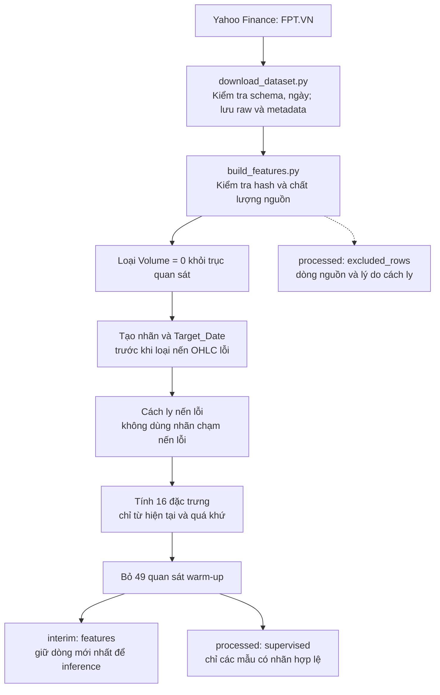
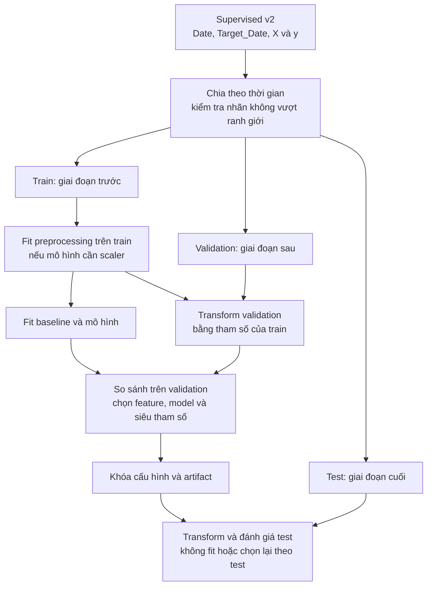
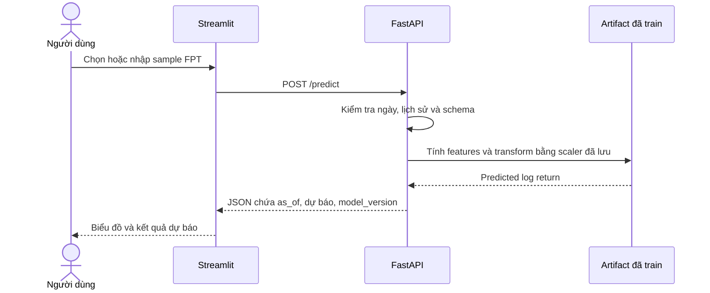

# FPT Stock Forecasting

**Đồ án môn Máy học · Phân tích dữ liệu và dự báo cổ phiếu FPT**

Nghiên cứu khả năng dự báo lợi suất và giá đóng cửa phiên kế tiếp của **FPT.VN** từ giá và khối lượng trong quá khứ. Hướng triển khai gồm **notebook nghiên cứu → REST API Python → ứng dụng có UI**.

Pipeline tải dữ liệu và tạo đặc trưng **schema v2** đã chạy. Source huấn luyện và notebook cũ cần cập nhật trước khi đánh giá lại; FastAPI và Streamlit là phần triển khai tiếp theo.


## 1. Bài toán và phạm vi

Với thông tin đã biết sau đóng cửa tại thời điểm `t`:

```text
y[t] = log(Close[t+1] / Close[t])
predicted_close[t+1] = Close[t] × exp(predicted_log_return[t])
```

- **Đối tượng:** một mã FPT, dữ liệu ngày và giá điều chỉnh của nhà cung cấp.
- **Khoảng mặc định:** `2018-01-01 ≤ Date < 2026-01-01`.
- **Câu hỏi nghiên cứu:** mô hình có tốt hơn baseline đơn giản trên cùng giai đoạn ngoài mẫu không?
- **T+1 hiện tại:** quan sát khối lượng dương kế tiếp trong nguồn. Chưa đối chiếu đầy đủ lịch HOSE, nên chưa khẳng định mọi quan sát là một phiên chính thức.
- **Chưa triển khai:** giá trực tiếp, dự báo 5/20 phiên và giao dịch tự động.

Giữ FPT để tập trung kiểm tra dữ liệu, thực nghiệm và phân tích lỗi. Lựa chọn này không hàm ý cổ phiếu không chịu tác động bên ngoài.

## 2. Làm sạch, build features và train theo thứ tự nào?

**Kiểm tra và làm sạch trước khi tính chỉ báo; tạo dataset trước khi train.** Một phần kiểm tra nằm trong downloader và `contracts.py`; `build_features.py` tiếp tục cách ly dòng lỗi, tạo nhãn và tính đặc trưng. Không train ngay trên CSV raw.



| Xử lý | Thời điểm phù hợp |
| --- | --- |
| Kiểm tra ngày trùng, schema, giá/volume không hợp lệ | Trước tính đặc trưng |
| Return, lag, SMA, RSI, rolling volatility | Có thể tính trước split nếu từng dòng chỉ dùng hiện tại và quá khứ |
| Scaler, imputer học tham số, chọn feature theo kết quả, tuning | Sau split; chỉ fit trên train trong từng fold |
| Chọn cấu hình | Dựa trên validation |
| Báo cáo cuối | Trên test, sau khi khóa cấu hình |

Không dùng `dropna()` chung để xóa mọi ô thiếu: warm-up, nhãn tương lai chưa có và lỗi nguồn cần xử lý riêng để không lệch ngày đích.

EDA chất lượng bắt đầu từ raw. Khi khảo sát phân phối để chọn model/features, dùng phần train/development; không dựa vào kết quả test để quyết định cấu hình.

## 3. Thiết kế huấn luyện tiếp theo

Sơ đồ này là **thiết kế cần triển khai cho modeling v2**, chưa phải mô tả notebook cũ đã hoàn tất:



- **Baseline hồi quy:** predicted return = 0, tương ứng giá dự báo bằng giá hiện tại; thêm persistence-return để đối chiếu.
- **Mô hình:** Ridge/Linear Regression, XGBoost và một LSTM nhỏ.
- **So sánh:** cùng ngày dự báo, horizon và thông tin sẵn có.
- **Thước đo:** MAE/RMSE trên return, sai số giá quy đổi và directional accuracy với chính sách ngày đứng giá rõ ràng.
- **LSTM:** cửa sổ kết thúc đúng ngày dự báo. Lịch sử trước ranh giới có thể làm context, nhưng không fit preprocessing trên tương lai.

Không mặc định LSTM tốt hơn mô hình đơn giản hoặc Hit Rate > 50% tự chứng minh lợi thế.

## 4. Có cần tải thêm mã khác không?

**Downloader hiện tại chỉ tải FPT.VN.** `TARGET_TICKER = "FPT.VN"` và hàm tải từ chối ticker khác. Không còn tải VCB, HPG, VNM, GAS, BID hay tạo rổ proxy.

Phần tải nhiều mã thuộc phiên bản trước. Market proxy cũ đã được dọn khỏi thư mục làm việc; `build_features.py` v2 **không phụ thuộc dữ liệu của mã khác**.

| Hướng thực hiện | Có cần lúc này? | Mục đích |
| --- | --- | --- |
| FPT với OHLCV và đặc trưng của chính FPT | **Có — phạm vi chính** | Xây baseline và đánh giá đúng trước |
| Một chỉ số thị trường có nguồn rõ ràng | Tùy chọn về sau | Thử thêm bối cảnh thị trường vào dự báo FPT |
| Tải một rổ mã rồi tự gọi là VN30 | Không | Tăng phạm vi; cần kiểm chứng thành phần, trọng số và lịch dữ liệu |

Tập trung một mã nghĩa là **một đối tượng cần dự báo**. Vẫn có thể dùng thông tin thị trường làm biến ngoại sinh, mà không phải huấn luyện mô hình cho tất cả mã khác.

Nếu thêm market context, so sánh **FPT-only** và **FPT + market context** trên cùng validation. Chỉ giữ nếu cải thiện đủ ổn định và đáng với độ phức tạp thêm; không mặc định thêm dữ liệu là tốt hơn.

## 5. Snapshot đã chạy

Lần tải **25/10/2026**, khoảng nghiên cứu đến **31/12/2025**:

| Bước | Số lượng | Ghi chú |
| --- | ---: | --- |
| Raw | 2.088 dòng | Giữ quan sát nguồn và bất thường được ghi nhận |
| Volume = 0 | 147 dòng | Giữ trong raw, cách ly khỏi chuỗi tính chỉ báo |
| OHLC không hợp lệ | 1 dòng | Cách ly, không tự sửa giá |
| Quan sát hợp lệ | 1.940 dòng | Dùng tính đặc trưng |
| Warm-up | 49 dòng | SMA-50 cần đủ lịch sử |
| Features | 1.891 dòng × 16 đầu vào | Thêm Date và Close làm cột đối chiếu |
| Supervised | 1.889 mẫu có nhãn | Bỏ nhãn chạm nến lỗi và dòng cuối chưa có nhãn |

- Bốn dòng Volume = 0 thiếu toàn bộ OHLC; giữ nguyên trong raw, không điền giá.
- Nến `2021-11-02` có Close lớn hơn High; cách ly cả mẫu này và nhãn chạm ngày đó.
- Dòng `2025-12-31` vẫn có trong features để inference.
- `data/processed/FPT.VN_excluded_rows.csv` lưu dòng nguồn cùng lý do.
- Metadata ghi SHA-256, thứ tự features, ngày đích và chính sách xử lý.
- Ghi qua file tạm; bản cũ được sao lưu tại `data/backups/` trước khi thay thế.

Đây là dữ liệu lịch sử tải năm 2026, chưa phải snapshot point-in-time được kiểm chứng. Giá điều chỉnh/số dòng có thể đổi khi nguồn cập nhật. Giá điều chỉnh không đồng nhất giá khớp lệnh lịch sử; loại Volume = 0 không thay thế việc đối soát lịch HOSE.

## 6. Bộ đặc trưng

| Nhóm | Cột |
| --- | --- |
| Return hiện tại | `Log_Return` |
| Return trễ | `Return_Lag_1`, `Return_Lag_2`, `Return_Lag_5` |
| Động lượng | `Return_5`, `Return_20` |
| Biến động | `Volatility_5`, `Volatility_20` |
| Khoảng cách đến SMA | `SMA_Distance_20`, `SMA_Distance_50` |
| RSI chuẩn hóa 0–1 | `RSI_14` |
| Biên độ theo tỷ lệ giá | `ATR_Ratio`, `Intraday_Range` |
| Khối lượng | `Volume_Ratio_20`, `Volume_Log_Change`, `Volume_ZScore_20` |

Cửa sổ tính theo số quan sát hợp lệ, không phải ngày lịch. Tỷ lệ giúp giảm phụ thuộc mức giá tuyệt đối, không bảo đảm tính dừng. Chưa fit scaler ở bước build features.

**Chỉ dùng `FEATURE_COLUMNS` làm X.** `Date`, `Close`, `Target_Date_1d` và `Target_Return_1d` không thuộc danh sách đầu vào.

## 7. API và UI sau khi có model

Đây là kiến trúc dự kiến; FastAPI và Streamlit chưa có implementation:



Inference dùng cùng công thức/thứ tự features với training. Không fit lại scaler và không cần giá tương lai hay target thật.

## 8. Công nghệ và cấu trúc

| Phần | Công nghệ | Trạng thái |
| --- | --- | --- |
| Data pipeline | Python, yfinance, pandas, NumPy, ta | Đã chạy v2 |
| Modeling | scikit-learn, XGBoost, TensorFlow/Keras | Giữ source để migrate; cần train artifact v2 |
| Nghiên cứu, biểu đồ | Jupyter, matplotlib, Plotly | Notebook cần cập nhật |
| Backend | FastAPI | Kế hoạch |
| UI | Streamlit | Kế hoạch |

```text
Stock_Prediction_Project/
├── data/
│   ├── raw/                       # Raw CSV + metadata nguồn
│   ├── interim/                   # Features CSV + metadata v2
│   ├── processed/                 # Supervised và excluded_rows
│   └── backups/                   # ZIP dự phòng v1, không commit
├── docs/
│   ├── assets/pipeline.svg
│   └── PROJECT_REVIEW.md          # Bản đánh giá trước khi chuyển sang v2
├── src/
│   ├── data/contracts.py          # Kiểm tra, hash, ghi và sao lưu
│   ├── data/download_dataset.py   # Chỉ tải FPT
│   ├── features/build_features.py # Làm sạch tiếp, nhãn và đặc trưng
│   └── models/train_baselines.py  # Source cũ, cần migrate
├── notebooks/                     # Ba notebook cũ, cần cập nhật v2
├── models/                        # Dành cho artifact v2 sau khi train
├── reports/                       # Dành cho kết quả đánh giá mới
├── tests/test_data_pipeline.py
├── requirements.txt
└── README.md
```

## 9. Cài đặt và chạy dữ liệu

Chạy tại thư mục gốc. Pipeline đã kiểm tra trên Python 3.13.15; dùng Python 3.11+ với dependency phù hợp môi trường.

```powershell
python -m venv venv
.\venv\Scripts\Activate.ps1
python -m pip install -r requirements.txt

# 1. Tải raw và metadata; cần kết nối Yahoo Finance.
python -m src.data.download_dataset --start 2018-01-01 --end 2026-01-01

# 2. Làm sạch tiếp, tạo features và supervised dataset.
python -m src.features.build_features

# 3. Kiểm tra pipeline offline.
python -m unittest discover -s tests -v
```

Nếu venv đã có, dùng `.\venv\Scripts\python.exe` thay cho `python`. Hai script cũng hỗ trợ gọi trực tiếp bằng đường dẫn.

Downloader trả exit code khác 0 khi tải lỗi; không ghi đè bằng phản hồi rỗng. Build chạy offline khi raw và metadata/hash hợp lệ. Không cần tải lại dữ liệu khi chỉ sửa tài liệu.

### Đọc dataset để cập nhật modeling

```python
import pandas as pd
from src.features.build_features import FEATURE_COLUMNS, TARGET_COLUMN

df = pd.read_csv(
    "data/processed/FPT.VN_supervised.csv",
    parse_dates=["Date", "Target_Date_1d"],
)
X = df[FEATURE_COLUMNS]
y = df[TARGET_COLUMN]
# Chia theo thời gian và target date trước khi fit preprocessing/model.
```

**Chưa chạy lại baseline/notebook cũ để báo cáo kết quả v2.** Cần sửa cách suy ra nhãn bằng shift, chọn feature, sequence LSTM và split. Model/scaler v1 không tương thích với bộ 16 features, nên đã dọn khỏi `models/`; phải train lại trước khi chạy notebook đánh giá/demo.

### Phần đã dọn

Model/scaler v1, biểu đồ cũ, market proxy, hai kế hoạch cũ và snapshot dữ liệu trước v2 được gom tại `data/backups/legacy-v1-20261025.zip`. File ZIP có manifest và hash để đối chiếu, được gitignore và không tham gia pipeline hiện tại. Cache, ảnh render tạm, thư mục trống không dùng và placeholder dư đã được xóa. Ba notebook và source baseline được giữ để cập nhật, cùng toàn bộ dữ liệu/metadata v2.

## 10. Kiểm tra và bước tiếp theo

Đã chạy **14 kiểm thử thành công**, gồm nhãn/ngày đích, cách ly nến lỗi, tính nhân quả của features, hash và bảo toàn snapshot khi nguồn lỗi. Đã đối chiếu công thức target trên dữ liệu thật. Chưa có benchmark model mới hoặc xác minh đầy đủ với HOSE.

1. Bổ sung notebook EDA cho FPT, giải thích dữ liệu và báo cáo chất lượng.
2. Chuyển baseline/notebook sang v2; thống nhất split, scaler và ngày đánh giá.
3. Train lại, so sánh baseline/XGBoost/LSTM, phân tích lỗi.
4. Đóng gói model tốt nhất thành API và nối UI.
5. Sau đó cân nhắc market context hoặc dự báo 5 phiên.

## 11. Tài liệu liên quan

- [Đánh giá và kế hoạch tổng thể](docs/PROJECT_REVIEW.md): review trước lần cập nhật dữ liệu/schema v2; số liệu và mô tả file thuộc snapshot cũ.
- [Tài liệu yfinance](https://ranaroussi.github.io/yfinance/reference/api/yfinance.download.html): tham số tải, trong đó ngày end không bao gồm.
- [TimeSeriesSplit](https://scikit-learn.org/stable/modules/generated/sklearn.model_selection.TimeSeriesSplit.html): tham khảo thiết kế split thời gian.
