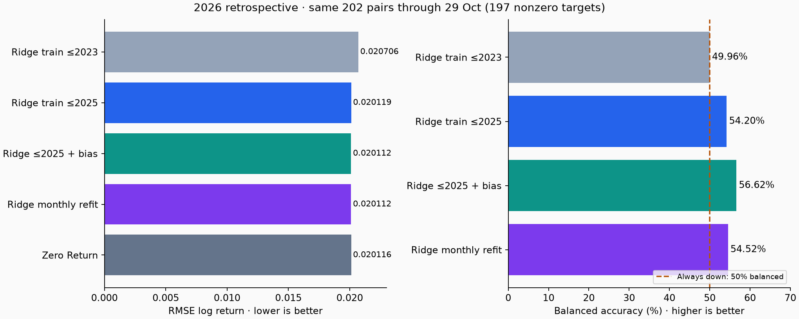
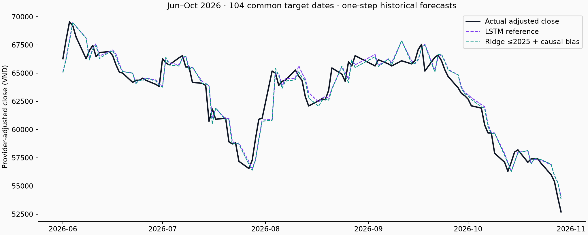
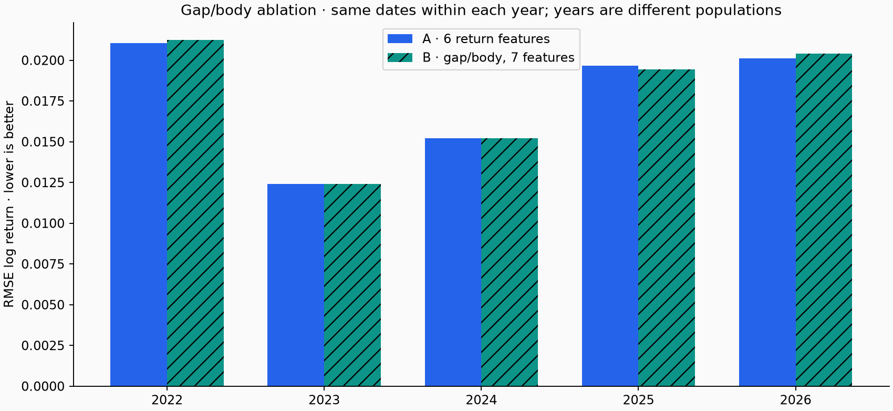

# Nhật ký training và quyết định chọn model FPT

Cập nhật tài liệu **31/10/2026, UTC+7**. Dữ liệu nghiên cứu mới nhất dừng ở **29/10/2026**. Tài liệu tổng hợp bằng chứng đã lưu; không train lại để viết báo cáo.

## Kết luận hiện tại

**Chọn Ridge6, alpha100, training window3 năm làm hướng chính.** Demo local dùng `Ridge+bias60` với calibration cố định; giữ Ridge raw và Zero Return. LSTM được giữ để đối chứng lịch sử. Đây là lựa chọn phục vụ hoàn thiện đồ án và tính đơn giản khi chạy local, **chưa phải chứng minh Ridge thắng ổn định ngoài tương lai**.

Refit Ridge đến cuối2025 giảm RMSE năm2026 từ0,0207058 xuống0,0201191 (−2,83%) so Ridge cũ. Thêm bias nhân quả cho0,0201116, gần Zero Return0,0201157; chênh lệch rất nhỏ. Nhánh phân loại/selective và gap/thân nến chưa có cải thiện đủ ổn định để thay bộ6 feature. [1]

Đóng gói API/UI local là sự kiện **0 fit mới**, dùng lại weights đã train đến29/10. Không gán điểm backtest của model train đến2025 cho bundle cập nhật này. Lưu cả kết quả âm, model cũ và lượt lỗi để team biết vì sao lựa chọn thay đổi.

## 1. Nhật ký các giai đoạn

Ngày lấy từ ID/protocol của study, đổi cách hiển thị theo UTC+7 khi cần. Đây là ngày chạy nghiên cứu, không phải ngày forecast được phát hành trên thị trường.

| Ngày | Thử gì / đối chứng | Kết luận | Bằng chứng |
| --- | --- | --- | --- |
| 25/10 | Legacy LSTM64→32/lookback60 → pipelinev2; CPU/Colab cùng config | Sửa nhãn, scaler, common dates và tính tái lập; không thể quy toàn bộ chênh lệch thành một cải tiến model | [Archive chi tiết](reports/training_history/research_notes.json), [runs](reports/training_history/runs.json) |
| 25/10 | 4 run v2; lookback10/30/60 | Chọn LSTM30 trong nhóm; Train Mean thắng validation toàn bộ | [CPU manifest](models/experiments/20261025T124951351761Z/manifest.json) |
| 29/10 | Robustness:63 candidate, các nhóm feature và seed | Chưa vượt baseline nhất quán; cần model đơn giản và nhiều giai đoạn | [Report](reports/robustness/20261029T131205702813Z/metrics.csv) |
| 29/10 | Audit Yahoo/Vietcap/KBS;112 candidate so nguồn | Chọn Vietcap làm nguồn nghiên cứu; chưa chứng nhận lịch sàn/PIT | [Audit](reports/data_audits/20261029T135735663765Z/summary.json), [source comparison](reports/source_comparison/20261029T142732805710Z/metrics.csv) |
| 29/10 | Training window:56 fit mới/112 điều kiện | Thu hẹp về Ridge returns-only, kiểm tra recency | [Report](reports/window_comparison/20261029T150501819490Z/metrics.csv) |
| 30/10 | Ridge refinement:48 fit mới/80 điều kiện | Window3y/alpha100 cho fold mới nhất; giữ cả lượt export lỗi trước đó | [Report hoàn tất](reports/ridge_refinement/20261030T011109863274Z/metrics.csv), [failure status](reports/ridge_refinement/20261030T010848752516Z/status.json) |
| 30/10 | Frozen2026:0fit,200 cặp chung/202native | LSTM và Ridge cũ chưa vượt Zero Return | [Metrics](reports/evaluation_2026/20261030T014012158951Z/metrics.csv) |
| 30/10 | Recency/bias:13fit mới | Refit cải thiện so Ridge cũ, edge vs zero rất nhỏ | [Metrics](reports/recency_bias/20261030T022440928507Z/metrics.csv) |
| 30/10 | Logistic/XGB classifier:20base+10calibrator | Sau sigmoid thiên về luôn giảm; chưa bật selective trong bản chính | [Metrics](reports/direction_selective/20261030T090621177786Z/metrics.csv) |
| 30/10 | Gap/body:20fitB+20artifactA tái dùng | Chưa cải thiện ổn định; giữ6 return features | [Metrics](reports/candle_ablation/20261030T093521684942Z/metrics.csv) |
| 30/10 | Đóng gói Ridge/API/UI local,0fit | User đồng ý hướng chính; reference cũ và ledger giữ nguyên | [Manifest local](models/local_demo/ridge6_20261029/manifest.json), [pointer riêng](models/local_demo.json) |

Không cộng số `candidate`, `condition`, `base fit`, `calibrator` như cùng một đơn vị. Không nối RMSE khác source/cohort thành một đường chất lượng tăng theo thời gian. [Timeline cho dashboard](reports/training_history/study_timeline.json).

## 2. Bằng chứng tái lập CPU ↔ Colab, không phải tăng accuracy

Bốn run25/10: `20261025T121448987851Z`, `20261025T124129642764Z`, `20261025T124951351761Z`, `20261025T132243824425Z`. LSTM30 đều có validationRMSE0,014032665, test2025RMSE0,019858318 và MAE0,013441519. XGBoost chuyển pickle→nativeJSON để nạp chéo môi trường; đổi định dạng lưu không phải thuật toán chính xác hơn.

Nguồn: [lstm_history.json](reports/experiments/20261025T124951351761Z/lstm_history.json), [64 hàng metric toàn bộ run](reports/training_history/metrics_over_runs.csv). Loss theo epoch khác với chất lượng dự báo qua các giai đoạn thị trường. Legacy thiếu snapshot/prediction tương đương và có công thức Hit khác nên chỉ dùng tham khảo lịch sử. Chi tiết cũ được giữ trong archive, không xóa.

## 3. Đối chứng recency và bias trên cùng202 cặp2026

| Strategy lịch sử | RMSE return ↓ | MAE giá adjusted (VND) ↓ | Hit /197nonzero | Balanced |
| --- | ---: | ---: | ---: | ---: |
| Ridge frozen train≤2023 | 0,0207058 | 1.114,18 | 43,15% | 49,96% |
| Ridge refit train≤2025 | 0,0201191 | 1.080,94 | 50,76% | 54,20% |
| Ridge refit≤2025+bias60 | 0,0201116 | 1.064,12 | 60,91% | 56,62% |
| Ridge monthly refit | 0,0201124 | 1.074,00 | 52,79% | 54,52% |
| Zero Return | 0,0201157 | 1.081,70 | N/A | N/A |

[1] Nguồn: [metrics.csv](reports/recency_bias/20261030T022440928507Z/metrics.csv), cohort`vci_full`, target đến29/10/2026,202pairs gồm197nonzero+5neutral. Số chính xác trong CSV là chuẩn nếu làm tròn bảng. Biểu đồ không có balanced của Zero Return vì không phát tín hiệu hướng.

Refit có lợi hơn model cũ trong giai đoạn này; so baselinezero còn yếu. Static+bias MSEskill chỉ khoảng+0,041%, CI mô tả chứa0. Monthly+bias có thể giảm MAE nhưng tăng RMSE; không nói bias cải thiện mọi mặt. Luôn giảm đạt59,39%Hit, balanced50%; hơn50%Hit không tự chứng minh edge.

Bias backtest dùng sai số có target đã xuất hiện trước origin hiện tại; không lấy mean của cả năm rồi cộng ngược cho mọi ngày. Các khoảng này đã xem và nghiên cứu tiếp dựa trên chúng: đây là **đối chứng hồi cứu thích nghi**, không phải holdout mới.

## 4. So giá thật với forecast đã lưu

[2] Nguồn: [predictions](reports/period_comparison/20261030T024048531444Z/predictions.csv.gz), [summary](reports/period_comparison/20261030T024048531444Z/summary.csv). Cùng104 cặp target01/06–29/10/2026,99actualnonzero. LSTM:RMSE0,0168315,Hit47,47%,balanced50,83%. Ridge≤2025+bias:Hit62,63%,balanced57,95%; ZeroReturn cũng là đối chứng bắt buộc.

Giá dự báo mỗi điểm được neo vào giá origin thực tế, là **dự báo một bước**, không phải tự chạy từ tháng6 rồi biết trước cả5tháng. LSTM có context Yahoo và model training khác Ridge; cùng target/nhãn không biến so sánh này thành ablation chỉ khác architecture. Không lấy104 hoặc200cặp so với202cặp mà bỏ qua mẫu số.

Notebook quan sát: [06_compare_predictions_jun_oct_2026.ipynb](notebooks/06_compare_predictions_jun_oct_2026.ipynb). Dashboard local có lọc tháng, đường actual và model, metric tính lại theo đúng subset.

## 5. Các nhánh chưa được chọn

### Phân loại và “chưa đủ tín hiệu”

Mean-foldbalanced2022–2024: Ridge_shared53,36%,Logisticraw51,83%,XGBraw49,82%. Sau sigmoid ở2026, cảhai dự đoán giảm202/202:Hit117/197=59,39% nhưngbalanced50%, đúng baselinealways-down. Margin2026 chọn0; không ép ngưỡng sau khi nhìn kết quả. Brier cải thiện không đồng nghĩa phân biệt hướng tốt hơn. [3]

[3] [Decision và probability diagnostics](reports/direction_selective/20261030T090621177786Z/metrics.csv), [Notebook05, phần 11](notebooks/05_training_journey_fpt.ipynb). Giữ code/artifact làm nghiên cứu, không bật trong API chính.

### Gap mở cửa và thân nến

A dùng6feature. B thayLog_Return bằng`log(Open_t/Close_previous_eligible)` và`log(Close_t/Open_t)`; không thêm cảba cột phụ thuộc tuyến tính. Hai thành phần đều đã biết sau đóng cửa origin, không dùng Open tương lai.

[4] [Metrics từng năm](reports/candle_ablation/20261030T093521684942Z/metrics.csv), [Notebook05, phần 12](notebooks/05_training_journey_fpt.ipynb). Primary2022–2024 Ridge_recent meanRMSE0,0162190→0,0162930 (B cao hơn0,46%); Logistic balanced chỉ+0,09điểm%. Full2026 Ridge_recentRMSE0,0201191→0,0204083,Hit50,76%→44,67%. B tốt hơn một số năm nhưng chưa ổn định; giữA.

Các năm là các population khác nhau, không coi chênh lệch độ cao cột giữa2022 và2026 là riêng tác động cải tiến feature. CI đi kèm trong study; phần lớn chưa phân biệt chắc chắn.

## 6. Model local hiện tại và bằng chứng forward

Bundle`ridge6_20261029`: StandardScaler→Ridge(alpha100),6features,train3năm, nhãn cuối29/10/2026. `Ridge+bias60` cộng bias và khoảng residual **đóng băng lúc tạo bundle**. Không retrain khi khởi động hoặc gửi request. Lượt đóng gói dùng lại đúng modelSHA`3f048d815cc36e507bfdea97b3d4a65a3d69c601a92af4e2a4a9ee4f9e75e916` từ [shadow_bundle](reports/recency_bias/20261030T022440928507Z/shadow_bundle.json).

Model này chưa có bộ nhãn tương lai đủ để kết luận performance. Ledger có1forecastpending phát09:25UTC+7ngày30/10; nếu target cũng30/10 thì không đủ điều kiện full-session. BấmAPI/UI không tự ghi ledger. Không sửa timestamp hoặc ghi prediction mới cho quá khứ rồi gọi là forward. Xem [ARCHITECTURE.md, mục Forward ledger](ARCHITECTURE.md#forward-ledger).

## 7. Quy tắc ghi lượt training sau

Lượt tích hợp local đã đạt **108 unit tests**, kiểm tra HTTP thật khớp offline và AppTest đổi model/cohort/tháng. [Biên bản kiểm chứng và cleanup](reports/verification/local_ridge_demo/checks.json). Đây là kiểm chứng phần mềm và artifact, không phải 108 phép thử chứng minh model chính xác hơn.

Mỗi study mới ghi ID/thời gian UTC và source/config hashes; nêu câu hỏi, biến thay đổi, baseline và cohort; khóa train/calibration/validation/evaluation trước fit; lưu ngày origin/target, prediction, scaler/model, metric và decision. Tách rõ sốfitmới/táisửdụng, failed/completed, đánhgiáhồicứu/forward. Ghi cả không cải thiện.

Chỉ so model trên cùng ngày và cùng nhãn; đọc RMSE/MAE, direction/coverage, baseline và CI. Data2026 đã được mở nằm trong [holdout_exposures](reports/holdout_exposures.json). Khi có đủ forecast phát trước target và nhãn mới, mới quyết định thay version; không tự promote vì một tháng tốt.

Biểu đồ dựng lại bằng `python -m src.models.training_review`, source/hash ở [assets/training/sources.json](docs/assets/training/sources.json); không train trong lệnh này. Các notebook05–06 giữ output để team quan sát chi tiết. Cleanup chỉ xóa cache tái tạo được; evidence/source ZIP/negative results/reference cũ được giữ. Không commit/push trong lượt này.

## 8. Bổ sung dự báo nhiều bước và giao diện Studio — 30/10/2026

**0 fit mới, weights/scaler/bias không đổi.** API mới lặp modelh=1 trên contextClose tự dự báo, tối đa23bước. Hôm nay/ngàymai/tuần/tháng có ngày requested/effective rõ; chỉ loại cuối tuần, chưa phải lịchsàn xác minh. 512path residualblockbootstrap tạo vùngkịchbảnP10–P90, không chứng minhcoverage80%.

Đây là mở rộng inference/UI, **không có điểm test mới hoặc bằng chứng accuracy tăng**. Không dùng bảngh=1 để gán thành tích tuần/tháng. Giao diện6trang bổ sungOHLCV, dựbáo, đốichứng, evidence, phươngpháp và roadmap1–2model. 119unit tests và UIchecks đạt; [chi tiết phương pháp](ARCHITECTURE.md#forecast-studio), [biên bản kiểm chứng](reports/verification/forecast_studio_20261030/checks.json). Không thayreference hoặc ghi thêmforecastledger; không commit/push/deploy.

## 9. Gom tài liệu và dọn kiến trúc — 31/10/2026

Chỉ giữ ba tài liệu Markdown ở gốc: README, TRAINING_HISTORY và ARCHITECTURE. Báo cáo/nghiên cứu cũ được gom vào [research_notes.json](reports/training_history/research_notes.json), tra theo đường dẫn gốc trong key `notes`; mỗi nội dung giữ SHA256 của bytes gốc để kiểm chứng. Không coi đây là một lượt train hoặc cải thiện accuracy.

Giữ nguyên model/scaler, dữ liệu, manifest, prediction và metric. Giữ notebook demo LSTM, lớp inference reference và wrapper baseline cùng các test tương ứng để tương thích/tái lập. UI chính dùng LocalRidgeService qua HTTP API. Các bộ tạo báo cáo tiếp tục lưu metric/ảnh nhưng ghi phần diễn giải vào registry JSON chung, không sinh thêm Markdown riêng lẻ.

Các nghiên cứu lịch sử có thể nhắc đường dẫn Markdown tại thời điểm tạo. Đọc nội dung đó trong registry; snapshot/protocol lịch sử không bị viết lại để giả là đã dùng cấu trúc mới. Khi train mới vẫn khóa giao thức và lưu đầy đủ kết quả tốt/xấu như trước.

Kiểm chứng sau dọn: **124 unit tests đạt**, bao gồm hash note lịch sử, lưu báo cáo không tạo Markdown mới và chặn giá dự báo không hữu hạn. Lượt dọn không train, đổi weights/scaler, ghi thêm forecast hoặc commit/push.

## 10. Rút gọn dashboard và notebook — 31/10/2026

Dashboard chỉ giữ Tổng quan, Dự báo, Đối chứng và Hành trình model. Đã bỏ giao diện Lộ trình/Dữ liệu & phương pháp cùng các hàm render tương ứng; nội dung giải thích vẫn ở README/ARCHITECTURE.

Notebook05 gom tóm tắt có biểu đồ của nhánh classifier/selective và gap/body từ07/08, giữ nguyên CSV/JSON, protocol/source snapshots và weights. Notebook03 đánh giá v2 trùng nội dung lịch sử trong05; notebook04 demo cũ được thay bởi Streamlit. Các bản này và hai generator notebook riêng không còn dùng được bỏ sau khi kiểm tra nội dung thay thế và phụ thuộc. Đây là dọn presentation, **0 fit mới**, không thêm thành tích dự báo.
