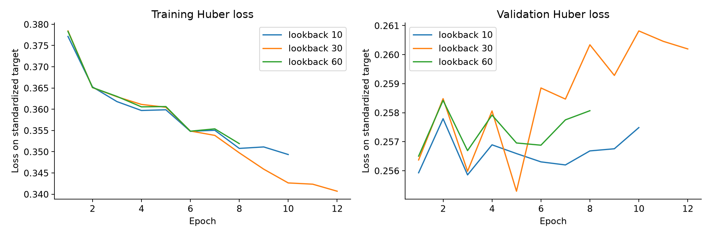
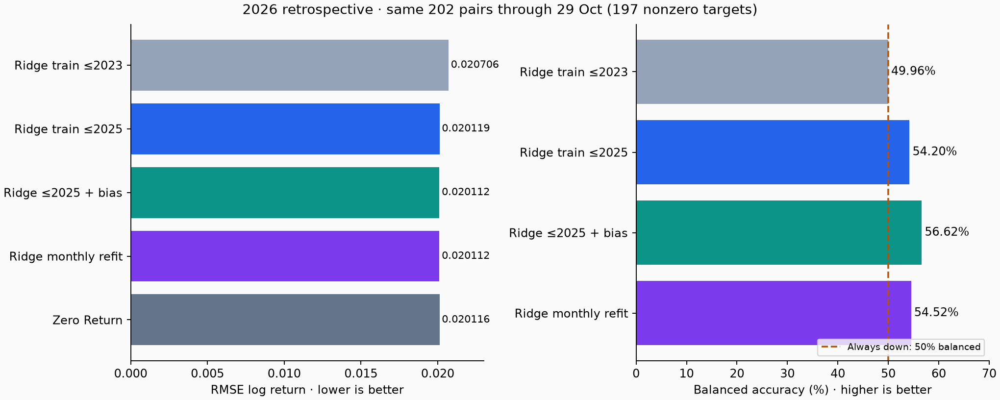
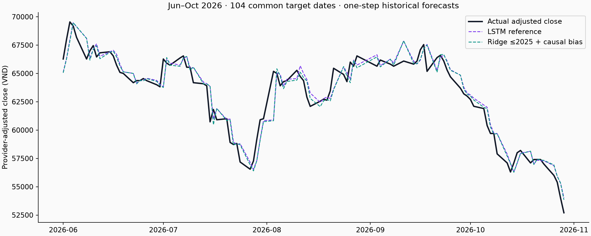
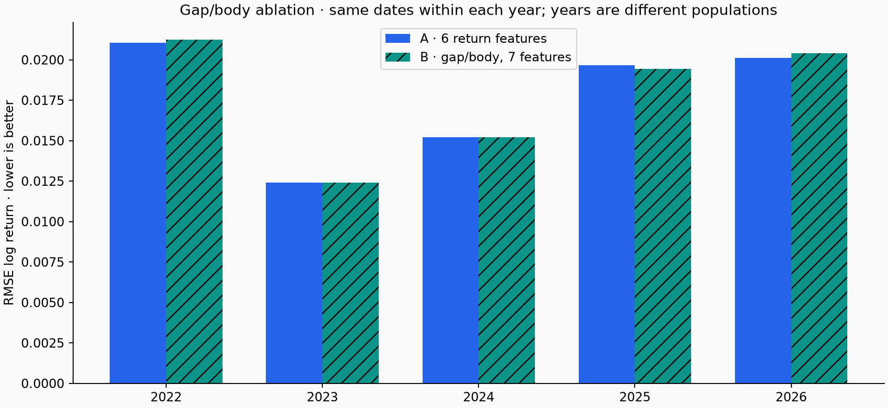
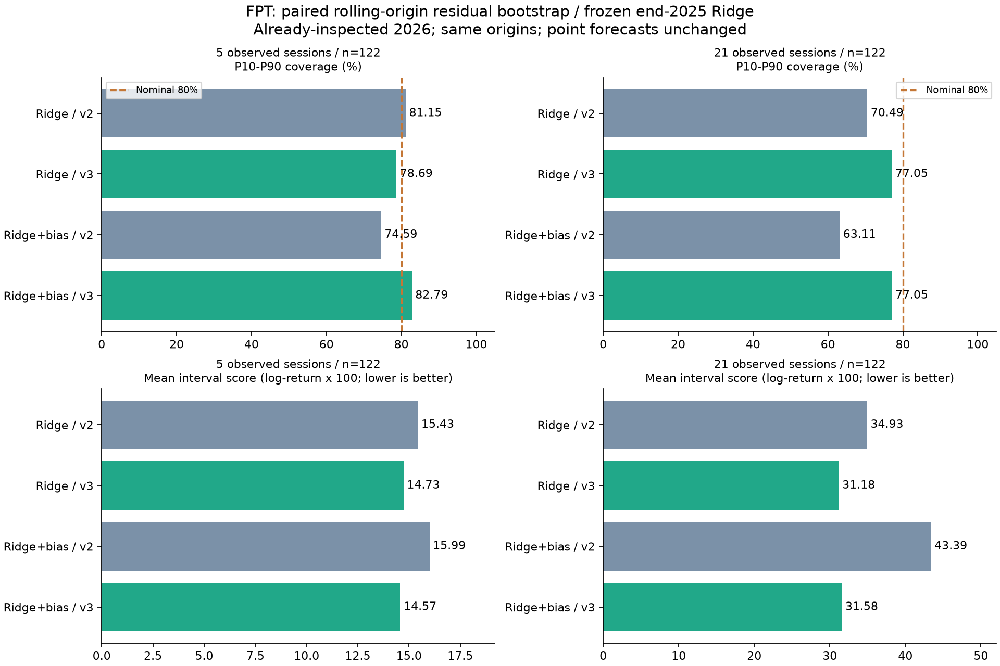
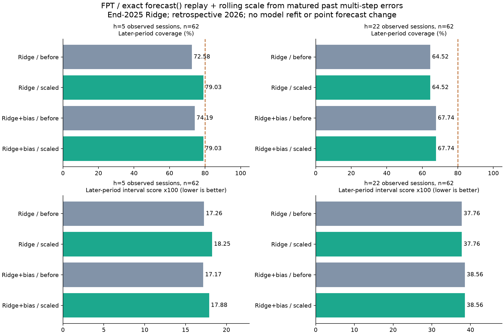
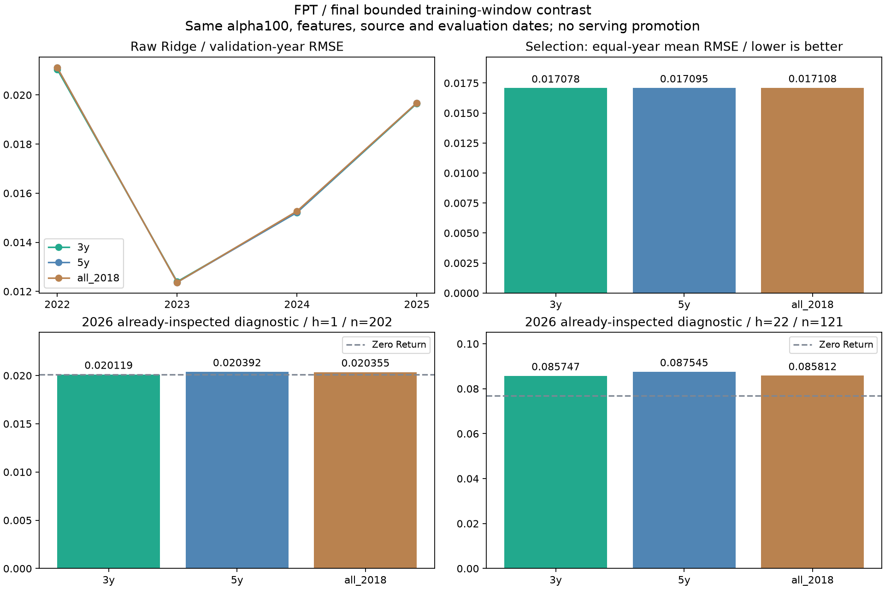

# Nhật ký training và quyết định chọn model FPT

Cập nhật tài liệu **31/10/2026, UTC+7**. Dữ liệu nghiên cứu mới nhất dừng ở **29/10/2026**. Tài liệu tổng hợp bằng chứng đã lưu; không train lại để viết báo cáo.

## Kết luận hiện tại

**Chọn Ridge6, alpha100, training window3 năm làm hướng chính.** Demo local dùng `Ridge+bias60` với calibration cố định; giữ Ridge raw và Zero Return. LSTM được giữ để đối chứng lịch sử. Đây là lựa chọn phục vụ hoàn thiện đồ án và tính đơn giản khi chạy local, **chưa phải chứng minh Ridge thắng ổn định ngoài tương lai**.

Refit Ridge đến cuối2025 giảm RMSE năm2026 từ0,0207058 xuống0,0201191 (−2,83%) so Ridge cũ. Thêm bias nhân quả cho0,0201116, gần Zero Return0,0201157; chênh lệch rất nhỏ. Nhánh phân loại/selective và gap/thân nến chưa có cải thiện đủ ổn định để thay bộ6 feature. [1]

Đóng gói API/UI local là sự kiện **0 fit mới**, dùng lại weights đã train đến29/10. Không gán điểm backtest của model train đến2025 cho bundle cập nhật này. Lưu cả kết quả âm, model cũ và lượt lỗi để team biết vì sao lựa chọn thay đổi.

## 1. Nhật ký các giai đoạn

Ngày lấy từ ID/protocol của study, đổi cách hiển thị theo UTC+7 khi cần. Đây là ngày chạy nghiên cứu, không phải ngày forecast được phát hành trên thị trường.

| Ngày | Thử gì / đối chứng | Kết luận | Bằng chứng |
| --- | --- | --- | --- |
| 25/10 | Legacy LSTM64→32/lookback60 → pipelinev2; CPU/Colab cùng config | Sửa nhãn, scaler, common dates và tính tái lập; không thể quy toàn bộ chênh lệch thành một cải tiến model | [Archive chi tiết](reports/training_history/research_notes.json), [runs](reports/training_history/runs.json) |
| 25/10 | 4 run v2; lookback10/30/60 | Chọn LSTM30 trong nhóm; Train Mean thắng validation toàn bộ | [CPU manifest](models/experiments/20261025T124951351761Z/manifest.json) |
| 29/10 | Robustness:63 candidate, các nhóm feature và seed | Chưa vượt baseline nhất quán; cần model đơn giản và nhiều giai đoạn | [Report](reports/robustness/20261029T131205702813Z/metrics.csv) |
| 29/10 | Audit Yahoo/Vietcap/KBS;112 candidate so nguồn | Chọn Vietcap làm nguồn nghiên cứu; chưa chứng nhận lịch sàn/PIT | [Audit](reports/data_audits/20261029T135735663765Z/summary.json), [source comparison](reports/source_comparison/20261029T142732805710Z/metrics.csv) |
| 29/10 | Training window:56 fit mới/112 điều kiện | Thu hẹp về Ridge returns-only, kiểm tra recency | [Report](reports/window_comparison/20261029T150501819490Z/metrics.csv) |
| 30/10 | Ridge refinement:48 fit mới/80 điều kiện | Window3y/alpha100 cho fold mới nhất; giữ cả lượt export lỗi trước đó | [Report hoàn tất](reports/ridge_refinement/20261030T011109863274Z/metrics.csv), [failure status](reports/ridge_refinement/20261030T010848752516Z/status.json) |
| 30/10 | Frozen2026:0fit,200 cặp chung/202native | LSTM và Ridge cũ chưa vượt Zero Return | [Metrics](reports/evaluation_2026/20261030T014012158951Z/metrics.csv) |
| 30/10 | Recency/bias:13fit mới | Refit cải thiện so Ridge cũ, edge vs zero rất nhỏ | [Metrics](reports/recency_bias/20261030T022440928507Z/metrics.csv) |
| 30/10 | Logistic/XGB classifier:20base+10calibrator | Sau sigmoid thiên về luôn giảm; chưa bật selective trong bản chính | [Metrics](reports/direction_selective/20261030T090621177786Z/metrics.csv) |
| 30/10 | Gap/body:20fitB+20artifactA tái dùng | Chưa cải thiện ổn định; giữ6 return features | [Metrics](reports/candle_ablation/20261030T093521684942Z/metrics.csv) |
| 30/10 | Đóng gói Ridge/API/UI local,0fit | User đồng ý hướng chính; reference cũ và ledger giữ nguyên | [Manifest local](models/local_demo/ridge6_20261029/manifest.json), [pointer riêng](models/local_demo.json) |

Không cộng số `candidate`, `condition`, `base fit`, `calibrator` như cùng một đơn vị. Không nối RMSE khác source/cohort thành một đường chất lượng tăng theo thời gian. [Timeline cho dashboard](reports/training_history/study_timeline.json).

## 2. Bằng chứng tái lập CPU ↔ Colab, không phải tăng accuracy

Bốn run25/10: `20261025T121448987851Z`, `20261025T124129642764Z`, `20261025T124951351761Z`, `20261025T132243824425Z`. LSTM30 đều có validationRMSE0,014032665, test2025RMSE0,019858318 và MAE0,013441519. XGBoost chuyển pickle→nativeJSON để nạp chéo môi trường; đổi định dạng lưu không phải thuật toán chính xác hơn.



Nguồn: [lstm_history.json](reports/experiments/20261025T124951351761Z/lstm_history.json), [64 hàng metric toàn bộ run](reports/training_history/metrics_over_runs.csv). Loss theo epoch khác với chất lượng dự báo qua các giai đoạn thị trường. Legacy thiếu snapshot/prediction tương đương và có công thức Hit khác nên chỉ dùng tham khảo lịch sử. Chi tiết cũ được giữ trong archive, không xóa.

## 3. Đối chứng recency và bias trên cùng202 cặp2026



| Strategy lịch sử | RMSE return ↓ | MAE giá adjusted (VND) ↓ | Hit /197nonzero | Balanced |
| --- | ---: | ---: | ---: | ---: |
| Ridge frozen train≤2023 | 0,0207058 | 1.114,18 | 43,15% | 49,96% |
| Ridge refit train≤2025 | 0,0201191 | 1.080,94 | 50,76% | 54,20% |
| Ridge refit≤2025+bias60 | 0,0201116 | 1.064,12 | 60,91% | 56,62% |
| Ridge monthly refit | 0,0201124 | 1.074,00 | 52,79% | 54,52% |
| Zero Return | 0,0201157 | 1.081,70 | N/A | N/A |

[1] Nguồn: [metrics.csv](reports/recency_bias/20261030T022440928507Z/metrics.csv), cohort`vci_full`, target đến29/10/2026,202pairs gồm197nonzero+5neutral. Số chính xác trong CSV là chuẩn nếu làm tròn bảng. Biểu đồ không có balanced của Zero Return vì không phát tín hiệu hướng.

Refit có lợi hơn model cũ trong giai đoạn này; so baselinezero còn yếu. Static+bias MSEskill chỉ khoảng+0,041%, CI mô tả chứa0. Monthly+bias có thể giảm MAE nhưng tăng RMSE; không nói bias cải thiện mọi mặt. Luôn giảm đạt59,39%Hit, balanced50%; hơn50%Hit không tự chứng minh edge.

Bias backtest dùng sai số có target đã xuất hiện trước origin hiện tại; không lấy mean của cả năm rồi cộng ngược cho mọi ngày. Các khoảng này đã xem và nghiên cứu tiếp dựa trên chúng: đây là **đối chứng hồi cứu thích nghi**, không phải holdout mới.

## 4. So giá thật với forecast đã lưu



[2] Nguồn: [predictions](reports/period_comparison/20261030T024048531444Z/predictions.csv.gz), [summary](reports/period_comparison/20261030T024048531444Z/summary.csv). Cùng104 cặp target01/06–29/10/2026,99actualnonzero. LSTM:RMSE0,0168315,Hit47,47%,balanced50,83%. Ridge≤2025+bias:Hit62,63%,balanced57,95%; ZeroReturn cũng là đối chứng bắt buộc.

Giá dự báo mỗi điểm được neo vào giá origin thực tế, là **dự báo một bước**, không phải tự chạy từ tháng6 rồi biết trước cả5tháng. LSTM có context Yahoo và model training khác Ridge; cùng target/nhãn không biến so sánh này thành ablation chỉ khác architecture. Không lấy104 hoặc200cặp so với202cặp mà bỏ qua mẫu số.

Notebook quan sát: [06_compare_predictions_jun_oct_2026.ipynb](notebooks/06_compare_predictions_jun_oct_2026.ipynb). Dashboard local có lọc tháng, đường actual và model, metric tính lại theo đúng subset.

## 5. Các nhánh chưa được chọn

### Phân loại và “chưa đủ tín hiệu”

Mean-foldbalanced2022–2024: Ridge_shared53,36%,Logisticraw51,83%,XGBraw49,82%. Sau sigmoid ở2026, cảhai dự đoán giảm202/202:Hit117/197=59,39% nhưngbalanced50%, đúng baselinealways-down. Margin2026 chọn0; không ép ngưỡng sau khi nhìn kết quả. Brier cải thiện không đồng nghĩa phân biệt hướng tốt hơn. [3]

[3] [Decision và probability diagnostics](reports/direction_selective/20261030T090621177786Z/metrics.csv), [Notebook05, phần 11](notebooks/05_training_journey_fpt.ipynb). Giữ code/artifact làm nghiên cứu, không bật trong API chính.

### Gap mở cửa và thân nến



A dùng6feature. B thayLog_Return bằng`log(Open_t/Close_previous_eligible)` và`log(Close_t/Open_t)`; không thêm cảba cột phụ thuộc tuyến tính. Hai thành phần đều đã biết sau đóng cửa origin, không dùng Open tương lai.

[4] [Metrics từng năm](reports/candle_ablation/20261030T093521684942Z/metrics.csv), [Notebook05, phần 12](notebooks/05_training_journey_fpt.ipynb). Primary2022–2024 Ridge_recent meanRMSE0,0162190→0,0162930 (B cao hơn0,46%); Logistic balanced chỉ+0,09điểm%. Full2026 Ridge_recentRMSE0,0201191→0,0204083,Hit50,76%→44,67%. B tốt hơn một số năm nhưng chưa ổn định; giữA.

Các năm là các population khác nhau, không coi chênh lệch độ cao cột giữa2022 và2026 là riêng tác động cải tiến feature. CI đi kèm trong study; phần lớn chưa phân biệt chắc chắn.

## 6. Model local hiện tại và bằng chứng forward

Bundle`ridge6_20261029`: StandardScaler→Ridge(alpha100),6features,train3năm, nhãn cuối29/10/2026. `Ridge+bias60` cộng bias và khoảng residual **đóng băng lúc tạo bundle**. Không retrain khi khởi động hoặc gửi request. Lượt đóng gói dùng lại đúng modelSHA`3f048d815cc36e507bfdea97b3d4a65a3d69c601a92af4e2a4a9ee4f9e75e916` từ [shadow_bundle](reports/recency_bias/20261030T022440928507Z/shadow_bundle.json).

Model này chưa có bộ nhãn tương lai đủ để kết luận performance. Ledger có1forecastpending phát09:25UTC+7ngày30/10; nếu target cũng30/10 thì không đủ điều kiện full-session. BấmAPI/UI không tự ghi ledger. Không sửa timestamp hoặc ghi prediction mới cho quá khứ rồi gọi là forward. Xem [ARCHITECTURE.md, mục Forward ledger](ARCHITECTURE.md#forward-ledger).

## 7. Quy tắc ghi lượt training sau

Lượt tích hợp local đã đạt **108 unit tests**, kiểm tra HTTP thật khớp offline và AppTest đổi model/cohort/tháng. [Biên bản kiểm chứng và cleanup](reports/verification/local_ridge_demo/checks.json). Đây là kiểm chứng phần mềm và artifact, không phải 108 phép thử chứng minh model chính xác hơn.

Mỗi study mới ghi ID/thời gian UTC và source/config hashes; nêu câu hỏi, biến thay đổi, baseline và cohort; khóa train/calibration/validation/evaluation trước fit; lưu ngày origin/target, prediction, scaler/model, metric và decision. Tách rõ sốfitmới/táisửdụng, failed/completed, đánhgiáhồicứu/forward. Ghi cả không cải thiện.

Chỉ so model trên cùng ngày và cùng nhãn; đọc RMSE/MAE, direction/coverage, baseline và CI. Data2026 đã được mở nằm trong [holdout_exposures](reports/holdout_exposures.json). Khi có đủ forecast phát trước target và nhãn mới, mới quyết định thay version; không tự promote vì một tháng tốt.

Biểu đồ dựng lại bằng `python -m src.models.training_review`, source/hash ở [assets/training/sources.json](docs/assets/training/sources.json); không train trong lệnh này. Các notebook05–06 giữ output để team quan sát chi tiết. Cleanup chỉ xóa cache tái tạo được; evidence/source ZIP/negative results/reference cũ được giữ. Không commit/push trong lượt này.

## 8. Bổ sung dự báo nhiều bước và giao diện Studio — 30/10/2026

**0 fit mới, weights/scaler/bias không đổi.** API mới lặp modelh=1 trên contextClose tự dự báo, tối đa23bước. Hôm nay/ngàymai/tuần/tháng có ngày requested/effective rõ; chỉ loại cuối tuần, chưa phải lịchsàn xác minh. 512path residualblockbootstrap tạo vùngkịchbảnP10–P90, không chứng minhcoverage80%.

Đây là mở rộng inference/UI, **không có điểm test mới hoặc bằng chứng accuracy tăng**. Không dùng bảngh=1 để gán thành tích tuần/tháng. Giao diện6trang bổ sungOHLCV, dựbáo, đốichứng, evidence, phươngpháp và roadmap1–2model. 119unit tests và UIchecks đạt; [chi tiết phương pháp](ARCHITECTURE.md#forecast-studio), [biên bản kiểm chứng](reports/verification/forecast_studio_20261030/checks.json). Không thayreference hoặc ghi thêmforecastledger; không commit/push/deploy.

## 9. Gom tài liệu và dọn kiến trúc — 31/10/2026

Chỉ giữ ba tài liệu Markdown ở gốc: README, TRAINING_HISTORY và ARCHITECTURE. Báo cáo/nghiên cứu cũ được gom vào [research_notes.json](reports/training_history/research_notes.json), tra theo đường dẫn gốc trong key `notes`; mỗi nội dung giữ SHA256 của bytes gốc để kiểm chứng. Không coi đây là một lượt train hoặc cải thiện accuracy.

Giữ nguyên model/scaler, dữ liệu, manifest, prediction và metric. Giữ notebook demo LSTM, lớp inference reference và wrapper baseline cùng các test tương ứng để tương thích/tái lập. UI chính dùng LocalRidgeService qua HTTP API. Các bộ tạo báo cáo tiếp tục lưu metric/ảnh nhưng ghi phần diễn giải vào registry JSON chung, không sinh thêm Markdown riêng lẻ.

Các nghiên cứu lịch sử có thể nhắc đường dẫn Markdown tại thời điểm tạo. Đọc nội dung đó trong registry; snapshot/protocol lịch sử không bị viết lại để giả là đã dùng cấu trúc mới. Khi train mới vẫn khóa giao thức và lưu đầy đủ kết quả tốt/xấu như trước.

Kiểm chứng sau dọn: **124 unit tests đạt**, bao gồm hash note lịch sử, lưu báo cáo không tạo Markdown mới và chặn giá dự báo không hữu hạn. Lượt dọn không train, đổi weights/scaler, ghi thêm forecast hoặc commit/push.

## 10. Rút gọn dashboard và notebook — 31/10/2026

Dashboard chỉ giữ Tổng quan, Dự báo, Đối chứng và Hành trình model. Đã bỏ giao diện Lộ trình/Dữ liệu & phương pháp cùng các hàm render tương ứng; nội dung giải thích vẫn ở README/ARCHITECTURE.

Notebook05 gom tóm tắt có biểu đồ của nhánh classifier/selective và gap/body từ07/08, giữ nguyên CSV/JSON, protocol/source snapshots và weights. Notebook03 đánh giá v2 trùng nội dung lịch sử trong05; notebook04 demo cũ được thay bởi Streamlit. Các bản này và hai generator notebook riêng không còn dùng được bỏ sau khi kiểm tra nội dung thay thế và phụ thuộc. Đây là dọn presentation, **0 fit mới**, không thêm thành tích dự báo.


## 11. Sửa dự báo nhiều bước: bias chỉ áp dụng bước 1 — 01/11/2026

**0 fit mới, weights/scaler/bias không đổi.** Rà soát phát hiện `forecast_method_version=recursive-ridge6-v1` cộng bias60 (−0,35%/ngày) ở **mọi** bước đệ quy: dự báo tháng thành −8,69%, trong khi phần Ridge thô chỉ khoảng −0,08%/ngày. Bias60 chỉ được kiểm chứng cho h=1, không phải cho quỹ đạo nhiều bước.

Bản `recursive-ridge6-v2`: bước 1 giữ nguyên `Ridge+bias60` (kết quả h=1 không đổi, −0,43%); từ bước 2 dùng Ridge thô trên context đã dự báo, cả đường điểm lẫn kịch bản bootstrap. Sau sửa, tháng còn −1,97% (band P10–P90 43.916–52.920), tuần −0,46%. Số liệu mới là **kịch bản chưa kiểm chứng**, không phải bằng chứng accuracy; không dùng để gán thành tích tuần/tháng.

Biên bản kiểm chứng ngày 30–31/10 giữ nguyên `v1` làm bằng chứng lịch sử, không viết lại. Test mới khóa hành vi (bước 1 có bias, bước ≥2 khớp Ridge thô, không cộng dồn); **125 unit tests đạt**.

## 12. Center residual bootstrap và đối chứng rolling-origin 5/21 phiên — 01/11/2026

**0 fit mới, 0 download, không đổi weights/scaler/bias/calibration của bundle, không commit/push.** Bản `recursive-ridge6-v3` giữ nguyên toàn bộ đường dự báo điểm của v2. Chỉ đổi innovations: lấy 60 residual đã biết, trừ **trung bình của pool** rồi circular block-bootstrap (block5, 512 paths, seed20261030). Không trừ trung bình từng đường/block vì sẽ ép giảm biến động tích lũy. Bias vẫn chỉ ở bước1.

Lý do: pool `corrected_errors` local có trung bình −0,002926 log return/bước. Trong v2, phần trung bình này được cộng lại qua các bước mô phỏng, dù đường điểm đã bỏ bias sau bước1. Centering tách vị trí của đường điểm khỏi độ lệch trung bình của innovations. Đây là giả định về phân phối sai số; không chứng minh drift thật đã biến mất hoặc đã đo đủ rủi ro thị trường. API trả thêm policy/pool/trung bình đã loại trong `uncertainty`. Hợp đồng interval một bước của `/predict` giữ nguyên; `/forecast` dùng policy v3 riêng.

**Giao thức đối chứng:** khóa trước khi chạy ở [protocol.json](reports/recursive_bootstrap/20261101T011353369474Z/protocol.json). Dùng đúng model Ridge6 alpha100 train3năm, nhãn cuối **31/12/2025**, có artifact/hash từ study recency; không dùng model local train29/10/2026 để chấm ngược quá khứ. Nguồn là snapshot Vietcap đã kiểm tra hash. Audit lại raw predictions, nhãn và bias nhân quả của calibration đã lưu.

Tại từng origin sau đóng cửa, chỉ residual có `Target_Date_1d ≤ origin` được dùng; đủ60 mẫu mới chấm. Bias lấy trung bình raw errors đã trưởng thành, chỉ áp dụng bước1; Ridge+bias lấy corrected residual pool, Ridge thô lấy raw pool, cùng định nghĩa giữa v2/v3. Không cập nhật context bằng giá thật trong21 bước dự báo. Nhãn tại h là `log(Close[t+h]/Close[t])` theo **quan sát hợp lệ, volume dương**, không đếm ngày nghỉ hoặc tự điền lịch.

Hai horizon dùng chung **122 origin: 06/04–30/09/2026**. Nhãn5phiên:13/04–07/10; nhãn21phiên:08/05–29/10. So v2/v3 cùng model, origin, seed và block indices; thêm Ridge thô và Zero Return. Đây là hồi cứu trên2026 đã xem và đã dùng đề xuất thay đổi, không phải holdout mới, forward test hoặc kiểm định bundle cuối10/2026. Khung5/21quan sát cũng không đồng nhất nút tuần/tháng theo lịch trên UI.

### Vùng kịch bản: coverage đọc cùng độ rộng và interval score

Coverage là tỷ lệ giá thật tại **đích h** nằm trong P10–P90, không phải hit tăng/giảm hoặc xác suất cả đường nằm trong band. Độ rộng và interval score bên dưới ở đơn vị log return; interval score80% phạt cả khoảng quá rộng và khoảng bỏ sót, **thấp hơn tốt hơn**.

| Model | h | Coverage v2 → v3 | Độ rộng trung bình v2 / v3 | Interval score v2 → v3 |
| --- | ---: | ---: | ---: | ---: |
| Ridge | 5 | 81,15% → 78,69% | 0,10588 / 0,10588 | 0,15430 → 0,14731 |
| Ridge+bias60 | 5 | **74,59% → 82,79%** | 0,10691 / 0,10691 | **0,15995 → 0,14570** |
| Ridge | 21 | 70,49% → 77,05% | 0,21821 / 0,21821 | 0,34933 → 0,31185 |
| Ridge+bias60 | 21 | **63,11% → 77,05%** | 0,22559 / 0,22559 | **0,43387 → 0,31582** |

Centering cải thiện interval score trung bình ở cả4đối chứng. Với Ridge thô h5, coverage giảm và hơi xa80% hơn; không gọi mọi chỉ số đều cải thiện. Độ rộng theo log return không đổi vì cùng model tuyến tính và chỉ dịch vị trí innovations; độ rộng tính VND/%giá origin có thể đổi sau hàm mũ. Ở Ridge+bias h21, tỷ lệ giá thật dưới band giảm34,43%→20,49%, vẫn có bất cân xứng và chưa đạt nominal80%.



### Đường điểm: chưa hơn baseline giữ nguyên giá

V2 và v3 có prediction/RMSE/MAE/hit **giống nhau**; đây là sửa vùng kịch bản, không tăng accuracy của dự báo điểm. Các giá trị sau là của model lịch sử, không phải điểm của bundle đang phục vụ:

| h | Model | RMSE log return ↓ | MAE giá điều chỉnh (VND) ↓ | Hit tăng/giảm | Balanced accuracy |
| --- | --- | ---: | ---: | ---: | ---: |
| 5 | Zero Return | **0,040131** | **2.024** | N/A | N/A |
| 5 | Ridge | 0,040857 | 2.088 | 39,32% | 47,54% |
| 5 | Ridge+bias60 | 0,040737 | 2.066 | 39,32% | 43,34% |
| 21 | Zero Return | **0,075352** | **3.756** | N/A | N/A |
| 21 | Ridge | 0,083738 | 4.248 | 35,25% | 50,00% |
| 21 | Ridge+bias60 | 0,083081 | 4.188 | 35,25% | 50,00% |

Hit bỏ actual return=0; Zero Return không có dự báo hướng nên không gán hit/balanced hoặc mượn band của Ridge. Ridge+bias có MSE skill so Zero **−3,04% ở h5, −21,57% ở h21**. Chưa có cơ sở quảng bá dự báo nhiều phiên chính xác hoặc thay hướng chính h=1.

**Phụ thuộc mẫu:** origin hằng ngày và các target chồng lấp. Paired circular block-bootstrap theo21origin,2000resamples,seed20261101 cho chênh interval score v3−v2 của Ridge+bias: h5=−0,01425, CI95% mô tả[−0,02503;−0,00458]; h21=−0,11805, CI[−0,24544;−0,02391]. Ridge thô có CI chứa0 ở cả2horizon. Không dùng CI này để tuyên bố lợi thế tương lai trên dữ liệu đã xem.

Độ nhạy lấy mỗi h-th origin từ origin đầu, không chọn anchor theo kết quả: **25 mẫu h5, chỉ6mẫu h21**. Ridge+bias coverage h5=72%→80%, score0,14215→0,13181; h21=66,67%→83,33%, score0,29590→0,24071. Sáu mẫu tháng quá ít để kết luận ổn định. Toàn bộ model/variant và baseline của cả hai cách lấy mẫu ở [metrics.csv](reports/recursive_bootstrap/20261101T011353369474Z/metrics.csv); [paired_comparison.csv](reports/recursive_bootstrap/20261101T011353369474Z/paired_comparison.csv) lưu CI, [predictions.csv.gz](reports/recursive_bootstrap/20261101T011353369474Z/predictions.csv.gz) lưu từng origin/target/calibration cutoff.

### Kiểm tra bundle phục vụ, tách khỏi chấm hồi cứu

Cố định request01/11/2026, origin29/10, chọntháng→target30/11, **22weekday dự kiến**, chưa trừ lịch nghỉ HOSE. Ridge+bias điểm cuối v2=v3 **51.659,71VND (−1,974%)**. P10–P90 đổi **43.916,08–52.920,42** → **46.892,97–56.507,68VND**; đây là kịch bản chưa có actual, không chấm accuracy. Request30/10 có21bước,target27/11 và band riêng; không trộn số21bước với22bước. [serving_before_after.json](reports/recursive_bootstrap/20261101T011353369474Z/serving_before_after.json) ghi cả hai ngày request, các model và version.

**Kết luận:** giữ v3 cho cách dựng band có centering rõ ràng, giữ cảnh báo mô phỏng nhiều bước và hướng chính h=1. Chưa train direct h5/h21, chưa promote model hoặc xác nhận coverage tương lai. Muốn tăng độ chính xác nhiều phiên cần một study riêng có validation, baseline, dữ liệu mới và forecast phát trước target.

Kiểm chứng: **130 unit tests đạt**, gồm bất biến khi dịch trung bình residual ở cả helper lẫn đường gọi forecast, không ép tổng nhiễu từng đường về0, bias chỉ bước1 cho cả paths, calibration không nhìn nhãn tương lai và interval score có phạt bỏ sót. Lượt chạy chặn `Ridge.fit`/`StandardScaler.fit`; **741 file dữ liệu/model/evidence cũ giữ nguyên hash**. Replay6snapshot v2 khớp cả điểm và band; **12 request HTTP thật khớp offline v3**, kiểm tra4mục/4khung UI đạt. [verification.json](reports/recursive_bootstrap/20261101T011353369474Z/verification.json), [http_ui_check.json](reports/recursive_bootstrap/20261101T011353369474Z/http_ui_check.json) và source ZIP lưu bằng chứng tái lập. Chạy lại chỉ tạo study mới:

```powershell
.\venv\Scripts\python.exe -B -m src.models.recursive_bootstrap_evaluation
```

Tham khảo phương pháp: [rolling forecasting origin](https://otexts.com/fpp3/tscv.html), [centered innovations và bootstrap chuỗi thời gian](https://www.kevinsheppard.com/files/teaching/mfe/advanced-econometrics/Kreiss_and_lahiri.pdf).

## 13. Backtest đúng hàm forecast ở h=5/h=22 và hiệu chỉnh độ rộng — 01/11/2026

**0 fit model/scaler, 0 download, không commit/push.** Lượt này bổ sung h=22 và chạy **chính `forecast()`**, gồm bước gọi `LocalRidgeService.predict`, builder, bootstrap và xuất band; không chỉ dùng helper recursion. Giữ model lịch sử train nhãn đến **31/12/2025** để tránh chấm bằng bundle đã học tới cuối10/2026. Tại mỗi origin, raw/features bị cắt tới origin; bias/residual chỉ chứa nhãn đã trưởng thành. Các ngày quan sát đích được truyền riêng qua tham số nghiên cứu, không truyền giá tương lai hoặc mở tham số này trên HTTP API.

**121 origin dùng chung: 06/04–29/09/2026**, có đủ60 residual và nhãn22 quan sát tiếp theo. h=5 đích13/04–06/10; h=22 đích11/05–29/10. Đây là backtest hồi cứu trên dữ liệu adjusted2026 đã xem, không phải holdout mới hoặc điểm của bundle hiện tại. Bảng5/21 ở mục12 khác horizon/cohort; không so trực tiếp các con số rồi gọi là cải thiện. Mỗi h ở lượt này gọi forecast riêng với số bước tương ứng, thay vì đọc bước5 từ một lần bootstrap21bước.

### Kết quả toàn bộ 121 origin, band centered chưa nới

| h | Model lịch sử | RMSE log return ↓ | RMSE giá (VND) ↓ | Hit hướng | Coverage band gốc |
| --- | --- | ---: | ---: | ---: | ---: |
| 5 | Ridge+bias60 | 0,040563 | 2.581 | 39,66% | 83,47% |
| 5 | Zero Return | **0,039999** | **2.546** | N/A | N/A |
| 22 | Ridge+bias60 | 0,085079 | 5.339 | 35,00% | 77,69% |
| 22 | Zero Return | **0,076851** | **4.775** | N/A | N/A |

Hit không tính nhãn return=0: h5 có116 nhãn khác0, h22 có120. Zero Return không phát hướng hoặc có band của Ridge. Các RMSE này đánh giá **return tích lũy tới đích h và Close đích**, không cộng trung bình các metric h=1.

### Hiệu chỉnh cố định: chọn hệ số bằng phần trước, chấm phần sau

Protocol được ghi trước khi chạy ở [protocol.json](reports/horizon_calibration/20261101T012415194582Z/protocol.json). Chỉ dùng target **≤30/06/2026** để chọn hệ số: h5 có54 origin, h22 có37. Các origin trước01/07 nhưng target vượt30/06 bị loại khỏi tập chọn hệ số; không để nhãn calibration lọt sang giai đoạn báo cáo sau.

Band được nới quanh **đường điểm theo log giá**: `L'=p+s(L−p)`, `U'=p+s(U−p)` với p/L/U trên thang log. Không nhân giá thấp/cao trực tiếp với s. Điểm dự báo, RMSE và hit không đổi. Score mỗi mẫu là `max((p−y)/(p−L), (y−p)/(U−p), 0)`; lấy order statistic thứ `ceil((n+1)×0,8)` và chặn s≥1 để chỉ thử nới. Mẫu phải có band bao quanh điểm. Đây là quy tắc split-calibration, **không có bảo đảm conformal80% cho chuỗi thời gian phụ thuộc này**.

Giai đoạn chọn hệ số có coverage Ridge+bias h5=92,59%, h22=100%; quy tắc chọn **s=1,0 ở cả hai**, nên không tạo cải thiện giả bằng cách dùng kết quả giai đoạn sau để chọn lại s.

Giai đoạn đến sau dùng **62 origin chung từ01/07–29/09**, đích h5 từ08/07–06/10, h22 từ31/07–29/10:

| h | Model | RMSE log return ↓ | RMSE giá (VND) ↓ | Hit hướng | Balanced | Coverage gốc |
| --- | --- | ---: | ---: | ---: | ---: | ---: |
| 5 | Ridge+bias60 | 0,045705 | 2.838 | 33,33% | 40,28% | 74,19% |
| 5 | Zero Return | **0,044671** | **2.770** | N/A | N/A | N/A |
| 22 | Ridge+bias60 | 0,100287 | 6.226 | 46,77% | 50,00% | 67,74% |
| 22 | Zero Return | **0,092743** | **5.709** | N/A | N/A | N/A |

h5 có60 actual khác0, h22 có62. Kết quả cho thấy điểm trung bình trên toàn kỳ che mất sự suy giảm coverage ở phần sau; nới band không sửa được RMSE/hit của đường điểm. [metrics.csv](reports/horizon_calibration/20261101T012415194582Z/metrics.csv) giữ thêm Ridge thô, các baseline và giai đoạn calibration/embargo.

### Thử tiếp rolling calibration có kiểm soát, giữ cả kết quả không đạt

Sau khi thấy hệ số cố định không thích nghi, đăng ký [protocol rolling riêng](reports/horizon_calibration/20261101T012415194582Z/adaptive/protocol.json). **Đây là biến thể thích nghi hậu nghiệm trên cùng giai đoạn đã xem**, không phải test độc lập mới. Ở mỗi origin, lấy tối đa60 score của cùng model/horizon có target≤origin, tối thiểu20; chọn s theo cùng quy tắc rồi gọi lại forecast. Không dùng actual của forecast đang phát để đặt s.

| Ridge+bias60 | Coverage gốc → rolling | Độ rộng log trung bình | Interval score ↓ | Kết luận |
| --- | ---: | ---: | ---: | --- |
| h5 | 74,19% → **79,03%** | 0,10462 → 0,11549 | 0,17170 → **0,17880** | Coverage gần80 hơn nhưng score xấu hơn; chưa bật |
| h22 | 67,74% → **67,74%** | 0,22846 → 0,22846 | 0,38564 → 0,38564 | Toàn bộ forecast đã chấm vẫn s=1; chưa có bằng chứng nới band giúp |



Ridge thô cũng có h5 coverage72,58%→79,03% nhưng score0,17263→0,18254, nên bị từ chối. Ở h22, target trưởng thành chậm22 quan sát: các sai số cuối kỳ chỉ được biết sau origin cuối của backtest. Khi đã có nhãn29/10, pool60 score tạo candidate Ridge+bias **s=1,47194**, Ridge **1,44383**, nhưng **0 forecast đã chấm** dùng mức nới>1 ở h22. Không dùng final factor này chấm lại các origin trước đó rồi gọi là ngoài mẫu. Candidate h5=1,12782/1,21500 được tính trong cohort chung, nhãn mới nhất06/10; không phải tập score h5 đầy đủ tới29/10.

Rà soát sau chạy phát hiện gate ban đầu “không xấu hơn” có thể cho qua trường hợp band chưa thay đổi. Bổ sung kiểm tra hỗ trợ: một hệ số>1 phải có ít nhất20 forecast đã chấm thực sự nới band, hệ số cuối nằm trong vùng đã thử, và có cải thiện coverage/score mà không làm score xấu hơn. Đây là **bước review hậu nghiệm**, được ghi rõ trong [reviewed_policy.json](reports/horizon_calibration/20261101T012415194582Z/adaptive/reviewed_policy.json); các policy/decision ban đầu giữ nguyên làm bằng chứng. Kết quả cuối: **mọi hệ số phục vụ vẫn là1×**.

Origin ngày và target nhiều bước chồng lấp; lấy mỗi h-th origin của giai đoạn sau chỉ còn **13 mẫu h5 và3 mẫu h22**. Ridge+bias coverage không chồng lấp h5=84,62% trước/sau, nhưng score0,15678→0,16387; h22=66,67% và score không đổi. Không đủ dữ liệu độc lập để chứng nhận ổn định theo tháng. [Predictions rolling](reports/horizon_calibration/20261101T012415194582Z/adaptive/predictions.csv.gz) lưu factor, số score và cutoff target ở từng origin.

### Trạng thái API/UI sau lượt này

`recursive-ridge6-v4` bổ sung scaling và kiểm tra cutoff/model-version trong [forecast_path.py](src/models/forecast_path.py). [recursive_band_calibration.json](configs/recursive_band_calibration.json) lưu candidate, decision và hệ số active **1×**. Không đổi dự báo điểm, không thay model hoặc ép band nới khi kiểm chứng chưa đạt. Chỉ h5/h22 có cơ chế factor riêng; không nội suy cho h khác hoặc đổi h1. Không claim bundle train29/10 đã được kiểm chứng tương lai từ điểm của model2025.

**5/22 quan sát giao dịch khác tuần/tháng theo lịch của UI.** Snapshot29/10, request01/11: nút tuần có6weekday từ origin, nút tháng có22; ngày nghỉ HOSE vẫn chưa xác minh. Không đổi nghĩa các nút để làm kết quả khớp bảng. UI hiển thị số bước/hệ số ở đích và nêu backtest thuộc model lịch sử. H1 có backtest riêng trước đó cũng không có nghĩa chắc chắn dự báo tương lai tốt.

Kiểm chứng **137 unit tests đạt**, gồm cutoff, embargo, order statistic, scaling log-distance qua chính forecast ở đúng bước5/22 mà không đổi point, không kích hoạt factor chưa có forecast được chấm, và bất biến khi sửa mọi giá/nhãn tương lai trong service lịch sử. Lượt replay chặn `Ridge.fit`/`StandardScaler.fit`. **12 request HTTP thật khớp offline v4**, UI4mục/4khung đạt, serving point/band active1× khớp v3 trước đó. Dữ liệu/model và evidence trước lượt này giữ nguyên hash; kiểm chứng/source snapshot ở [study cố định](reports/horizon_calibration/20261101T012415194582Z/verification.json), [study rolling](reports/horizon_calibration/20261101T012415194582Z/adaptive/verification.json). Không commit/push.

Tái chạy chỉ xuất study mới, mặc định không cài/ghi đè policy API:

```powershell
.\venv\Scripts\python.exe -B -m src.models.recursive_horizon_calibration
```

Kết luận: đã có backtest đúng h5/h22 và đã thử hiệu chỉnh; **chưa chứng minh dự báo nhiều phiên vượt baseline hoặc band đạt80% ổn định**. Giữ h1 làm hướng chính, tuần/tháng là mô phỏng có công bố kết quả và giới hạn. Thu forecast/nhãn mới để kiểm tra candidate thay vì chọn hệ số bằng bộ điểm đã báo cáo. Tham khảo [time-series cross-validation](https://otexts.com/fpp3/tscv.html) và [điều kiện exchangeability của split conformal](https://statgrades.berkeley.edu/~ryantibs/statlearn-s24/lectures/conformal.pdf).

## 14. Đối chứng train cuối: 3 năm, 5 năm, toàn bộ từ 2018 — 01/11/2026

**Đã hoàn tất lượt train cuối theo yêu cầu: 16 fit mới cho18điều kiện, không mở thêm grid, không commit/push hoặc tự thay model phục vụ.** Giữ đúng Vietcap snapshot tới29/10/2026, sáu feature lợi suất, `StandardScaler → Ridge(alpha=100)`, h=1. Chỉ thay độ dài lịch sử train. Kết quả ủng hộ **giữ cửa sổ3năm cho hướng chính h=1**, nhưng chênh validation rất nhỏ và CI mô tả chứa0; không chứng minh cửa sổ này luôn thắng trong tương lai.

### Giao thức và cách chia dữ liệu

[Protocol](reports/final_window_comparison/20261101T014607720130Z/protocol.json) được ghi **trước fit**; config cố định ở [final_window_comparison_v1.json](configs/final_window_comparison_v1.json). Không tải thêm dữ liệu hoặc thay cleaning/feature builder.

- Validation walk-forward2022/2023/2024/2025: mỗi năm dùng model train tới31/12 của năm trước. So ba cửa sổ trên **cùng origin/target và cùng nhãn** trong từng năm; số mẫu lần lượt248/248/249/248, tổng993. Các cặp vượt ranh giới năm không được lẫn vào train hoặc năm chấm trước.
- Chọn cửa sổ bằng **trung bình RMSE h1 raw Ridge của bốn năm, mỗi năm trọng số bằng nhau**; tie ưu tiên3y→5y→all2018. Scaler chỉ fit train, nhãn phải có target≤cutoff. Không dùng2026, bias, h5/h22 hoặc điểm của candidate mới tới29/10 để chọn lại window.
- Chẩn đoán2026: model train tới31/12/2025, chấm chung202cặp h1; h5/h22 dùng chung121origin có60 residual đã trưởng thành. Mỗi model/window tự tính bias60 nhân quả; replay chính forecast với band centered và mọi factor=1, không refit model giữa các origin.
- Sau đối chứng, train thêm ba candidate tới29/10/2026 **chỉ để lưu cho dự báo tương lai**; không chấm lại quá khứ bằng các candidate này. Chưa promote hoặc đóng gói candidate mới sang API.

`all_2018` dùng mọi mẫu hợp lệ từ lịch sử2018 tới cutoff. Origin có feature đầu tiên21/03/2018 do warm-up49quan sát; raw trước đó vẫn được giữ để tạo feature. Khi train tới2021/2022,5y và all2018 có đúng cùng dữ liệu sẵn có, không đủ năm để tạo khác biệt. Hai điều kiện này dùng chung weights có xác minh signature, nên **18điều kiện chỉ có16fit độc lập**:13model lịch sử và3candidate hiện tại. Không gọi chúng là18thực nghiệm dữ liệu độc lập.

### Validation quyết định window: raw Ridge, RMSE log-return ↓

| Năm chấm | 3 năm | 5 năm | Toàn bộ từ2018 |
| --- | ---: | ---: | ---: |
| 2022 | **0,021045** | 0,021112 | 0,021112 |
| 2023 | 0,012397 | **0,012371** | **0,012371** |
| 2024 | **0,015216** | 0,015220 | 0,015269 |
| 2025 | **0,019655** | 0,019678 | 0,019680 |
| Mean của4năm | **0,01707812** | 0,01709506 | 0,01710787 |
| Worst-fold RMSE | **0,02104458** | 0,02111200 | 0,02111200 |

3y thấp nhất ở3/4năm; năm2023 cửa sổ dài hơn tốt hơn. Mean RMSE3y giảm **0,099% so5y**, **0,174% soall2018**; chưa phải cải thiện lớn. Zero Return mean RMSE khoảng0,017095, TrainMean các window khoảng0,017081–0,017086, cũng rất gần các model.

Paired block-bootstrap2000resamples, block20origin **trong từng năm**, cùng seed20261101: chênh MSE bình quân năm của5y−3y là`+7,993e−7`, CI95%`[−8,524e−7; +2,476e−6]`; all2018−3y là`+1,195e−6`, CI`[−8,527e−7; +3,205e−6]`. **Cả hai CI chứa0**. Đây là CI mô tả có điều kiện trên các model đã fit, không tính toàn bộ bất định của chọn window hoặc chứng nhận edge tương lai. [paired_validation_ci.csv](reports/final_window_comparison/20261101T014607720130Z/paired_validation_ci.csv).



### Chẩn đoán2026 cùng202cặp h1, tách khỏi quyết định validation

Origin05/01–28/10, target06/01–29/10/2026. Các model ở bảng này chỉ train nhãn tới31/12/2025; bias cập nhật từ nhãn đã biết tại từng origin, có20mẫu warm-up. Không phải điểm của bundle đã train tới29/10. Hit/balanced bỏ5actual=0, còn197nhãn có hướng.

| Window | Train n tại31/12/2025 | RMSE raw Ridge ↓ | RMSE Ridge+bias60 ↓ | Hit của bản+bias | Balanced của bản+bias |
| --- | ---: | ---: | ---: | ---: | ---: |
| 3y | 747 | **0,020119** | **0,020112** | **60,91%** | **56,62%** |
| 5y | 1.246 | 0,020392 | 0,020301 | 50,25% | 46,26% |
| all2018 | 1.947 | 0,020355 | 0,020286 | 52,79% | 48,60% |
| Zero Return | N/A | 0,020116 | N/A | N/A | N/A |

3y có kết quả tốt nhất trong ba window ở phép chẩn đoán h1 này; raw vẫn hơi kém Zero về return RMSE, bản+bias chỉ nhỉnh rất ít. Không diễn giải hit60,91% thành xác suất chắc chắn đúng mỗi lần, hoặc so nó với50% mà bỏ baseline luôn đoán giảm59,39% của cùng197nhãn. Không thay selection bằng kết quả2026 đã xem.

### Nhiều phiên: thêm lịch sử có lợi ở vài chỉ số, không thắng mọi horizon

121origin chung06/04–29/09; đích h5 tới06/10, h22 tới29/10. Bảng dưới là **Ridge+bias60** của từng window, cùng policy bias chỉ bước1 và band centered chưa nới. Có116actual khác0 ởh5 và120ởh22.

| h | Window | RMSE log-return ↓ | Hit hướng | Balanced | Coverage band |
| --- | --- | ---: | ---: | ---: | ---: |
| 5 | 3y | 0,040563 | 39,66% | 43,51% | 83,47% |
| 5 | 5y | 0,040424 | 45,69% | 51,97% | 81,82% |
| 5 | all2018 | **0,040181** | **49,14%** | **55,21%** | 85,12% |
| 5 | Zero Return | **0,039999** | N/A | N/A | N/A |
| 22 | 3y | 0,085079 | 35,00% | 50,00% | 77,69% |
| 22 | 5y | 0,086518 | 35,00% | 50,00% | 74,38% |
| 22 | all2018 | **0,084892** | 35,00% | 50,00% | 75,21% |
| 22 | Zero Return | **0,076851** | N/A | N/A | N/A |

All2018+bias có RMSE h5/h22 thấp hơn3y+bias trong đoạn này, nên **không kết luận nhiều dữ liệu luôn có hại**. Tuy vậy mọi window vẫn kém Zero Return về RMSE nhiều bước. Coverage cao hơn cũng không mặc nhiên tốt hơn: ởh5, interval score3y/5y/all lần lượt0,14710/0,14673/0,14548; ởh22 là0,32906/0,33759/0,33360. Band all2018 h22 có score kém3y dù point RMSE hơi tốt hơn. Raw Ridge và TrainMean cũng được lưu đầy đủ ở [metrics.csv](reports/final_window_comparison/20261101T014607720130Z/metrics.csv).

Các target nhiều bước chồng lấp và2026 đã được mở nhiều lần. Đây là chẩn đoán hỗ trợ, không chọn thêm một modelh5 bằng chính điểm2026 hoặc gọi tuần/tháng đã thắng ngoài tương lai.5/22quan sát vẫn khác khung tuần/tháng theo lịch UI.

### Ba candidate train tới29/10/2026, chưa có điểm tương lai

| Candidate | Origin train đầu → cuối | Nhãn cuối | Số mẫu |
| --- | --- | --- | ---: |
| 3y | 30/10/2023 → 28/10/2026 | 29/10/2026 | 746 |
| 5y | 01/11/2021 → 28/10/2026 | 29/10/2026 | 1.244 |
| all2018 | 21/03/2018 → 28/10/2026 | 29/10/2026 | 2.150 |

Weights/scaler Pipeline và train dates có hash trong [manifest.json](reports/final_window_comparison/20261101T014607720130Z/manifest.json); bản nén16model nhỏ nằm ở [weights_snapshot.zip](reports/final_window_comparison/20261101T014607720130Z/weights_snapshot.zip), không cần giữ thêm file Markdown. Candidate là artifact nghiên cứu raw-only, chưa có calibration/bundle serving mới. **Candidate3y có SHA256 đúng bằng weights đang chạy** `3f048d815cc36e507bfdea97b3d4a65a3d69c601a92af4e2a4a9ee4f9e75e916` và prediction reload khớp, nên không có lý do thay file API chỉ để đổi timestamp.

### Kết luận để thống nhất model

**Đề xuất giữ Ridge6 alpha100, train3năm, cấu hình Ridge+bias60 h1 làm hướng chính; Zero Return là baseline bắt buộc.** Giữ5y/all2018 làm evidence/candidate nghiên cứu. Lựa chọn này dựa vào rule validation đã khóa và phù hợp chẩn đoán h1, không khẳng định ưu thế có ý nghĩa thống kê hoặc lợi thế tương lai ổn định. Không thay model/API hoặc bật band calibration sau lượt này. Toàn bộ lịch sử có thể hữu ích cho horizon khác, nhưng chưa đủ bằng chứng để promote một model thứ hai.

Giữ alpha100 giúp đối chứng đúng cấu hình hiện tại; do Ridge dùng tổng squared error cộng penalty, tỷ lệ regularization so mỗi mẫu cũng thay đổi khi n thay đổi. Vì vậy không quy mọi chênh lệch thành riêng “dữ liệu cũ” hoặc riêng “số mẫu”. Nguồn adjusted chưa được chứng nhận point-in-time; đây vẫn là nghiên cứu thích nghi trên lịch sử đã xem.

Kiểm chứng **141 unit tests đạt**,18điều kiện/16fit/2reuse, mọi model nạp lại độc lập, scaler khớp train-only, nhãn target không vượt cutoff và ngày/nhãn chấm chung giữa các window. **770 file dữ liệu/model/evidence cũ giữ nguyên hash**. [verification.json](reports/final_window_comparison/20261101T014607720130Z/verification.json), [decision.json](reports/final_window_comparison/20261101T014607720130Z/decision.json), [predictions từng origin](reports/final_window_comparison/20261101T014607720130Z/predictions.csv.gz) và source/config ZIP lưu bằng chứng. Không download, commit/push, auto-promote hoặc chạy thêm vòng train/tune nào sau study cuối này. Bước tiếp theo là thống nhất kết luận và theo dõi forecast/nhãn mới, không tiếp tục đào điểm trên2026.

## 15. Mở rộng dashboard: chọn ngày và phân tích snapshot — 01/11/2026

**0 fit mới, không thay model/data/calibration hoặc commit/push.** Giữ Ridge huấn luyện trên 3 năm + bias60 đã chốt. Dự báo thêm lựa chọn ngày đích trong một tháng từ hôm nay; backend kiểm tra ngày và tối đa 23 ngày làm việc kể từ snapshot, nêu rõ trường hợp cuối tuần được chuyển sang weekday kế tiếp. Đoạn nối snapshot với hôm nay được vẽ xám và đánh dấu là mô phỏng, không coi là giá thật hiện tại. Bảng từng bước và CSV/JSON giữ requested/effective dates cùng cờ trong khoảng chọn.

Tổng quan bổ sung khung ngắn/toàn bộ lịch sử, nến/Close, SMA20/50/200, Bollinger20, volume, RSI/MACD, gap/thân nến, ATR, drawdown, phân bố return và heatmap tháng, kèm bật/tắt chi tiết và xuất dữ liệu. Các chỉ báo chỉ mô tả OHLCV đã có; không đi vào Ridge hoặc tạo thành một lần cải thiện accuracy. Có chú thích quy ước 252 quan sát/năm, sample size, warm-up, tháng chưa hoàn tất và phân biệt Bollinger với band dự báo.

**149 unit tests đạt**, kiểm tra UI 4 mục, 4 preset, ngày tùy chọn min/max/rỗng, khung 22 quan sát và toàn bộ, layer chỉ báo bật/tắt, cùng các case regression cũ. Đã khởi động lại API/Streamlit local và kiểm tra trực tiếp trên trình duyệt. Cả 8 lượt gọi HTTP có đường giá khớp offline; 4 request sai được từ chối bằng HTTP 422. 770 file dữ liệu/model/evidence cũ và kết quả, weights của lượt train cuối giữ nguyên hash. [Biên bản kiểm chứng](reports/verification/dashboard_custom_date_20261101.json). Giữ ba Markdown gốc, không tạo notebook/tài liệu rời hoặc train thêm.

Cùng lượt hoàn thiện dashboard, bổ sung 3 sơ đồ trong “Hiểu cách model dự báo”, ví dụ đổi log return thành giá từ response thật và nội dung riêng cho từng model. Đã kiểm tra UI của Ridge+bias60, Ridge và Zero Return; đây chỉ là thay đổi trình bày, không train hoặc đổi kết quả dự báo.

Trang Dự báo bổ sung cụm dashboard gồm return từng bước, thay đổi tích lũy và độ rộng band, kèm thẻ biên ở đích. Kiểm tra UI và đối chiếu số liệu trực tiếp với tỷ lệ giá API đạt; Zero Return không nhận band Ridge. Không đổi inference, train, dữ liệu hay model.
