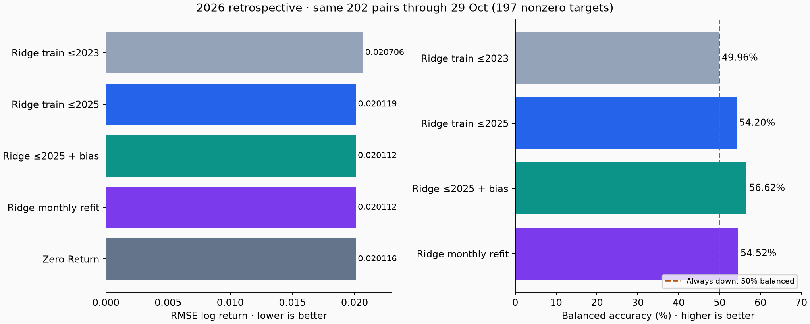
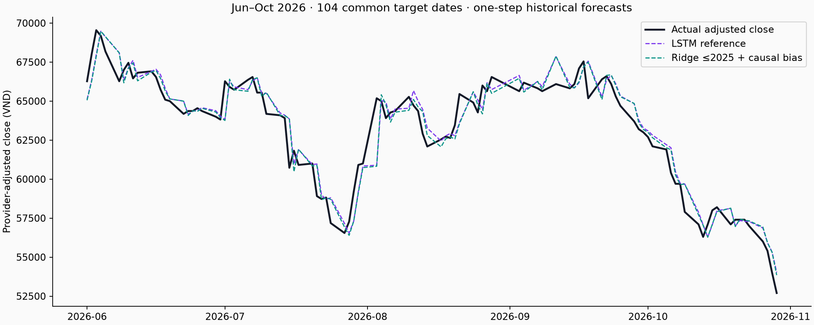
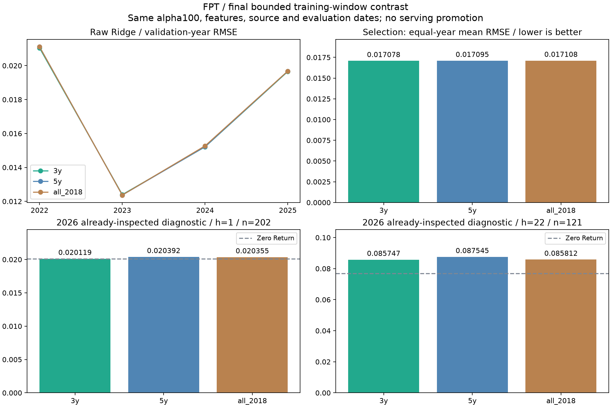

# Nhật ký training và bằng chứng chọn model FPT

**Biên tập ngày 24/11/2026 · dữ liệu nghiên cứu dừng ở 29/10/2026.** Tài liệu này tóm tắt các thử nghiệm đã có; lượt biên tập không train lại, tải data hoặc thay model. CSV, protocol, prediction và artifact trong các liên kết là bằng chứng gốc.

**Cấu hình đang giữ:** `StandardScaler → Ridge(alpha=100)`, 6 feature lợi suất, cửa sổ train 3 năm. Demo mặc định dùng `Ridge+bias60`; giữ Ridge thô và Zero Return để đối chứng. **Lý do và số liệu chốt model nằm ở mục 18.**

## Cách đọc số liệu

| Chỉ số | Ý nghĩa và cách đọc |
| --- | --- |
| RMSE log return ↓ | Sai số dự báo lợi suất logarit; phạt mạnh các sai số lớn. Không phải phần trăm accuracy. |
| MAE giá điều chỉnh ↓ | Sai lệch giá tuyệt đối trung bình, đơn vị VND. |
| Hit rate ↑ | Tỷ lệ đoán đúng hướng trên các nhãn có return khác 0; phải ghi rõ mẫu số. |
| Balanced Accuracy ↑ | Trung bình khả năng nhận diện tăng và giảm; baseline luôn đoán một hướng đạt 50% khi có đủ hai lớp. |
| Coverage P10–P90 | Tỷ lệ giá thật ở ngày đích nằm trong band. Mục tiêu danh nghĩa 80% khác với accuracy của đường điểm. |
| Interval score ↓ | Đánh giá cả độ rộng band và mức bỏ sót giá thật; band rộng hơn không tự động tốt hơn. |

Chỉ so trực tiếp các hàng **trong cùng một bảng có cùng ngày đích và nhãn**. Các study khác nguồn, giai đoạn hoặc cohort không tạo thành một đường “accuracy tăng dần”. Năm 2026 đã được xem nhiều lần: đây là nghiên cứu hồi cứu, chưa phải một holdout mới hay kiểm chứng dự báo phát trước sự kiện.

## 1. Tổng quan 8 đợt training chính

“8 đợt” là 8 nhóm câu hỏi nghiên cứu, **không phải chỉ 8 lần gọi fit**. Một đợt có nhiều model/cấu hình; số candidate, điều kiện chấm và fit mới là các đơn vị khác nhau.

| Đợt / ngày | Câu hỏi và quy mô | Thông số tiêu biểu trong đợt | Quyết định |
| --- | --- | --- | --- |
| **1 · 25/10** | Chuẩn hóa pipeline v2; 4 run CPU/Colab; LSTM lookback 10/30/60 | LSTM30: Val RMSE **0,0140327**, Test 2025 **0,0198583**. Train Mean tốt nhất Val: **0,0139814** | Giữ pipeline có nhãn/split/scaler rõ và khả năng tái lập. Chưa chọn Ridge làm bộ cuối từ đợt này. |
| **2 · 29/10** | Robustness: **63 candidate**, nhiều nhóm feature/seed/fold | Bộ returns: mean-fold RMSE Ridge **0,016403**, LSTM **0,016432**, XGBoost **0,016706**; Zero Return **0,016390** | Ưu tiên kiểm tra đầu vào gọn; các model chưa vượt baseline nhất quán. |
| **3 · 29/10** | Audit Yahoo/Vietcap/KBS; **112 điều kiện** so Yahoo/Vietcap | Yahoo: **147** dòng Volume=0, **4** thiếu Close, **1** nến lỗi. Vietcap: **2** dòng Volume=0, **0** thiếu Close/nến lỗi trong snapshot audit | Chọn Vietcap làm nguồn chính cho nghiên cứu sau và bundle demo; KBS dùng kiểm tra chéo. |
| **4 · 29–30/10** | Window **56 fit mới** + Ridge refinement **48 fit mới** | Mean-fold RMSE Ridge: control expanding **0,016354** → chọn window **0,016327**; joint refinement **0,016298** | Thu hẹp về Ridge 6 returns; `alpha=100` và cửa sổ 3 năm trở thành cấu hình dùng tiếp. |
| **5 · 30/10** | Recency/bias: **13 fit mới**, chấm cùng **202 cặp 2026** | Ridge cũ **0,0207058** → refit tới 2025 **0,0201191** RMSE (**−2,83%**). Thêm bias60: **0,0201116**, Hit **60,91%**, Balanced **56,62%** | Refit có ích so bản cũ; giữ bias60 cho demo, nhưng lợi thế RMSE so Zero Return rất nhỏ. |
| **6 · 30/10** | Phân loại tăng/giảm và selective: **20 base + 10 calibrator** | Mean-fold Balanced: Ridge_shared **53,36%**, Logistic raw **51,83%**, XGB raw **49,82%**. Hai classifier sau sigmoid đều đoán giảm 202/202 ở 2026, Balanced **50%** | Chưa đưa nhánh phân loại/chưa đủ tín hiệu vào bản phục vụ chính. |
| **7 · 30/10** | Gap/Body A/B: **20 fit B mới**, đối chiếu **20 artifact A tái dùng** | Ridge_recent mean RMSE **0,0162190 → 0,0162930**; riêng 2026 **0,0201191 → 0,0204083**, Hit **50,76% → 44,67%** | Giữ A: 6 feature lợi suất. Tách Gap/Body chưa cải thiện ổn định. |
| **8 · 01/11** | So 3 năm/5 năm/toàn bộ từ 2018: **18 điều kiện, 16 fit mới, 2 tái dùng** | 993 cặp Validation 2022–2025: mean RMSE **0,01707812 / 0,01709506 / 0,01710787** | Giữ 3 năm theo quy tắc Validation đã khóa. Chênh lệch nhỏ, CI chứa 0; không đổi bundle đang chạy. |

Đợt 3 audit snapshot giai đoạn 2018–2025, không phải kiểm tra toàn bộ dữ liệu đến tháng 10/2026. Đợt 4 gộp hai study; kết quả tinh chỉnh theo fold không có nghĩa `alpha=100` thắng mọi giai đoạn. Bảng trên ghi một vài kết quả đại diện; không cộng tất cả quy mô thành số fit độc lập.

**Bằng chứng theo đợt:** [1 · CPU/Colab](reports/training_history/runs.json) · [2 · Robustness](reports/robustness/20261029T131205702813Z/fold_summary.csv) · [3 · Audit](reports/data_audits/20261029T135735663765Z/summary.json), [so nguồn](reports/source_comparison/20261029T142732805710Z/primary_summary.csv) · [4 · Window](reports/window_comparison/20261029T150501819490Z/selected_primary_summary.csv), [Ridge refinement](reports/ridge_refinement/20261030T011109863274Z/primary_summary.csv) · [5 · Recency](reports/recency_bias/20261030T022440928507Z/primary_summary.csv) · [6 · Classifier](reports/direction_selective/20261030T090621177786Z/primary_summary.csv) · [7 · Gap/Body](reports/candle_ablation/20261030T093521684942Z/primary_summary.csv) · [8 · Window cuối](reports/final_window_comparison/20261101T014607720130Z/validation_summary.csv).

## 2. Đợt đầu: Ridge, XGBoost và LSTM so với baseline

**Phạm vi:** pipeline v2 trên Yahoo; Train 2018–2022 (**1.087 mẫu**), Validation 2023–2024 (**493**), Test 2025 (**248**), sau xử lý và lọc context chung. Chọn bằng **RMSE Validation**, không chọn bằng điểm Test.

| Model | RMSE Validation ↓ | RMSE Test 2025 ↓ |
| --- | ---: | ---: |
| Zero Return | 0,0140950 | 0,0199172 |
| Train Mean | **0,0139814** | 0,0200217 |
| Linear Regression | 0,0140515 | 0,0200796 |
| Ridge tham chiếu | 0,0140353 | 0,0200551 |
| XGBoost tham chiếu | 0,0140460 | 0,0200173 |
| LSTM30 | 0,0140327 | **0,0198583** |

**Bài học:** LSTM30 tốt nhất trong nhóm LSTM đã thử và có Test RMSE thấp nhất ở bảng này; Train Mean mới là lựa chọn theo Validation của lượt v2. Vì vậy không dùng đợt đầu để nói Ridge luôn thắng LSTM/XGBoost.

Bốn run CPU/Colab tái lập LSTM30 với Val RMSE 0,014032665 và Test RMSE 0,019858318. Đây là bằng chứng chạy lại cùng giao thức, không phải bốn lần accuracy tăng. [Manifest và metric](models/experiments/20261025T124951351761Z/manifest.json) · [learning curves](reports/experiments/20261025T124951351761Z/learning_curves.png).

## 3. Đối chứng recency và bias trên cùng 202 cặp năm 2026

**Phạm vi:** cùng 202 cặp nhãn Vietcap đến 29/10/2026; Hit/Balanced tính trên **197 nhãn khác 0**, loại 5 nhãn đứng giá. Model refit lịch sử chỉ học nhãn đến **31/12/2025**; bias dùng sai số đã có đáp án tại từng origin.

| Strategy lịch sử | RMSE return ↓ | MAE giá (VND) ↓ | Hit /197 | Balanced |
| --- | ---: | ---: | ---: | ---: |
| Ridge frozen train ≤2023 | 0,0207058 | 1.114,18 | 43,15% | 49,96% |
| Ridge refit train ≤2025 | 0,0201191 | 1.080,94 | 50,76% | 54,20% |
| Ridge refit ≤2025 + bias60 | **0,0201116** | 1.064,12 | **60,91%** | **56,62%** |
| Ridge monthly refit | 0,0201124 | 1.074,00 | 52,79% | 54,52% |
| Ridge monthly refit + bias60 | 0,0201704 | **1.063,57** | 57,87% | 54,25% |
| Zero Return | 0,0201157 | 1.081,70 | N/A | N/A |

**Đọc kết quả:** refit tới 2025 giảm RMSE khoảng **2,83% so Ridge frozen 2023**. Bản refit cố định + bias60 có RMSE thấp nhất trong bảng, nhưng chỉ thấp hơn Zero Return khoảng **0,020%**; MSE skill khoảng **+0,041%**, CI mô tả chứa 0. Monthly+bias có MAE thấp hơn một chút nhưng RMSE và Balanced kém hơn bản refit cố định+bias: không phải mọi tiêu chí đều cùng tốt lên.

Tập có 117 phiên giảm và 80 phiên tăng. **Luôn đoán giảm đạt Hit 117/197 = 59,39%, Balanced 50%**. Zero Return không phát hướng nên Hit/Balanced là N/A, không gán 50%.

[Bảng gốc](reports/recency_bias/20261030T022440928507Z/primary_summary.csv) · [protocol](reports/recency_bias/20261030T022440928507Z/protocol.json). Các điểm trên thuộc model lịch sử, không phải kết quả tương lai của bundle train đến 29/10/2026.

## 4. So các model trên cùng 104 ngày tháng 6–10/2026

**Phạm vi:** 104 cặp ngày đích 01/06–29/10/2026; Hit/Balanced trên **99 nhãn khác 0**. Mỗi điểm là dự báo **một bước**, neo từ giá origin thực tế; không phải chạy đệ quy một lần từ tháng 6 đến tháng 10.

| Model lịch sử | RMSE return ↓ | MAE giá (VND) ↓ | Hit /99 | Balanced |
| --- | ---: | ---: | ---: | ---: |
| Ridge tham chiếu | 0,0170783 | 787,96 | 45,45% | 49,17% |
| XGBoost tham chiếu | 0,0172463 | 810,83 | 38,38% | 41,99% |
| LSTM tham chiếu | 0,0168315 | 786,38 | 47,47% | 50,83% |
| Ridge refit ≤2025 | 0,0168589 | 781,62 | 50,51% | 55,13% |
| Ridge refit ≤2025 + bias60 | 0,0167760 | **767,28** | **62,63%** | **57,95%** |
| Zero Return | **0,0167746** | 773,51 | N/A | N/A |

**Kết luận có thể nói:** Ridge cập nhật+bias có MAE giá và khả năng phân biệt hướng tốt hơn các model tham chiếu trong đoạn này; RMSE vẫn sát và hơi kém Zero Return. **Không nói Ridge luôn tốt nhất về mọi chỉ số.**

Nhóm tham chiếu dùng model/context Yahoo; Ridge refit dùng Vietcap và cutoff train mới hơn. Cùng ngày chấm và nhãn giúp so các phương án thực tế, nhưng không tách riêng tác động thuật toán khỏi tác động nguồn/feature/cutoff. [Metric gốc](reports/period_comparison/20261030T024048531444Z/summary.csv) · [prediction từng ngày](reports/period_comparison/20261030T024048531444Z/predictions.csv.gz).

## 5. Vì sao không chọn các nhánh thử thêm?

| Nhánh | Đối chứng và kết quả chính | Quyết định |
| --- | --- | --- |
| Phân loại tăng/giảm + selective | Mean-fold Balanced 2022–2024: Ridge_shared **53,36%**, Logistic raw **51,83%**, XGBoost raw **49,82%**. Sau sigmoid, hai classifier đoán giảm 202/202 ở 2026: Hit **59,39%**, Balanced **50%** | Chưa đủ bằng chứng thay nhánh hồi quy; không sửa ngưỡng theo điểm 2026 đã xem. |
| Tách Gap/Body | A dùng 6 returns; B thay log return bằng Gap + Body (7 feature). Ridge_recent mean-fold RMSE **0,0162190 → 0,0162930**; năm 2026 **0,0201191 → 0,0204083** | Giữ A. B hữu ích ở vài năm nhưng chưa ổn định. |

Gap = `log(Open_t / Close_prev)`; Body = `log(Close_t / Open_t)`. Hai giá trị chỉ có đủ sau đóng cửa phiên origin; không dùng Open tương lai. Thử nghiệm không thêm đồng thời ba cột phụ thuộc tuyến tính Log_Return/Gap/Body.

[Classifier: metric và quyết định](reports/direction_selective/20261030T090621177786Z/metrics.csv) · [Gap/Body: metric](reports/candle_ablation/20261030T093521684942Z/metrics.csv), [biểu đồ A/B](docs/assets/training/02_gap_body.png). Kết quả chưa cải thiện cũng được giữ làm bằng chứng, không coi đây là chứng minh phân loại hoặc Gap/Body luôn không phù hợp.

## 6. Bộ đang phục vụ khác bộ dùng để chấm lịch sử

`models/local_demo.json` trỏ bundle **`ridge6_20261029`**: `StandardScaler → Ridge(alpha=100)`, 6 feature, cửa sổ 3 năm, nhãn train cuối **29/10/2026**. Bias và residual được đóng băng khi tạo bundle; mở API/UI không tự fit hoặc cập nhật calibration.

Backtest 2026 dùng **model lịch sử train trước các ngày đích**, không dùng bundle tháng 10 chấm ngược tháng 1–10. Chưa có bằng chứng forward độc lập đủ để gán các điểm ở mục 3–4 cho bundle đang phục vụ.

[Manifest local và SHA256](models/local_demo/ridge6_20261029/manifest.json) · [bundle nguồn](reports/recency_bias/20261030T022440928507Z/shadow_bundle.json) · [quy tắc forward ledger](ARCHITECTURE.md#forward-ledger).

## 7. Quy tắc ghi lượt training và chọn model

Mỗi study phải ghi câu hỏi, biến thay đổi, nguồn/snapshot, train/validation/evaluation cutoff, baseline, ngày origin/target, prediction, metric và quyết định. Tách **fit mới / tái dùng / chỉ suy luận**, giữ cả kết quả không cải thiện và lỗi chạy.

Scaler chỉ fit Train; mẫu có nhãn vượt cutoff bị loại khỏi Train. Chọn cấu hình bằng Validation, rồi chấm giai đoạn sau. Khi đã xem một tập nhiều lần để phát triển tiếp, không tiếp tục gọi nó là Test độc lập. [Lịch sử mở dữ liệu đánh giá](reports/holdout_exposures.json).

Unit test và replay CPU/Colab/HTTP xác nhận phần mềm, artifact và tính tái lập; số test đạt không phải số phép thử chứng minh accuracy tăng.

## 8. Mở rộng inference và Studio — 30/10/2026

**0 fit mới.** API lặp model h=1 để mô phỏng nhiều bước, tối đa 23 bước từ snapshot, kèm 512 đường residual bootstrap. Các nút ngày/tuần/tháng là khung lịch dự kiến, chưa trừ lịch nghỉ HOSE. Mở rộng giao diện không tạo thêm điểm Test. [Kiểm chứng Studio](reports/verification/forecast_studio_20261030/checks.json).

## 9. Gom tài liệu và dọn kiến trúc — 31/10/2026

**0 fit mới.** Giữ README, TRAINING_HISTORY và ARCHITECTURE ở gốc; ghi chú nghiên cứu cũ nằm trong [registry có hash](reports/training_history/research_notes.json). Model, dữ liệu và kết quả cũ được giữ để tái lập. [Kiểm chứng local](reports/verification/local_ridge_demo/checks.json).

## 10. Rút gọn dashboard và notebook — 31/10/2026

**0 fit mới.** Dashboard giữ Tổng quan, Dự báo, Đối chứng và Hành trình model; bỏ các màn trùng nội dung tài liệu. Notebook trùng được gộp, CSV/JSON/protocol/source snapshot và weights nghiên cứu vẫn được giữ. Đây là thay đổi trình bày, không tăng độ chính xác.

## 11. Sửa quy tắc cộng bias nhiều bước — 01/11/2026

**0 fit mới.** `recursive-ridge6-v1` cộng bias60 ở mọi bước. Bản `v2` chỉ cộng ở bước 1, từ bước 2 dùng Ridge thô trên context đã dự báo. Một replay cùng snapshot ghi nhận: h=1 giữ **−0,43%**; tuần **−2,19% → −0,46%**; tháng **−8,69% → −1,97%**.

Đây là thay cách sử dụng cùng model, **không phải so accuracy bằng giá thật**. Lựa chọn “Mỗi bước · cách cũ” được đưa lại vào UI ở mục 16; không xem v2 là chế độ duy nhất hiện có. [Replay trước/sau](reports/recursive_bootstrap/20261101T011353369474Z/serving_before_after.json).

## 12. Căn tâm residual bootstrap — 01/11/2026

**0 fit mới.** `v3` giữ nguyên đường điểm của v2; lấy 60 residual đã có nhãn, trừ trung bình **cả pool**, rồi circular block-bootstrap (block 5, 512 paths). Không ép tổng nhiễu từng đường hoặc từng block về 0.

Cùng **122 origin**, model lịch sử train ≤2025, bias chỉ bước đầu:

| Ridge+bias60 | Coverage v2 → v3 | Interval score v2 → v3 ↓ |
| --- | ---: | ---: |
| h=5 | 74,59% → **82,79%** | 0,15995 → **0,14570** |
| h=21 | 63,11% → **77,05%** | 0,43387 → **0,31582** |

Đường điểm, RMSE và Hit không đổi. Tập này khác cohort 121 origin của mục 13; không so chéo để nói chất lượng tăng. Origin/target chồng lấp; mẫu không chồng lấp chỉ còn 25 ở h5 và 6 ở h21.

[Metric và baseline đầy đủ](reports/recursive_bootstrap/20261101T011353369474Z/metrics.csv) · [CI mô tả](reports/recursive_bootstrap/20261101T011353369474Z/paired_comparison.csv) · [kiểm chứng](reports/recursive_bootstrap/20261101T011353369474Z/verification.json).

## 13. Backtest đúng hàm forecast h=5/h=22 và calibration — 01/11/2026

**0 fit mới.** Chạy chính `forecast()` với raw/features cắt đến từng origin, model lịch sử train nhãn ≤31/12/2025. Cùng **121 origin 06/04–29/09/2026**, có đủ nhãn 22 quan sát tiếp theo; chỉ dùng sai số đã trưởng thành.

| Horizon | Model lịch sử | RMSE return tích lũy ↓ | Coverage band |
| --- | --- | ---: | ---: |
| 5 phiên | Ridge+bias60 | 0,040563 | 83,47% |
| 5 phiên | Zero Return | **0,039999** | N/A |
| 22 phiên | Ridge+bias60 | 0,085079 | 77,69% |
| 22 phiên | Zero Return | **0,076851** | N/A |

**Kết luận:** đường điểm nhiều bước chưa vượt baseline. Chọn hệ số band bằng target ≤30/06 rồi chấm 62 origin từ 01/07: coverage Ridge+bias còn **74,19% ở h5**, **67,74% ở h22**. Rolling calibration kéo h5 lên **79,03%**, nhưng interval score xấu đi **0,17170 → 0,17880**; h22 chưa có forecast đã chấm thực sự dùng band nới.

Do đó hệ số phục vụ giữ **1×**. Candidate h22 khoảng **1,47194×** chỉ tính được sau khi nhãn cuối kỳ xuất hiện, không dùng nó để chấm ngược rồi gọi là ngoài mẫu. Những backtest này dùng **bias chỉ bước đầu**, không xác nhận chế độ every_step hoặc bundle tháng 10.

[Protocol và metric](reports/horizon_calibration/20261101T012415194582Z/metrics.csv) · [rolling calibration](reports/horizon_calibration/20261101T012415194582Z/adaptive/metrics.csv) · [policy sau review](reports/horizon_calibration/20261101T012415194582Z/adaptive/reviewed_policy.json) · [policy API](configs/recursive_band_calibration.json).

## 14. Đợt cuối: train 3 năm, 5 năm hay toàn bộ từ 2018? — 01/11/2026

Giữ nguồn Vietcap, 6 feature, `StandardScaler → Ridge(alpha=100)` và h=1; **chỉ thay cửa sổ train**. Validation walk-forward 2022–2025: train tới cuối năm trước, chấm cùng các ngày của năm sau. Số mẫu từng năm **248 / 248 / 249 / 248**, tổng **993**.

Quy tắc chọn ghi trước fit: **RMSE h1 raw Ridge trung bình của bốn năm, mỗi năm trọng số bằng nhau**. Không dùng điểm 2026, bias hoặc h5/h22 để chọn lại cửa sổ.

| Năm Validation | 3 năm | 5 năm | Toàn bộ từ 2018 |
| --- | ---: | ---: | ---: |
| 2022 | **0,021045** | 0,021112 | 0,021112 |
| 2023 | 0,012397 | **0,012371** | **0,012371** |
| 2024 | **0,015216** | 0,015220 | 0,015269 |
| 2025 | **0,019655** | 0,019678 | 0,019680 |
| **Mean RMSE** | **0,01707812** | 0,01709506 | 0,01710787 |
| Worst-fold RMSE | **0,02104458** | 0,02111200 | 0,02111200 |

**Chọn 3 năm:** thấp nhất 3/4 năm, mean RMSE giảm **0,099% so 5 năm**, **0,174% so toàn bộ**. Khoảng tin cậy 95% mô tả của chênh MSE đều chứa 0: 5y−3y **[−8,524e−7; +2,476e−6]**, all−3y **[−8,527e−7; +3,205e−6]**. Đây là lợi thế nhỏ theo quy tắc đã chọn, chưa chứng minh hơn chắc chắn.

Ở chẩn đoán nhiều bước 2026, all2018+bias có RMSE thấp hơn 3y+bias tại h5 (**0,040181 so 0,040563**) và h22 (**0,084892 so 0,085079**), nhưng vẫn kém Zero Return. **Không kết luận nhiều data luôn có hại** hoặc chọn thêm model bằng chính đoạn 2026 đã xem.

Có **16 fit mới / 18 điều kiện** vì hai điều kiện 5y và all2018 ở các cutoff đầu dùng đúng cùng dữ liệu nên tái dùng weights. Ba candidate train tới 29/10/2026 có lần lượt **746 / 1.244 / 2.150 mẫu**; chỉ lưu cho dự báo sau cutoff, không chấm lại quá khứ. Candidate 3y khớp SHA256 của weights đang phục vụ, nên giữ nguyên bundle.

[Protocol](reports/final_window_comparison/20261101T014607720130Z/protocol.json) · [validation summary](reports/final_window_comparison/20261101T014607720130Z/validation_summary.csv) · [CI](reports/final_window_comparison/20261101T014607720130Z/paired_validation_ci.csv) · [metric các horizon](reports/final_window_comparison/20261101T014607720130Z/metrics.csv) · [manifest/weights](reports/final_window_comparison/20261101T014607720130Z/manifest.json) · [decision](reports/final_window_comparison/20261101T014607720130Z/decision.json).

## 15. Chọn ngày và các biểu đồ phân tích — 01/11/2026

**0 fit mới.** UI bổ sung ngày đích, nến/đường giá, phân tích snapshot, biểu đồ return từng bước, thay đổi tích lũy, độ rộng band và sơ đồ giải thích. Các chỉ báo quan sát không tự trở thành đầu vào Ridge. Giới hạn ngày phụ thuộc snapshot và tối đa 23 bước; chưa xác minh lịch nghỉ HOSE. [Biên bản kiểm chứng](reports/verification/dashboard_custom_date_20261101.json).

## 16. Đối chiếu hai cách sử dụng bias60 — 21/11/2026

**0 fit mới.** Cùng weights và calibration `ridge6_20261029`; cả hai dùng residual bootstrap đã căn tâm. Dashboard mặc định **Mỗi bước · cách cũ** (`every_step`); API khi thiếu `bias_mode` mặc định **Chỉ bước đầu** (`first_step`).

Cùng snapshot 29/10/2026, giá gốc **52.700 VND**:

| Ngày đích dự kiến | Số bước | Mỗi bước · cách cũ | Chỉ bước đầu |
| --- | ---: | ---: | ---: |
| 30/10/2026 | 1 | 52.471 VND (−0,43%) | 52.471 VND (−0,43%) |
| 23/11/2026 | 17 | 48.970 VND (−7,08%) | 51.786 VND (−1,73%) |
| 27/11/2026 | 21 | 48.120 VND (−8,69%) | 51.666 VND (−1,96%) |

Đây là **đối chiếu hai kịch bản suy luận, chưa chấm bằng giá thật**. Backtest h5/h22 ở trên dùng first_step; every_step giữ band 1× và chưa được kiểm chứng riêng ở các horizon đó. Không lấy độ dốc rõ hơn để kết luận model chính xác hơn.

## 17. Quan sát XGBoost và LSTM trên dashboard local — 23/11/2026

**0 fit mới.** Thử nạp artifact tham chiếu Yahoo đã lưu (train tới 2022, chọn trên 2023–2024) và suy luận từ cùng đầu vào Vietcap 29/10/2026, giá origin 52.700 VND. Kết quả một phiên: Ridge+bias đang dùng **52.471,30**, Ridge tham chiếu **52.855,80**, XGBoost **52.744,09**, LSTM **52.763,54 VND**.

Khác nguồn/cutoff/feature giữa bundle và tham chiếu; đây là quan sát phản ứng, không phải điểm accuracy. Replay trên 248 cặp Yahoo 2025 khớp dự báo cũ dưới **1e−15 log return**: tái lập, không train hay cải thiện model.

Sau khi tham khảo, đã gỡ phần thử khỏi UI/API theo yêu cầu. Artifact nghiên cứu và bảng so sánh lịch sử vẫn giữ. [Bộ tham chiếu](models/experiments/20261025T124951351761Z/manifest.json) · [metric v2 đã tái lập](reports/training_history/metrics_over_runs.csv).

## 18. Chốt model: chọn gì, dựa vào đâu, vì sao và như thế nào?

### Cấu hình cuối và phạm vi sử dụng

| Thành phần | Cấu hình đã giữ |
| --- | --- |
| Bài toán / horizon train | Hồi quy có giám sát; dự báo log return **phiên hợp lệ kế tiếp, h=1** |
| Nguồn / snapshot | Vietcap FPT; dữ liệu và nhãn train đến **29/10/2026** |
| Đầu vào | **6 feature:** `Log_Return`, `Return_Lag_1`, `Return_Lag_2`, `Return_Lag_5`, `Return_5`, `Return_20` |
| Pipeline / tham số | **StandardScaler → Ridge(alpha=100)** |
| Cửa sổ train | **3 năm**; candidate cùng cutoff có **746 mẫu có nhãn** |
| Hiệu chỉnh demo | **Ridge+bias60** từ sai số đã có nhãn; calibration đóng băng trong bundle |
| Đối chứng giữ lại | Ridge không bias; Zero Return; XGBoost/LSTM và 5y/all2018 giữ để nghiên cứu |
| Phục vụ | Bundle `models/local_demo/ridge6_20261029/`; API/UI suy luận, không train trong request |
| Nhiều bước | Lặp model h=1; công bố riêng bias_mode, band và giới hạn; không phải model direct tuần/tháng |

### Bảng 1. Đối chứng các model để giải thích lựa chọn Ridge

**Cùng 104 cặp dự báo một phiên, ngày đích 01/06–29/10/2026**, dùng cùng nhãn Vietcap. RMSE và MAE tính trên cả 104 cặp; Hit/Balanced trên **99 nhãn có biến động**, bỏ 5 nhãn đứng giá. Đây là đối chứng hồi cứu hỗ trợ lựa chọn demo; bảng Validation ở dưới mới là căn cứ chốt cửa sổ train.

| Model lịch sử | RMSE return ↓ | MAE giá — VND ↓ | Hit rate /99 ↑ | Balanced Accuracy ↑ |
| --- | ---: | ---: | ---: | ---: |
| **Ridge refit ≤2025 + bias60** | 0,0167760 | **767,28** | **62,63%** | **57,95%** |
| LSTM tham chiếu | 0,0168315 | 786,38 | 47,47% | 50,83% |
| XGBoost tham chiếu | 0,0172463 | 810,83 | 38,38% | 41,99% |
| Zero Return | **0,0167746** | 773,51 | N/A | N/A |

**Các model trong bảng là gì?**

- **Ridge Regression:** hồi quy tuyến tính có phạt L2 để hạn chế hệ số quá lớn. Trong bản cuối, Ridge nhận vector **6 feature lợi suất**, dự báo log return phiên kế tiếp rồi quy đổi thành giá. Dùng **scikit-learn**, pipeline `StandardScaler → Ridge(alpha=100)`.
- **Ridge refit + bias60:** vẫn là Ridge; `refit` là fit lại bằng dữ liệu đến cutoff mới hơn. `bias60` bổ sung mức hiệu chỉnh từ tối đa 60 sai số dự báo gần nhất đã có nhãn. Ở bảng này, weights lịch sử học đến cuối 2025; bias chỉ dùng thông tin đã biết tại từng origin. Bundle demo tháng 10 đóng băng cả weights và calibration.
- **XGBoost:** tập hợp các cây quyết định được xây nối tiếp, cây mới giúp giảm sai số của cả hệ. Có thể học quan hệ phi tuyến trên các feature; dùng thư viện **XGBoost**. Đây là bản hồi quy tham chiếu, khác nhánh XGBoost phân loại tăng/giảm đã thử ở đợt 6.
- **LSTM:** mạng nơron hồi quy có cơ chế bộ nhớ, học từ một chuỗi quan sát. Bản tham chiếu dùng **30 quan sát × 16 feature**, triển khai bằng **TensorFlow/Keras**. Ridge hiện tại nhận vector 6 feature, không nhận chuỗi LSTM này.
- **Zero Return:** baseline đặt return dự báo bằng 0, tức giá dự báo phiên sau bằng giá origin. Không có weights cần học và không phát tín hiệu tăng/giảm; vì vậy Hit/Balanced để N/A.

**Các thông số đánh giá bên trên nói gì?**

- **RMSE return ↓:** căn bậc hai của trung bình bình phương sai số log return; sai số lớn bị phạt mạnh hơn. Số nhỏ hơn tốt hơn. `0,0167760` không có nghĩa accuracy bằng `98,32%`.
- **MAE giá ↓:** trung bình độ lệch tuyệt đối giữa giá dự báo và giá thật cùng basis điều chỉnh. `767,28 VND` nghĩa là sai lệch tuyệt đối trung bình khoảng 767 đồng trong 104 cặp này, không phải mức sai số tối đa.
- **Hit rate ↑:** số lần đoán đúng dấu tăng/giảm chia số nhãn có biến động. Ridge đạt **62/99 ≈ 62,63%**; đây là thống kê của đoạn đã chấm, không phải xác suất chắc chắn đúng của một dự báo mới.
- **Balanced Accuracy ↑:** trung bình tỷ lệ nhận diện đúng lớp tăng và lớp giảm, giúp đọc kết quả khi số phiên tăng/giảm không bằng nhau. Luôn đoán một hướng đạt Balanced 50% khi tập có đủ hai lớp.
- **Ký hiệu ↓ / ↑:** lần lượt là thấp hơn / cao hơn tốt hơn trong phép đối chứng này. Cần xem đồng thời sai số, hướng và baseline; không chọn chỉ bằng một cột cao nhất.

**Vì sao giữ Ridge?** Trong bảng này, bản Ridge cập nhật+bias có MAE giá thấp nhất và Balanced cao nhất; RMSE gần baseline và thấp hơn LSTM/XGBoost tham chiếu. Kết hợp các study robustness, feature và refinement, nhóm giữ cấu hình tuyến tính 6 feature vì gọn, dễ kiểm tra và tích hợp API. Ridge không thắng mọi phép thử: ở pipeline v2 ban đầu, Train Mean tốt nhất Validation và LSTM tốt nhất Test RMSE (mục 2); ngay bảng này Zero Return vẫn có RMSE thấp nhất.

**Giới hạn so sánh:** nhóm tham chiếu dùng nguồn/context Yahoo và cutoff cũ hơn, còn Ridge refit dùng Vietcap và nhãn train tới 2025. Cùng ngày đích và nhãn giúp so các phương án đã xây dựng, nhưng không chứng minh riêng thuật toán Ridge tốt hơn khi giữ mọi yếu tố khác giống nhau. Không dùng điểm này làm điểm tương lai của bundle `ridge6_20261029`.

[Nguồn bảng 1 — summary và từng chỉ số](reports/period_comparison/20261030T024048531444Z/summary.csv) · [dự báo từng ngày](reports/period_comparison/20261030T024048531444Z/predictions.csv.gz) · [manifest nhóm tham chiếu](models/experiments/20261025T124951351761Z/manifest.json).

### Bảng 2. Validation chọn cửa sổ train 3 năm, 5 năm hay toàn bộ lịch sử

Giữ cùng nguồn Vietcap, 6 feature, `StandardScaler → Ridge(alpha=100)` và h=1; chỉ thay cửa sổ train. Walk-forward **2022–2025**: mỗi năm train tới cuối năm trước rồi chấm cùng ngày/nhãn của năm sau. Số cặp từng năm **248 / 248 / 249 / 248**, tổng **993**. Quy tắc chọn được ghi trước fit: **RMSE raw Ridge trung bình theo năm thấp nhất**, mỗi năm trọng số bằng nhau; không dùng điểm 2026 để chọn lại window.

| Năm Validation | 3 năm | 5 năm | Toàn bộ từ 2018 |
| --- | ---: | ---: | ---: |
| 2022 | **0,021045** | 0,021112 | 0,021112 |
| 2023 | 0,012397 | **0,012371** | **0,012371** |
| 2024 | **0,015216** | 0,015220 | 0,015269 |
| 2025 | **0,019655** | 0,019678 | 0,019680 |
| **Mean RMSE ↓** | **0,01707812** | 0,01709506 | 0,01710787 |
| **Worst-fold RMSE ↓** | **0,02104458** | 0,02111200 | 0,02111200 |

**Các cấu hình và thông số trong bảng là gì?**

- **Cửa sổ 3 năm / 5 năm:** tại mỗi cutoff, lấy các mẫu có nhãn trong 3 hoặc 5 năm gần nhất để fit. Đây là độ dài lịch sử huấn luyện, không phải số phiên đầu vào của một mẫu hoặc số năm dự báo.
- **Toàn bộ từ 2018:** dùng tất cả mẫu hợp lệ có sẵn từ lịch sử 2018 đến cutoff của từng fold; không lấy dữ liệu sau cutoff.
- **Fold / năm Validation:** một lượt học trên quá khứ rồi chấm năm kế tiếp. Ví dụ, khi chấm 2025 chỉ fit bằng nhãn có sẵn tới cuối 2024.
- **RMSE ở từng năm:** sai số log return trên đúng các ngày Validation của năm đó, đơn vị và cách đọc giống bảng 1. Scaler được fit lại chỉ trên Train của từng cấu hình/fold.
- **Mean RMSE ↓:** trung bình cộng RMSE của bốn năm; mỗi năm một trọng số bằng nhau, không phải gộp 993 sai số rồi tính một RMSE chung. **Đây là chỉ số chọn window trong protocol.**
- **Worst-fold RMSE ↓:** RMSE lớn nhất trong bốn năm, dùng xem kết quả ở năm khó nhất. Thấp hơn là tốt hơn ở những fold đã chấm; không bảo đảm ổn định trong tương lai.
- **CI 95%:** khoảng tin cậy mô tả từ block-bootstrap của chênh lệch MSE giữa các window. CI chứa 0 nghĩa là kết quả chưa đủ phân biệt chắc chắn lợi thế; không diễn giải thành xác suất 95% model thắng trong tương lai.

**Vì sao chọn cửa sổ 3 năm?**

1. **Đúng tiêu chí đã khóa:** Mean RMSE **0,01707812** thấp nhất, giảm khoảng **0,099% so 5 năm** và **0,174% so toàn bộ từ 2018**.
2. **Có hỗ trợ từ các năm riêng:** 3 năm thấp nhất **3/4 năm** và có Worst-fold RMSE thấp nhất. Năm 2023 cửa sổ dài hơn tốt hơn, nên không nói 3 năm luôn thắng.
3. **Giữ cấu hình đã kiểm chứng:** candidate 3 năm train tới 29/10/2026 có 746 mẫu và khớp SHA256 weights đang phục vụ. Vì vậy nhóm giữ bundle hiện tại, không thay model chỉ để đổi phiên bản.
4. **Lợi thế còn nhỏ:** cả hai CI chênh MSE trong mục 14 đều chứa 0. Chọn 3 năm để thống nhất bản demo theo protocol; chưa chứng minh dữ liệu cũ luôn có hại. All2018 tốt hơn 3y ở một số phép chấm nhiều bước nhưng vẫn chưa vượt Zero Return.

`alpha=100` là độ mạnh phạt L2 của Ridge, không phải số epoch hoặc độ chính xác 100%. Lượt refinement trước đó đã thử lưới alpha/window và đưa alpha100/3y thành cấu hình fold mới nhất; lượt so window cuối giữ alpha100 cố định để so lịch sử train. Cấu hình này không được tuyên bố tối ưu cho mọi giai đoạn.

[Nguồn bảng 2 — mean/worst RMSE](reports/final_window_comparison/20261101T014607720130Z/validation_summary.csv) · [metric từng năm](reports/final_window_comparison/20261101T014607720130Z/metrics.csv) · [quy tắc chọn trước fit](reports/final_window_comparison/20261101T014607720130Z/protocol.json) · [CI](reports/final_window_comparison/20261101T014607720130Z/paired_validation_ci.csv) · [quyết định](reports/final_window_comparison/20261101T014607720130Z/decision.json).

**Lời trình bày ngắn:** “Nhóm dùng bảng đối chứng để xem cả sai số giá, khả năng đoán hướng và baseline. Ridge cập nhật kèm bias có kết quả cạnh tranh trong các phương án đã thử, nên nhóm chọn cấu hình gọn để phục vụ demo. Riêng cửa sổ train, nhóm so 3 năm, 5 năm và toàn bộ lịch sử trên cùng các năm Validation 2022–2025. Cửa sổ 3 năm có Mean RMSE thấp nhất, thắng 3/4 năm và khớp bộ weights đang dùng nên nhóm giữ nguyên. Chênh lệch còn nhỏ, vì vậy nhóm tiếp tục cần dự báo và nhãn mới để kiểm tra chất lượng tương lai.”

### Cách nhóm đi từ thực nghiệm đến bộ phục vụ

1. **Chuẩn bị dữ liệu và nhãn:** kiểm tra OHLCV, loại/cách ly quan sát không hợp lệ; feature chỉ dùng thông tin đến origin, nhãn là `log(Close_next / Close_t)`.
2. **Khóa giao thức theo thời gian:** Train học tham số, Validation chọn cấu hình; scaler fit trên Train, không để nhãn vượt cutoff. Các nghiên cứu sau dùng walk-forward; lịch sử đã xem không còn là holdout mới.
3. **So bằng nhiều chỉ số và baseline:** đối chiếu cùng ngày/nhãn; xem RMSE, MAE, Hit, Balanced và CI, giữ cả trường hợp baseline thắng. Chọn alpha/feature qua các study; chọn cửa sổ cuối bằng raw Ridge Validation 2022–2025.
4. **Chốt cấu hình và giữ bundle:** đối chứng mới nhất ủng hộ giữ 3y; candidate 3y tới 29/10 khớp weights hiện có nên không thay file chỉ để đổi timestamp. Điểm backtest của model train ≤2025 được tách khỏi bundle hiện tại.
5. **Đánh giá tiếp bằng dữ liệu mới:** ghi forecast trước khi biết target, chờ nhãn rồi chấm; chỉ thay model nếu cải thiện phù hợp trên cùng giao thức. Thử nghiệm/đóng gói API không tự tạo bằng chứng forward.

**Kết luận dùng khi báo cáo:** Nhóm giữ Ridge6 alpha100, cửa sổ 3 năm và bias60 cho bản demo vì cấu hình gọn, có chuỗi đối chứng giải thích được và cải thiện so Ridge cũ ở giai đoạn đã chấm. Nhóm không chọn vì một con số Hit cao: baseline luôn giảm đã đạt 59,39% Hit và sai số Ridge vẫn gần Zero Return. Chưa chứng minh ưu thế dự báo tương lai ổn định; tuần/tháng còn là mô phỏng, cần đọc riêng chế độ bias và kết quả kiểm định. Các model nghiên cứu được giữ để tái lập, không tự đưa vào phục vụ.
