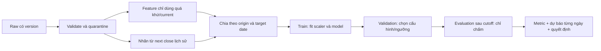
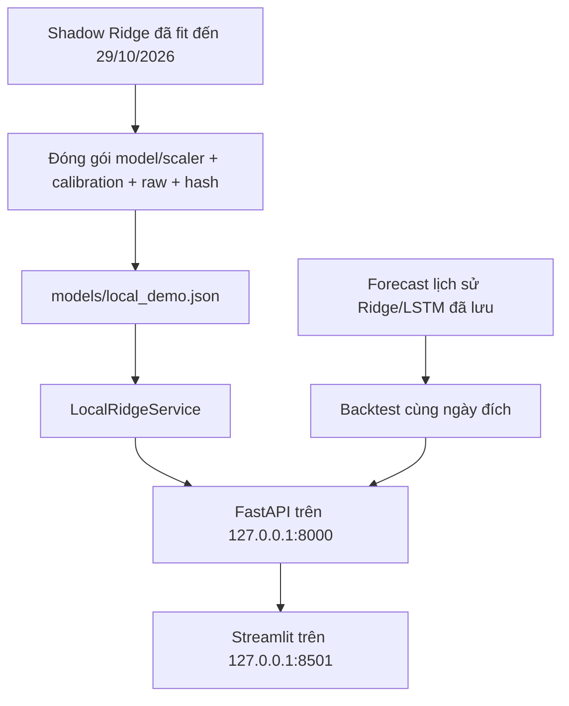
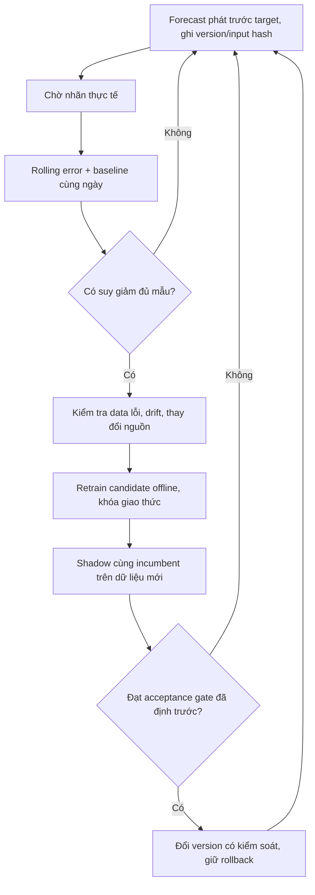

# Kiến trúc và các khái niệm ML của dự án FPT

Cập nhật 30/10/2026. Phạm vi đã làm: nghiên cứu offline, API và dashboard local. Deploy public, tự cập nhật data/retrain và auto-promotion vẫn là kế hoạch.

## 1. Học có giám sát và hồi quy

Mỗi mẫu gồm đầu vào `X_t` đã biết sau đóng cửa origin `t` và nhãn:

```text
y_t = log(Close_next(t) / Close_t)
f(X_t) ≈ y_t
predicted_close_next = Close_t × exp(f(X_t))
```

Nhãn được tính tự động từ giá tương lai trong **tập lịch sử**, vẫn là **học có giám sát (supervised learning)**. Không cần con người gán nhãn bằng tay. Khi inference, model chỉ nhận X; không được đọc giá target chưa xuất hiện.

Đầu ra y là số thực nên bài toán chính là **hồi quy (regression)**. Cần phân biệt return với giá: sai số return và sai số giá là hai đại lượng; giá gần hôm nay không đồng nghĩa đoán đúng hướng.

| Thành phần | Cấu hình thực tế |
| --- | --- |
| Ridge chính | Vector 6 feature tại t; không có tensor 60 phiên |
| 6 feature | Log_Return, Return_Lag_1/2/5, Return_5/20 |
| Scaler | StandardScaler, fit chỉ trên Train của từng model/fold |
| Hàm mục tiêu Ridge | Squared error + phạt L2, alpha100 trong nhánh đã chốt |
| Training window Ridge | 3 năm; không đồng nghĩa lookback 3 năm ở mỗi mẫu |
| LSTM v2 đối chứng | 30 quan sát feature ×16 feature; 32 units, dropout0,2, Dense8 |
| Hàm loss LSTM v2 | Huber; RMSE validation dùng để chọn lookback |
| LSTM legacy | Từng dùng lookback60, 64→32 units; chỉ giữ làm lịch sử |

`Training window` là khoảng ngày có nhãn dùng fit weights. `Lookback` là số hàng feature ghép cho một mẫu LSTM. `Warm-up` là lịch sử cần để tính indicator (builder canonical hiện có SMA50 nên loại 49 hàng đầu). Ba khái niệm không thay thế nhau. Ridge6 vẫn tái dùng builder16 hiện tại để giữ đúng ngày/feature đã kiểm chứng; chưa tối ưu warm-up xuống chỉ vì bỏ technical features.

## 2. Phân loại và học không giám sát

Nếu đổi nhãn thành dấu của return, đây là **phân loại có giám sát**. Hai classifier Logistic/XGBoost đã được thử, kèm calibration và margin để trả `tang`, `giam`, `chua_du_tin_hieu`. Nhánh này chưa cải thiện ổn định nên chưa được bật trong API chính. Dấu của dự báo Ridge không phải xác suất tăng/giảm đã được calibration.

Clustering/PCA/HMM là các cách có thể mô hình hóa cấu trúc hoặc trạng thái ẩn mà không dùng nhãn return như hồi quy. Chúng không tự cho ra dự báo return chỉ vì đã fit; cần thêm giả định/mô hình liên hệ trạng thái với return. Có thể thử regime biến động cao/thấp hoặc xu hướng/đi ngang làm feature phụ, nhưng **chưa triển khai**. Fit cluster/PCA/HMM trên Train; áp dụng tham số đã khóa cho Val/Test. Với HMM, không dùng smoothing dựa vào quan sát tương lai để tạo feature tại t.

## 3. Dữ liệu và chỉ một mã FPT

Yahoo/yfinance là nguồn của pipeline v2 cũ (`FPT.VN`, `auto_adjust=True`). Sau audit, nghiên cứu mới dùng snapshot Vietcap FPT; KBS kiểm tra chéo. Demo local đọc snapshot Vietcap đóng gói, không gọi nhà cung cấp trong từng request.

Khoảng vài nghìn quan sát ngày không có nghĩa vài nghìn mẫu độc lập. Rolling returns và chuỗi LSTM chồng lấp, số mẫu hữu hiệu thấp hơn. Mạng lớn dễ overfit; không mặc định tăng layer/epoch sẽ tốt hơn Ridge. V2 Yahoo cụ thể có 1.087 Train,493 Val,248 Test; số đó **không áp dụng** cho mọi fold Vietcap hoặc tập2026. Xem `phase_counts.csv`/manifest mỗi study để lấy số chính xác.

Chỉ FPT được dùng làm feature. Không có gộp mã, embedding ID, ablation đa mã hoặc IC xếp hạng chéo mã. Nếu bổ sung IC, dùng tương quan Spearman giữa prediction và actual **theo thời gian trên cùng các origin**, ghi rõ n và sự phụ thuộc thời gian; hiện chưa phải KPI chính của demo.

Không tạo lịch bằng forward-fill ngày lễ. Zero-volume bị tách để review, không tự chứng nhận đó là ngày nghỉ. Nến bất hợp lệ và nhãn chạm nến bất hợp lệ được quarantine. `next(t)` hiện là quan sát positive-volume hợp lệ kế tiếp theo hợp đồng nguồn; `calendar_verified=false`.

Provider-adjusted history có thể thay đổi khi nhà cung cấp back-adjust. So giá phải cùng basis của origin/target; không lấy giá origin từ snapshot cũ nhân return rồi so giá target thuộc snapshot mới mà bỏ qua điều chỉnh. Hash xác nhận bytes, không chứng nhận dữ liệu point-in-time.

## 4. Chia thời gian, nhãn và walk-forward



Không random split chuỗi thời gian. Nhãn đi qua ranh giới phase phải bị loại: origin thuộc Train nhưng target thuộc Val không được dùng để fit Train. Context lịch sử có thể nằm trước ranh giới để dự báo tại một origin mới, vì dữ liệu ấy đã biết tại origin.

Walk-forward lặp nhiều cutoff train → validation → evaluation để thấy chất lượng khác nhau theo giai đoạn. Model mỗi fold có weights/scaler riêng. Evaluation đã xem nhiều lần không còn là holdout mới; các study2022–2026 hiện là nghiên cứu hồi cứu có điều chỉnh theo kết quả trước. Không chọn tháng/năm đẹp rồi bỏ phần còn lại.

Bản chính chỉ có **h=1**. `h=5` là đề xuất thử riêng, cần định nghĩa return5 quan sát, purge nhãn qua ranh giới và xử lý target chồng lấp. Horizon khoảng một tháng với rất ít nhãn không chồng lấp khó đủ bằng chứng; không khẳng định sẵn một số lượng mẫu nếu chưa tính theo cohort.

## 5. Bundle local và model lịch sử



- `models/latest_experiment.json` và `reference_experiment.json` giữ reference20261025 cũ để tái lập, không bị đổi khi chạy demo mới.
- `models/local_demo.json` chọn bundle Ridge riêng. Manifest kiểm tra hash trước khi load; chỉ load artifact do project tạo, không nhận pickle upload từ API.
- `ridge.pkl` đã chứa Pipeline StandardScaler→Ridge; không fit scaler trong request.
- `Ridge+bias60` cộng mean của tối đa60 sai số đã có nhãn trong bundle. Calibration cố định, không tự học mỗi lần bấm.
- Khoảng residual dùng phân vị10%–90% của60 sai số corrected đã biết. Đây là khoảng thực nghiệm có nominal80%, không phải độ tin cậy chính xác được bảo đảm.
- Input mặc định là snapshot; custom input chỉ nhận ngày đã qua, origin không trước cutoff training/calibration, nến cuối không được âm thầm bỏ rồi dự báo ngày cũ.
- API không tự train, download, ghi ledger hoặc promote. Dashboard chỉ nhận JSON từ API.

Backtest năm2026 dùng model train trước các target tương ứng. Bản Ridge train đến29/10/2026 **không** được dùng chấm từ tháng1–10 như dự báo ngoài mẫu. Tên `Ridge_2025+bias60` trên dashboard chỉ model lịch sử; khác bundle `ridge6_20261029` đang inference. LSTM lịch sử có context Yahoo, được re-anchor giá và chấm cùng nhãn Vietcap trong cohort104 cặp; không coi đây là thí nghiệm chỉ khác architecture.

## 6. Đọc metric đúng

| Metric | Ý nghĩa và giới hạn |
| --- | --- |
| RMSE/MAE log return | Sai số numeric; thấp hơn tốt hơn; không phải xác suất dự báo đúng |
| MAE giá adjusted | Sai lệch VND trên cùng basis giá; phụ thuộc mức giá |
| Hit rate | Đúng dấu trên actual khác0; vẫn giữ prediction0 trong mẫu số khi có tín hiệu |
| Balanced accuracy | Trung bình recall tăng/giảm; giảm ảnh hưởng mất cân bằng lớp |
| Coverage | Tỷ lệ có phát tín hiệu hướng; cần đọc cùng hit khi có abstain |
| MSE skill vs zero | 1−MSE_model/MSE_zero trên cùng ngày; số âm là kém zero |
| CI block-bootstrap | Mô tả bất định có xét block; không xóa hết adaptive research/multiple testing |

Zero Return không phát hướng nên Hit/Balanced là N/A; không dùng50% giả. “Luôn giảm” có thể đạt hit cao vì tập có nhiều ngày giảm. Trên202 cặp2026 có80 tăng,117 giảm,5 đứng giá: luôn giảm đạt117/197=59,39% Hit, balanced50%.

## 7. Giám sát và cải thiện trong tương lai



Input drift là thay đổi phân phối feature, chưa tự chứng minh model hỏng. Performance/concept drift cần nhãn để kiểm tra quan hệ X→y và sai số. Catastrophic forgetting thường liên quan cập nhật/online learning; pipeline batch hiện tại chưa có bằng chứng đó. Không gọi mọi điểm kém là “quên”.

Ledger shadow hiện có một forecast pending; không sửa thời điểm hoặc viết lại quá khứ. Bấm dự báo UI không tự tạo evidence forward. Gate tự thay model, lịch retrain, API public/HTTPS/auth, Docker và cloud hosting đều **chưa triển khai**. Lượt hiện tại chỉ chạy local; lựa chọn nhà cung cấp và chi phí sẽ đánh giá sau.

## 8. Tái lập và bàn giao

Mỗi lượt mới cần protocol/config, nguồn có hash, ngày origin/target, scaler/model version, predictions, metrics, decision và cả failure log. Đóng gói phục vụ là một sự kiện khác training: lượt local này có **0 fit mới**. Không dùng thời gian tạo file thay thời gian model được train.

Xem [TRAINING_HISTORY.md](TRAINING_HISTORY.md), [README](../README.md), [forward ledger](FORWARD_SHADOW.md). Các notebook và báo cáo cũ giữ nguyên giá trị lịch sử; tài liệu current này quyết định cách hiểu bản local hiện tại.

## 9. Bổ sung Forecast Studio — vẫn chỉ model h=1 đã train

`src/models/forecast_path.py` thêm recursive scenario cho hôm nay/ngày mai/tuần/tháng từ Close, không sinh futureOHLCV. Tối đa23bướcweekday, không chứng nhận lịchHOSE, không fit hoặc ghiledger. VùngP10–P90 từ512circularblockbootstrap paths chỉ là vùng kịch bản, không guaranteecoverage. `/api/v1/forecast` tách khỏi `/predict` để giữ hợp đồng một bước cũ.

Ridge raw/bias là hai cấu hình cùng model. Tương lai chỉ giữ thêm LSTM/XGBoost làm challenger nếu có lợi ích kiểm chứng ngoài mẫu; chưa chọn model thứhai hoặc ensemble. [Định nghĩa đầy đủ và cách kiểm chứng](FORECAST_STUDIO.md).
