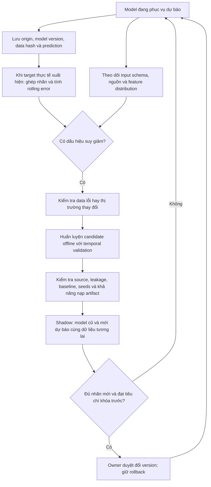

# FPT ML: bài toán, vòng lặp retraining và triển khai API

Biên bản thiết kế ngày 29/10/2026. Phần ML do luồng này thực hiện; API/Streamlit thuộc bạn phụ trách tích hợp. Tài liệu không thay cấu hình dịch vụ hoặc triển khai cloud.

## 1. Đây là hồi quy có giám sát

Nguồn là Yahoo Finance qua thư viện yfinance, mã `FPT.VN`. yfinance tải OHLCV lịch sử; nó không phải thuật toán học máy và không quyết định supervised/unsupervised.

- `X_t`: 16 đặc trưng tính từ dữ liệu đã biết tới sau đóng cửa tại origin t. LSTM dùng chuỗi 30 quan sát feature; Ridge/XGBoost dùng vector tại origin t.
- `y_t = log(Close_next / Close_t)`: nhãn số thực được tạo từ giá lịch sử ở quan sát hợp lệ kế tiếp. Có nhãn đầu ra để fit model nên đây là **supervised regression**.
- Giá điều chỉnh dự báo được quy đổi bằng `Close_t * exp(predicted_log_return)`. Không trực tiếp học giá tuyệt đối. Bản hiện tại dự báo quan sát hợp lệ kế tiếp, chưa bảo đảm đó là phiên HOSE kế tiếp theo lịch được xác minh độc lập.
- Nếu đổi mục tiêu thành tăng/giảm thì đó là supervised classification, cần một giao thức và bộ metric riêng. Clustering các chế độ thị trường có thể dùng unsupervised learning, nhưng không phải bài toán hiện tại.

Một mẫu minh họa: features từ các quan sát đến t → nhãn lợi suất từ t đến next(t). Nhãn được sinh tự động từ lịch sử vẫn là nhãn giám sát, không cần con người gắn nhãn bằng tay.

## 2. Đợt thí nghiệm hiện tại nhằm tăng độ tin cậy của đánh giá

Đây là nghiên cứu hồi cứu, không hứa sai số chắc chắn giảm sau training. Protocol được ghi ra file trước khi fit bất kỳ model nào, gồm hash source/data, seed, feature order, splits và cấu hình.

| Fold | Train đến | Validation | Evaluation chẩn đoán |
| --- | --- | --- | --- |
| eval_2022 | 2020-12-31 | 2021 | 2022 |
| eval_2023 | 2021-12-31 | 2022 | 2023 |
| eval_2024 | 2022-12-31 | 2023 | 2024 |

Mọi model/feature group dùng chung eligible origin/target dates và common context 60. Nhãn đi qua cutoff bị loại. Scaler fit từng fold bằng train; early stopping chỉ xem validation. Không random shuffle train/validation/evaluation.

- Baseline: zero return, train mean, persistence, always-up và always-down.
- Model học: Ridge alpha 10; XGBoost depth 2; LSTM 32 units, Dense 8, dropout 0.2, lookback 30, Huber, Adam lr 0.001, max 40 epochs, shuffle=False, early stopping patience 7.
- XGBoost/LSTM chạy seed 42, 123, 2026; Ridge xác định chạy một lần cho từng fold/feature group.
- Feature ablation: returns (6), returns + technical (13), full gồm volume (16).
- Xuất metrics từng candidate, prediction theo từng origin, seed standard deviation, số fold vượt baseline và worst-fold RMSE. Độ lệch chuẩn seed của model chỉ chạy một lần là thiếu dữ liệu, không ghi thành 0 để giả ổn định.

**Giới hạn:** kiến trúc/features đã được xem ở giai đoạn phát triển 2023–2025. Các fold này và việc xếp hạng tổng hợp là chẩn đoán hồi cứu; không phải ước lượng không thiên lệch trên holdout mới. Các evaluation/validation năm giữa những fold có chồng lấn lịch sử. Không dùng điểm evaluation tổng hợp để tự chọn/promote model. Giữ năm 2025 làm reference lịch sử đã xem, không biến nó thành holdout mới.

Lệnh tái tạo:

```powershell
python -m src.models.robustness --config configs/robustness_v1.json
python -m src.models.robustness_report
```

Mỗi lần chạy tạo study ID riêng dưới `reports/robustness/` và artifact riêng dưới `models/research/`. Không thay hai pointer serving/reference hiện tại. Các run cũ tiếp tục giữ nguyên để đối chứng. Dữ liệu nguồn vẫn là snapshot khóa; không âm thầm download đè Yahoo rồi so sánh hai bộ khác nhau.

## 3. Chất lượng data và hướng cải thiện

Data hiện được kiểm tra nội bộ: ngày duy nhất và tăng dần, features hữu hạn, nhãn tính độc lập lại từ giá nguồn, tách 147 dòng zero-volume và 1 nến bất hợp lệ. Có 4 dòng Close thiếu trong raw không được điền giá giả.

Đã thực hiện [audit ba nguồn ngày 29/10](../reports/data_audits/20261029T135735663765Z/REPORT.md). Yahoo mới vẫn có 56 ngày zero-volume mà Vietcap/KBS cùng ghi nhận giao dịch; 131/249 cặp lợi suất năm 2025 khác Vietcap trên 10 bps. Vietcap là ứng viên nguồn v3; chưa thay v2 hoặc train lại. Lịch HOSE chính thức, action ledger và tính point-in-time vẫn chưa được chứng nhận; không xem đồng thuận hai chart là chứng nhận của sàn. Không xóa các ngày đứng giá thật hoặc các biến động thật để tăng điểm.

Mục tiêu gần nhất là kiểm tra: nhóm feature nào giúp nhiều giai đoạn và nhiều seed; sai số thay đổi vì seed hay regime; model có vượt baseline đủ nhất quán không. Kết quả xấu cũng là bằng chứng để bỏ bớt feature/model không hữu ích. Sau đó mới thử thay regularization, learning rate hoặc training window, mỗi thí nghiệm chỉ thay một nhóm yếu tố với đối chứng.

## 4. Vòng lặp giám sát → điều tra → retrain → kiểm chứng → thay model



### Phân biệt ba loại tín hiệu

1. **Data quality failure:** thiếu schema, sai đơn vị, duplicate date, bất hợp lệ OHLCV, nguồn thay đổi hoặc mismatch hash. Chặn/điều tra ingest trước; không retrain để học theo data lỗi.
2. **Data/concept drift:** phân phối features, lợi suất hoặc quan hệ features → target thay đổi. Input drift có thể đo trước khi có nhãn; performance drift phải đợi target thực tế xuất hiện. Drift chỉ là cảnh báo điều tra, không tự chứng minh model cần bị thay.
3. **Quên:** performance trên kiến thức/phân phối cũ giảm sau cập nhật, thường đáng quan tâm khi fine-tune/online learning. Hiện pipeline train batch từ đầu, nên chưa có bằng chứng catastrophic forgetting. Kiểm tra theo regime và cửa sổ là cần thiết, nhưng không gọi mọi biến động điểm là quên.

### Những gì cần tích hợp khi API có dữ liệu mới

- Log dự báo **trước** khi biết kết quả: ticker, timestamp phát hành UTC, ngày phiên theo timezone của sở giao dịch, target observation rule, prediction, model version, feature/source hash và ngày dữ liệu cuối.
- Lưu raw snapshots mới theo phiên bản; không sửa ngược forecast đã phát hành khi Yahoo back-adjust lịch sử.
- Khi có target mới, tính RMSE/MAE, balanced accuracy, direction coverage, neutral share; đồng thời ghi cùng baseline. Phân biệt số ngày lịch với số label hợp lệ.
- Chọn rolling window/minimum samples và ngưỡng cảnh báo từ phân phối lỗi ở giai đoạn calibration; không đặt một PSI/RMSE threshold tùy ý rồi coi là chuẩn chung.
- Tách development validation khỏi acceptance gate; không chọn seed tốt nhất bằng test. Báo mức dao động và paired error cùng origin.
- Khi có đủ dữ liệu tương lai chưa dùng tuning, chạy candidate ở shadow cùng incumbent. Tiêu chí thay version phải được khóa trước về metric chính, guardrails và minimum sample size; chưa đặt tự động cho project này.
- Lưu artifact, scaler, feature schema, manifest và decision file. Giữ rollback. Một model train trên dữ liệu mới không được dùng để dự báo lại quá khứ rồi gọi đó là backtest ngoài mẫu; retention replay chỉ có giá trị chẩn đoán nếu đã có look-ahead.

Hiện chỉ có nghiên cứu offline và tài liệu giao thức; chưa có service giám sát live, cron retrain hoặc auto-promotion. Bộ snapshot dừng ở 2025 nên không thể gọi nó là giám sát thị trường đang diễn ra ngày 29/10/2026.

## 5. Deploy API: công cụ nào, có miễn phí không?

Kiểm tra tài liệu chính thức ngày **29/10/2026**. FastAPI viết endpoint; Uvicorn chạy Python server; Docker đóng gói môi trường; nhà cung cấp cloud mới cấp URL HTTPS cho người dùng bên ngoài. Training có thể làm offline/Colab rồi chỉ đưa artifact lên inference server; không train trong mỗi request.

| Lựa chọn | Miễn phí/điều kiện | Đánh đổi cho project |
| --- | --- | --- |
| Render Free Web Service | Có gói free; 512 MB RAM, 0.1 CPU; ngủ sau 15 phút không có traffic | Dễ đưa FastAPI lên; cần đo memory và cold start. TensorFlow có thể không vừa 512 MB, dù file weights nhỏ; chưa benchmark nên không bảo đảm chạy được full LSTM |
| Google Cloud Run | Có monthly free tier; bắt buộc billing account; vượt quota ở paid billing có thể tính phí | Chạy Docker/FastAPI, chọn RAM theo đo đạc; cần tính cả các dịch vụ phụ như build/storage/network |
| Hugging Face Docker Spaces | CPU Basic không có phí theo giờ, nhưng hiện tạo Docker/Gradio compute Space yêu cầu paid plan (có ngoại lệ riêng cho Gradio ZeroGPU) | Không hứa custom FastAPI Docker là miễn phí hoàn toàn; kiểm tra quyền tài khoản trước |
| Streamlit Community Cloud | Free cho Streamlit theo điều kiện nền tảng | Phù hợp UI của bạn trong team; UI gọi API riêng. Không đồng nhất với host FastAPI độc lập |

Tài liệu chính thức: [Render free](https://render.com/docs/free), [Render compute](https://render.com/docs/compute-plans), [Cloud Run pricing](https://cloud.google.com/run/pricing), [Google Cloud Free Tier](https://docs.cloud.google.com/free/docs/free-cloud-features), [Hugging Face Spaces](https://huggingface.co/docs/hub/spaces-overview), [Streamlit deployment](https://docs.streamlit.io/deploy).

**Đề xuất:** nếu ngân sách tuyệt đối 0, thử benchmark một API inference tối giản trên máy trước, rồi kiểm tra Render Free có đủ RAM; model tuyến tính nhẹ hơn TensorFlow. Nếu cần full LSTM và chấp nhận billing có quota miễn phí, xem Cloud Run sau khi đo memory/latency và thống nhất giới hạn chi phí. Chưa tạo tài khoản, bật billing hay deploy dịch vụ nào trong đợt này.

Đầu ra bàn giao cho API/UI: model + scaler + feature order + lookback + price/target definition + metadata/version + input/output mẫu. Giữ hợp đồng này ổn định để bạn tích hợp cập nhật độc lập với các thí nghiệm ML.
