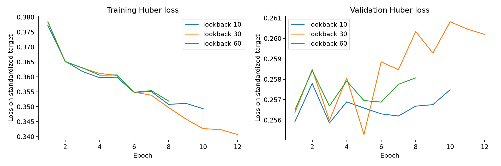

> Archive tài liệu trước khi tích hợp Ridge local ngày 30/10/2026. Các quyết định serving bên dưới là trạng thái lịch sử; xem [tài liệu current](../TRAINING_HISTORY.md).

# Nhật ký retraining và bằng chứng phát triển model FPT

Ngày ghi nhận: **25/10/2026**, múi giờ **UTC+7 (Bangkok/Việt Nam)**. Dữ liệu thị trường cố định: 2018–2025. Báo cáo này ghi quá trình phát triển trên cùng một snapshot; không phải chuỗi đánh giá hiệu quả đầu tư qua nhiều tháng.

## Kết luận để team trình bày

- Quy trình hiện có bằng chứng tái lập: snapshot và artifact có hash, các model dùng cùng tập mẫu, scaler chỉ fit train, cấu hình được chọn trên validation, API/UI dùng chung inference.
- LSTM lookback **30** được chọn trong nhóm LSTM theo RMSE validation. **Train Mean** thắng khi so tất cả model trên validation; LSTM là model ML phục vụ demo.
- Colab T4 đã chạy đủ **8 cell**, cùng code/data/config/split với CPU. Model JSON/Keras từ Colab đã nạp lại được trên Windows và khớp **16 hàng model/split metrics** của chính lượt Colab.
- Các lượt v2 có RMSE LSTM gần như bằng nhau. Đây là bằng chứng tái lập, **chưa phải bằng chứng độ dự báo tăng dần sau mỗi lần train**. XGBoost còn lệch nhỏ giữa môi trường và được báo công khai.

## 1. Bản trước review: chỉ dùng làm lịch sử tham khảo

Bản backup trước review có LSTM hai tầng 64/32, Dense 16, MinMaxScaler, lookback 60, tối đa 75 epoch, early stopping patience 12. Metadata ghi 1.087 train, 493 validation, 248 test; thực tế chạy 17 epoch.

| Chỉ số được lưu trong metadata cũ | Validation | Test lịch sử 2025 |
| --- | ---: | ---: |
| RMSE log return | 0.014085049 | 0.020040139 |
| MAE log return | 0.010166675 | 0.013511785 |
| Hit rate theo công thức cũ | 52.59% | 47.39% |

Nguồn: [metadata cũ trích nguyên từ backup](../../reports/training_history/evidence/legacy_metadata.json), kèm hash ZIP và member. Không khôi phục weights cũ vào pipeline đang dùng.

**Giới hạn so sánh:** metadata cũ thiếu hash snapshot và dự báo theo từng origin. Hàm hit rate cũ loại cả actual 0 lẫn prediction 0 và dùng 50% khi không có tín hiệu; v2 giữ prediction 0 là abstention và trả N/A khi không có tín hiệu hướng. Scaler, kiến trúc, callbacks và quy trình so mẫu cũng thay đổi. Vì vậy không tuyên bố chênh lệch với bảng v2 là mức cải thiện có kiểm soát hay do riêng một thay đổi gây ra. Không dùng số trong ảnh chụp nếu không đối chiếu được artifact tương ứng.

## 2. Các thay đổi đã thực hiện và bằng chứng

| Vấn đề | Xử lý | Bằng chứng kiểm chứng |
| --- | --- | --- |
| Dễ chạy dữ liệu/code khác nhau giữa máy và Colab | ZIP public snapshot 6 file; kiểm tra SHA256; clone code GitHub đã push | [Snapshot manifest](../../data/snapshots/manifest.json), `protocol_checks` trong comparison |
| So sánh model khác tập ngày hoặc lookback gây sai khác mẫu | Giữ common context 60; cùng origin/target dates cho mọi model | Split trong experiment manifest; kiểm thử boundary/sequence |
| Dễ chọn theo test hoặc chỉ xem hit rate | Chọn RMSE validation; thêm baseline zero/mean/persistence; báo MAE, coverage và neutral | `selection.json`, `validation_trials.csv`, `metrics.csv` |
| Alias weights/scaler có thể trỏ nhầm lượt | Artifact theo run ID, manifest, feature order và hash; một pointer dùng demo | [CPU manifest](../../models/experiments/20261025T124951351761Z/manifest.json) |
| XGBoost pickle từ Colab không nạp được trên Windows | Đổi sang native JSON `save_model`/`load_model` | [Kiểm chứng chuyển model](../../reports/verification/colab_portability.json) |
| Backend và UI có thể dùng logic khác notebook | ModelService dùng builder/scaler chung; Streamlit gọi HTTP API | [API/UI smoke check](../../reports/verification/api_ui_smoke.json), 36 unit test |

Nguồn kỹ thuật cho XGBoost: [Model IO chính thức](https://xgboost.readthedocs.io/en/stable/tutorials/saving_model.html). Tài liệu phân biệt native model IO với pickle memory snapshot; không bảo đảm pickle ổn định/portable. Đổi định dạng lưu **không làm model chính xác hơn**.

## 3. Nhật ký các lượt v2 có manifest

Tất cả thời gian bên dưới là **lúc bắt đầu run**, lấy từ run ID UTC rồi đổi sang UTC+7. Không dùng thời gian sửa file để giả làm thời gian training. Giá trị là log return; cột chỉ số là LSTM được chọn trong nhóm trên validation.

| Giờ 25/10/2026 | Run ID | Môi trường | XGBoost format | Lookback LSTM | Val RMSE | Test RMSE | Test MAE | Test hit rate |
| --- | --- | --- | --- | ---: | ---: | ---: | ---: | ---: |
| 19:14:48 | `20261025T121448987851Z` | CPU | .pkl | 30 | 0.014032665 | 0.019858318 | 0.013441519 | 54.98% |
| 19:41:29 | `20261025T124129642764Z` | GPU | .pkl | 30 | 0.014032665 | 0.019858318 | 0.013441519 | 54.98% |
| 19:49:51 | `20261025T124951351761Z` | CPU | .json | 30 | 0.014032665 | 0.019858318 | 0.013441519 | 54.98% |
| 20:22:43 | `20261025T132243824425Z` | GPU | .json | 30 | 0.014032665 | 0.019858318 | 0.013441519 | 54.98% |

- **19:14:** bộ v2 cùng benchmark, thiết lập CPU reference ban đầu; XGBoost vẫn lưu pickle.
- **19:41:** Colab kiểm tra cùng code. LSTM tái lập; phát hiện pickle XGBoost không nạp được khi mang về Windows. Kết quả đã lưu trước khi giải phóng session cũ.
- **19:49:** train lại CPU sau sửa JSON. Các metric CPU giữ nguyên, chứng minh thay định dạng lưu không làm thay kết quả dự báo. Khóa reference hiện tại `20261025T124951351761Z`.
- **20:22:** train bản JSON trên Colab T4 từ commit `5eddc45`; tải artifact về Windows và nạp lại thành công. Giữ thành lượt kiểm chứng riêng, không thay pointer phục vụ demo bằng kết quả test tốt hơn.

Các manifest trước sửa được giữ trong [evidence](../../reports/training_history/evidence), thay vì giữ alias weights cũ. [runs.json](../../reports/training_history/runs.json) chứa hash manifest sau chuẩn hóa LF theo Git attributes, config, split, seed, versions và đường dẫn từng nguồn; [metrics_over_runs.csv](../../reports/training_history/metrics_over_runs.csv) chứa toàn bộ 64 hàng model/split, không chỉ kết quả LSTM được chọn.

## 4. Giao thức và cấu hình được khóa

| Thành phần | Thiết lập |
| --- | --- |
| Dữ liệu sau quarantine | 1.940 quan sát hợp lệ; 1.891 feature rows; 16 inputs |
| Chia mẫu chung | Train 1.087, validation 493, test lịch sử 248 |
| Train | Origin 2018-06-19 đến 2022-12-29; target cuối 2022-12-30 |
| Validation | Origin 2023-01-03 đến 2024-12-30; target cuối 2024-12-31 |
| Test | Origin 2025-01-02 đến 2025-12-30; target cuối 2025-12-31 |
| Nhãn | Log return của quan sát hợp lệ kế tiếp; không tự suy ra lịch HOSE |
| Scaler | StandardScaler feature và target; fit trên train |
| LSTM | 32 units, dropout 0.2, Dense 8, Huber, Adam lr 0.001, clipnorm 1 |
| Huấn luyện | Batch 32, shuffle=False, tối đa 40 epoch, early stopping patience 7, seed 42 |
| Chọn cấu hình | Lookback 10/30/60 theo RMSE validation; test không dùng chọn |

Dữ liệu không được forward/back-fill để tạo giá giả. Ngữ cảnh quá khứ có thể đi qua ranh giới train/validation để dự báo tại thời điểm hiện tại; nhãn tương lai đi qua ranh giới tập bị loại. Raw/source/outputs được đối chiếu hash trong manifest.

## 5. Bằng chứng chọn lookback bằng validation

CPU reference `20261025T124951351761Z`:

| Candidate | Validation RMSE | Validation MAE | Validation hit rate |
| --- | ---: | ---: | ---: |
| LSTM/10 | 0.014055344 | 0.010011078 | 55.17% |
| LSTM/30 | 0.014032665 | 0.009997314 | 54.74% |
| LSTM/60 | 0.014078786 | 0.010037336 | 53.45% |

Lookback 30 có RMSE validation thấp nhất trong nhóm LSTM. Chênh lệch nhỏ, chỉ có một seed; chưa đủ để kết luận lookback 30 luôn tốt hơn trong thị trường khác. Chỉ tiêu chọn là RMSE nên không chuyển sang candidate có hit rate cao hơn sau khi xem test.



Nguồn: [lstm_history.json](../../reports/experiments/20261025T124951351761Z/lstm_history.json). Loss theo epoch phản ánh tối ưu trong một lượt; không đồng nghĩa chất lượng ngoài mẫu tăng theo thời gian thị trường.

## 6. Đối chiếu CPU và Colab sau sửa JSON

CPU `20261025T124951351761Z`; Colab `20261025T132243824425Z`. Cùng phiên bản numpy/pandas/sklearn/xgboost/joblib và TensorFlow 2.21.0. Python CPU 3.13.15, Colab 3.13.16; môi trường/hardware khác nhau.

| Model | CPU test RMSE | Colab test RMSE | Chênh lệch tương đối tuyệt đối |
| --- | ---: | ---: | ---: |
| Zero-Return | 0.019917213 | 0.019917213 | 0.000000% |
| Return Persistence | 0.027995444 | 0.027995444 | 0.000000% |
| Train Mean | 0.020021735 | 0.020021735 | 0.000000% |
| Always Up | 0.024133456 | 0.024133456 | 0.000000% |
| Linear Regression | 0.020079600 | 0.020079600 | 0.000000% |
| Ridge | 0.020055121 | 0.020055121 | 0.000000% |
| XGBoost | 0.020017319 | 0.019938554 | 0.393487% |
| LSTM | 0.019858318 | 0.019858318 | 0.000000% |

Hash raw, data, feature order, splits, seed, training config và source code đều khớp. Cùng Train Mean thắng validation và cùng LSTM lookback 30.

**Trạng thái chính thức: `protocol_match_numeric_difference`.** Các baseline tuyến tính/hằng và LSTM gần như khớp; XGBoost không qua ngưỡng so sánh rất chặt của nhóm baseline. Tất cả RMSE nằm trong tolerance kỹ thuật **5% định trước**. Không đổi ngưỡng sau khi xem kết quả, không gọi hai model tương đương thống kê. Chưa cô lập nguyên nhân chênh XGBoost giữa môi trường; không quy cho GPU vì XGBoost không được cấu hình train GPU.

- [Comparison sinh trực tiếp trên Colab](../../reports/experiments/20261025T132243824425Z/reference_comparison.json)
- [Comparison sau nạp lại trên Windows](../../reports/verification/colab_reloaded_comparison.json)
- [Notebook Colab đã thực thi](../../reports/experiments/20261025T132243824425Z/executed_colab.ipynb): đủ 8 code cells, không có code error. Lỗi trình duyệt hiển thị iframe output được tách khỏi trạng thái thực thi Python.
- [Kết quả kiểm tra portability](../../reports/verification/colab_portability.json): toàn bộ 16 hàng metrics nạp lại khớp báo cáo Colab.

## 7. Hiện đã cải thiện điều gì?

**Đã chứng minh:** khả năng tái lập, tính nhất quán mẫu/metric, truy vết artifact, chọn model trên validation và khả năng chuyển model Colab → Windows.

**Chỉ quan sát được trên test lịch sử:** LSTM RMSE 0.019858 thấp hơn Zero-Return 0.019917 một lượng nhỏ, nhưng MAE LSTM 0.013442 cao hơn Zero-Return 0.013146. LSTM hit rate 54,98% trên 211 actual khác 0; always-down hậu nghiệm cũng đạt 54,98%. Không coi đây là bằng chứng lợi nhuận.

**Chưa chứng minh:** giảm sai số qua nhiều đợt cập nhật dữ liệu, tốt hơn bền vững qua nhiều seed, vượt baseline trên nhiều cửa sổ walk-forward hoặc có lợi nhuận sau chi phí. Năm 2025 đã được xem trong thử nghiệm trước; không gọi nó là pristine holdout. Giá điều chỉnh không phải giá khớp lệnh lịch sử; chưa xác minh lịch HOSE/corporate actions/point-in-time độc lập.

## 8. Cách lưu bằng chứng cho những lần tiếp theo

1. Trước thử nghiệm ghi hypothesis, thay đổi dự kiến, snapshot, khoảng train/validation/evaluation và metric chính. Không dùng kết quả test để chọn thay đổi.
2. Giữ nhóm đối chứng cùng snapshot/ngày đánh giá; mỗi ablation đổi một yếu tố. Nếu thêm dữ liệu, dùng walk-forward và so trên cùng khoảng ngoài mẫu.
3. Gọi pipeline chung; giữ toàn bộ run directory, model/scaler, manifest, prediction và learning history. Ghi cả lượt không cải thiện.
4. Chạy `python -m src.models.training_history` để tái tạo ledger và kiểm tra tính toán; lệnh này không train hoặc chọn model. CSV và JSON cập nhật từ manifest đã lưu, không từ ảnh chụp.
5. Viết kết luận kèm chênh RMSE/MAE, directional denominator, biến động nhiều seed, giới hạn và quyết định giữ/thay. Chỉ promote theo tiêu chí khóa trước, tách khỏi báo cáo test.

```powershell
python -m src.models.training_history
python -m src.models.compare_runs --candidate models/experiments/<run_id> --output reports/colab_comparison.json
```

[calculation_checks.json](../../reports/training_history/calculation_checks.json) tính độc lập lại RMSE/MAE/hit rate từ prediction export của reference và kiểm tra khớp manifest. Bản Markdown này là biên bản ngày 25/10/2026; ledger có thể cập nhật về sau mà không sửa ngược kết luận lịch sử này.


## 9. Cập nhật nghiên cứu ngày 29/10/2026

Đã thực hiện [đợt rolling-origin/feature ablation](../../reports/robustness/20261029T131205702813Z/REPORT.md): 63 model train, 156 hàng metrics, 3 fold và 3 seed cho từng model stochastic. Mọi forecast origin được đối chiếu; 63 model đã nạp lại và qua 126 kiểm tra validation/evaluation prediction. Bộ kiểm thử hiện tại có 42 test qua.

Các kết quả này thuộc protocol/window khác với test 2025 bên trên, nên không vẽ chúng nối thành một đường tăng accuracy theo ngày train. LSTM returns-only giảm mean-fold RMSE khoảng 0,66% so với full features, nhưng chưa vượt baseline nhất quán và seed variation không cải thiện đồng thời. Quyết định giữ model phục vụ hiện tại. Chỉ mục study và toàn bộ kết quả tốt/xấu nằm trong [studies.json](../../reports/robustness/studies.json).

[Vòng lặp monitoring/retraining và giải thích supervised regression/deploy](ML_WORKFLOW_AND_DEPLOYMENT.md) là thiết kế cho bước tiếp theo; chưa có live monitor hoặc auto-promotion.

## 10. Audit dữ liệu trước vòng train tiếp theo — 29/10/2026

[Báo cáo đối chiếu Yahoo cũ/mới, Vietcap và KBS](../../reports/data_audits/20261029T135735663765Z/REPORT.md) phát hiện 56 ngày Yahoo volume=0 được cả hai nguồn kia ghi nhận giao dịch, cùng bất đồng lợi suất tập trung năm 2025. Tải lại Yahoo không tự sửa được. Dry-run cùng feature builder tạo 1.947 mẫu Vietcap so với 1.889 mẫu Yahoo, với 39 origin chung đổi ngày target.

Lượt này **không có training mới**, không ghi thêm accuracy giả vào lịch sử model. Giữ hash cả snapshot và pointer v2. Đề xuất Vietcap làm nguồn nghiên cứu v3, KBS đối chiếu; cần khóa bộ nhãn/cohort chung trước thử nghiệm so sánh nguồn. Metric cũ giữ nguyên, được hiểu là kết quả lịch sử trên snapshot Yahoo chưa hòa giải nguồn.

## 11. Đã train đối chứng nguồn — 29/10/2026

Study **20261029T142732805710Z**: [quyết định](../../reports/source_comparison/20261029T142732805710Z/DECISION.md), [protocol/bảng/biểu đồ](../../reports/source_comparison/20261029T142732805710Z/REPORT.md). 112 model gồm 48 LSTM, 48 XGBoost, 16 Ridge; hai nguồn, hai feature groups, bốn fold và ba seed cho model stochastic. Khóa source/data/config trước training. 1.791 origin–target pairs chung; native train labels nhưng cùng nhãn Vietcap cho validation/early stopping/evaluation. Hai nguồn có cùng số labeled training rows; lịch sử context native có thể khác.

| Thay đổi trong cùng study, mean-fold 2022–2024 | Kết quả |
| --- | --- |
| XGBoost returns: Yahoo → Vietcap | RMSE 0,0166373 → 0,0164722, giảm khoảng 0,99% |
| LSTM returns: Yahoo → Vietcap | RMSE 0,0164172 → 0,0163951, giảm khoảng 0,13%; mean seed SD giảm khoảng 30,1% |
| LSTM full: Yahoo → Vietcap | RMSE 0,0164958 → 0,0165224, tăng khoảng 0,16% |
| Baseline trên cùng nhãn/cohort | Train Mean/Vietcap 0,0162915; Zero Return 0,0163497 |

LSTM returns/Vietcap vẫn kém Zero Return khoảng 0,28% và Train Mean khoảng 0,64% về RMSE. Năm 2025 được tách riêng: không cải thiện đồng loạt; trung bình seed của cả sáu nhóm Vietcap vẫn kém Zero Return. Không chọn một seed thắng để thay kết quả cả nhóm.

Đã tính độc lập lại 264 hàng metrics, nạp lại 112 model với 224 đối chiếu prediction/scaler; 59/59 unit tests qua. Không có model train thất bại trong study; một lỗi parser ở giai đoạn chuẩn bị trước training đã được sửa và thêm test. Canonical data/model pointers giữ nguyên. Lượt này chạy CPU local, không phải một lượt kiểm chứng Colab mới.

**Quyết định:** tiếp tục dùng Vietcap làm nguồn ứng viên nghiên cứu, ưu tiên returns-only cho thử nghiệm tiếp, chưa promote serving. Tác động đổi nguồn/nhãn được ghi riêng; không nối metric này với các lượt chấm theo nhãn Yahoo cũ để tuyên bố accuracy tăng. Chỉ mục [source_comparison/studies.json](../../reports/source_comparison/studies.json) giữ các lượt đối chứng về sau.

## 12. Đối chứng training window và notebook tổng hợp — 29/10/2026 (local)

Study **20261029T150501819490Z**: [kết luận](../../reports/window_comparison/20261029T150501819490Z/DECISION.md), [protocol và kết quả đầy đủ](../../reports/window_comparison/20261029T150501819490Z/REPORT.md). Giữ Vietcap/returns-only, thử train 2y/3y/5y/expanding. Window chọn bằng mean validation RMSE, không chọn bằng evaluation; giữ nguyên cohort và reference labels của study nguồn trước.

112 điều kiện gồm **56 fit mới** (24 LSTM, 24 XGBoost, 8 Ridge) và 56 điều kiện reuse control trùng train cohort. Đã kiểm chứng 320 hàng metrics; nạp lại 84 model duy nhất/168 bộ prediction và kiểm tra duplicate forecast/scaler. 62 unit tests qua.

Mean-fold 2022–2024: Ridge 0,0163539 → 0,0163271 (giảm 0,16%); LSTM 0,0163951 → 0,0164282 (tăng 0,20%); XGBoost 0,0164722 → 0,0165185 (tăng 0,28%). Ridge mới vẫn chưa hơn Train Mean expanding 0,0162915. Năm 2025 báo cáo riêng và không dùng chọn lại window sau khi thấy điểm.

[Notebook 05](../../notebooks/05_training_journey_fpt.ipynb) có 8 biểu đồ tổng hợp các giai đoạn và kết quả mới, đã thực thi đầy đủ và lưu outputs. Không có model serving/data canonical bị thay; không commit/push những thay đổi local này theo yêu cầu người dùng.

## 13. Phân tích lỗi và Ridge alpha/window — 30/10/2026 (local)

Study hoàn tất **20261030T011109863274Z**: [phân tích lỗi trước fit](../../reports/ridge_refinement/20261030T011109863274Z/ERROR_ANALYSIS.md), [quyết định và so sánh](../../reports/ridge_refinement/20261030T011109863274Z/DECISION.md). Ngưỡng volatility fit train từng fold; SMA50 ±1% chỉ là proxy, không thêm vào features. Forecast chẩn đoán lấy từ lựa chọn validation cũ.

Grid alpha 0.1/1/10/100/1000 với expanding/2y/3y/5y, giữ Vietcap/returns-only và cohort/nhãn cũ. 80 điều kiện gồm **48 fit mới**, 32 điều kiện reuse; 60 model duy nhất/160 đối chiếu prediction validation/evaluation. Alpha10 tái lập đúng control cũ; scaler train-only và tất cả trường metrics được kiểm tra. 68/68 tests qua.

| Mean-fold 2022–2024, cùng nhãn/cohort | RMSE |
|---|---:|
| Ridge window-only alpha10 trước | 0,0163271 |
| Ridge alpha-only / joint mới | 0,0162983 |
| Zero Return | 0,0163497 |
| Train Mean expanding | 0,0162915 |

RMSE Ridge giảm 0,18% so với bản trước, nhưng vẫn kém Train Mean khoảng 0,04% và worst-fold tăng khoảng 0,16%. Joint giữ đúng window cũ, alpha1000 cho ba fold chính; lợi ích đến từ regularization, không thêm tín hiệu/features. Năm 2025 chẩn đoán riêng, alpha100/window3y vẫn kém baseline. Không promote model hoặc mở giá 2026.

Một lượt đầu **20261030T010848752516Z** dừng do thiếu import ở export, sau một partial fit; lưu nguyên source/status/log riêng và không dùng chọn model. Lượt hoàn tất chạy lại đúng grid sau sửa import, thêm regression test. [studies.json](../../reports/ridge_refinement/studies.json) giữ cả hai lượt. Notebook 05 cập nhật 12 biểu đồ; toàn bộ thay đổi tiếp tục local, không commit/push và giữ nguyên tám hash canonical data/model.

## 14. Đánh giá hồi cứu 2026 với weights đóng băng — 30/10/2026 (local)

Study **20261030T014012158951Z**: [quyết định và ưu/nhược](../../reports/evaluation_2026/20261030T014012158951Z/DECISION.md), [bảng metrics/nguồn/giới hạn](../../reports/evaluation_2026/20261030T014012158951Z/REPORT.md). **Không train mới**. Khóa model/scaler/constants lúc 08:40 UTC+7 trước download 2026; giữ model gốc và lưu ZIP snapshot. LSTM/Ridge/XGBoost serving train tới2022; research Ridge dùng validation2024 của fold2025 chọn window3y/alpha100, train tới2023. Không lấy alpha1000 thắng các fold cũ để chọn theo2026.

Chấm cùng 200 origin–target pairs từ05/01–28/10, target cuối29/10/2026; nhãn Vietcap và giá forecast quy đổi cùng anchor Vietcap. Full-Vietcap202 pairs bổ sung coverage. LSTM returnRMSE0,020428/MAE0,015523; researchRidge mới0,020727/0,015908; Zero0,020114/0,015388. LSTM hit51,28% balanced54,27%; classprior luôn giảm60% hit. Chưa chứng minh lợi thế hồi quy so Zero; bias dự báo tăng trong đoạn nhiều ngày giảm.

73 tests qua; metrics và forecasts của 15 model/cohort groups được kiểm tra/reload. Một sai khác float32-exp/float64 ở xuất giá được phát hiện, sửa derived prices/scores từ return forecasts đã lưu, không fit/download/chọn model lại. Giữ initial_export.zip và correction metadata. Tám hash canonical data/model không đổi.

Notebook05 cập nhật15 biểu đồ; reports/holdout_exposures.json ghi khoảng2026 đã mở. Đây là temporal evaluation hồi cứu, không phải dự báo live, không còn là holdout mới cho lần tune sau. Không tự promote, không sửa API/Streamlit hoặc commit/push.

## 15. Recency, hiệu chỉnh bias và shadow — 30/10/2026 (local)

Study **20261030T022440928507Z**: [quyết định](../../reports/recency_bias/20261030T022440928507Z/DECISION.md), [giao thức/kết quả](../../reports/recency_bias/20261030T022440928507Z/REPORT.md). Giữ 6 return features, alpha 100, window 3 năm. 13 fit mới; 11 strategy × 2 cohort; primary 202 cặp Vietcap, secondary 200 cặp common cũ. Snapshot đã khóa đến 29/10 được tái dùng, không download mới. Protocol/code/package versions ghi trước fit; 2026 đã xem nên là mô phỏng hồi cứu thích nghi, không phải holdout độc lập mới.

| Đối chứng | RMSE return | MAE giá adjusted (VND) | Hit / 197 actual khác 0 | MSE skill vs Zero |
|---|---:|---:|---:|---:|
| Ridge cũ, train đến 2023 | 0,0207058 | 1.114,18 | 43,15% | −5,953% |
| Refit đến cuối 2025 | 0,0201191 | 1.080,94 | 50,76% | −0,033% |
| Refit theo tháng mô phỏng | 0,0201124 | 1.074,00 | 52,79% | +0,034% |
| Cuối 2025 + causal bias | 0,0201116 | 1.064,12 | 60,91% | +0,041% |
| Theo tháng + causal bias | 0,0201704 | 1.063,57 | 57,87% | −0,545% |
| Zero Return | 0,0201157 | 1.081,70 | N/A | 0% |

Refit đến 2025 giảm RMSE **2,83% so Ridge cũ**, chưa chứng minh edge vs Zero. Rebuild đúng 693 ngày từ snapshot mới tái lập bản cũ; coverage thêm cùng cutoff chỉ giúp ít. Monthly raw vượt Zero 5/10 tháng so bản cũ 3/10, nhưng vẫn có tháng kém. Bias giảm mean error, có thể giảm MAE nhưng tăng RMSE: giữ trade-off thay vì chỉ báo metric tốt. Static+bias skill +0,041%, CI mô tả [−4,28%; +3,80%], balanced 56,62%; luôn đoán giảm hit 59,39%, balanced 50%.

Khoảng dự báo residual quantile danh nghĩa 80% cần 60 lỗi trước đó; static+bias coverage 82,39% / 142 ngày, mean width 0,04602 log-return. Không bảo đảm coverage forward. Bảng warm-up so cùng 182/142 ngày, không đổi mẫu để làm đẹp kết quả. Verification kiểm tra scaler, Ridge normal equations, cutoff từng dòng, forecast/calibration và mọi metric; không refit khi verify. **82 tests đạt**, tám hash canonical/pointer giữ nguyên.

Bundle shadow riêng train target đến 29/10; model/calibration cố định đến khi rebuild thủ công. [Hướng dẫn](FORWARD_SHADOW.md) cho issue/score/verify, hash-chain và input snapshot. Một forecast phát **09:25 ngày 30/10**, pending, chưa có outcome; nếu target 30/10 thì phát cùng ngày và không tính vào full-session. Chưa có bằng chứng cải thiện forward. Không tạo lịch tự động.

Notebook 05 đã thực thi đủ **42 cells, 18 biểu đồ**, kiểm tra hiển thị các biểu đồ mới và timeline. Phần 10 lưu so sánh recency, độ ổn định từng tháng và khoảng dự báo. Giữ serving/API/Streamlit cho team; tất cả thay đổi tiếp tục local, **không commit/push**.

## 16. Đối chiếu cùng tập tháng 6–10/2026 — không train mới

Theo khoảng người dùng đề xuất, [đối chiếu 104 phiên chung](../../reports/period_comparison/20261030T024048531444Z/COMPARISON.md) đọc lại forecast đã lưu của 17 strategy, giữ cùng origin/target/reference adjusted close, target từ 01/06 đến 29/10/2026. Tháng 10 chưa đủ tháng; tháng 9 chỉ có 18 cặp common vì nguồn Yahoo không khớp hai cặp. 99 actual khác 0 để tính Hit; 5 nhãn bằng 0 giữ trong RMSE/MAE/ngưỡng giá. Mỗi tháng có 22/23/20/18/21 phiên. Không refit, download hay dùng shadow model đã học target cuối tháng 10 để chấm ngược tháng 6–9.

LSTM RMSE 0,016831, Zero 0,016775; cả hai cùng 80,77% phiên sai số giá ≤2%. Ridge static đến 2025 RMSE 0,016859; static+bias 0,016776, Hit 62,63%/balanced 57,95%. Luôn đoán giảm đạt 60,61% Hit ở đoạn này. Monthly raw RMSE 0,016746, skill +0,34%, CI mô tả [−2,83%; +4,32%], chưa chứng minh edge. Giữ cả full-period comparison cũ, không chọn riêng tháng đẹp. Các model khác source/features/cutoff nên chưa cô lập tác dụng riêng thuật toán.

Thêm bảng từng tháng, tỷ lệ sai số giá ≤1%/≤2%, độ lớn và độ lệch chuẩn simple return, biểu đồ monthly skill và actual-vs-predicted return. Biên độ là **close-to-close**, không phải High–Low. Đây là mô phỏng one-step với OHLCV thực tế cập nhật mỗi origin; không phải dự báo cả 5 tháng ngay từ đầu tháng 6. Nguồn, hash, script và kiểm tra đối soát được giữ cạnh báo cáo. Không thay notebook/model/API/Streamlit; không commit/push.

Tiếp theo đã tạo [Notebook 06](../../notebooks/06_compare_predictions_jun_oct_2026.ipynb) riêng cho phần quan sát: 26 cells, 8 biểu đồ với code Matplotlib chỉnh sửa được, bảng ngày của tháng/model đang chọn và outputs đã chạy đầy đủ. Input hashes được khóa trong notebook; tự kiểm tra cùng 104 cặp, tính lại metric và đối soát 85 nhóm tháng. Phần phóng to mặc định LSTM/tháng 10; đổi `DETAIL_MONTH`/`DETAIL_MODEL` ở đầu để xem trường hợp khác. Không cần weights hoặc code training khi đọc/chạy notebook; Colab cần kèm đúng thư mục kết quả. Đã kiểm tra hiển thị các biểu đồ. Không train/download hoặc commit/push.

Bổ sung theo yêu cầu quan sát: biểu đồ đầu phần 3 đặt **giá thực tế đường đen đậm** và 4 model cùng trục trên đúng 104 target. `OVERLAY_MODELS` chọn model; `OVERLAY_MONTH=None` xem toàn kỳ hoặc đặt tháng để phóng to. Giữ các panel từng model bên dưới. Notebook hiện có **29 cells, 9 biểu đồ**, đã thực thi và kiểm tra biểu đồ mới; không thay metric, nguồn dữ liệu hoặc model.

## 17. Classifier và “chưa đủ tín hiệu” — 30/10/2026 (local)

Study **20261030T090621177786Z**: [quyết định](../../reports/direction_selective/20261030T090621177786Z/DECISION.md), [giao thức và metric](../../reports/direction_selective/20261030T090621177786Z/REPORT.md), [Notebook 07](../../notebooks/07_direction_and_insufficient_signal_fpt.ipynb). Không download mới; tái dùng ZIP Vietcap khóa tới 29/10. Giữ 6 return features, model parameters cố định trước fit. 20 base models (2 Ridge controls + Logistic/XGBoost qua 5 fold) và 10 sigmoid calibrators, tổng 30 fit/artifact.

Mỗi fold: train window 3 năm đến 30/6 năm trước; Q3 calibration riêng; Q4 chọn margin riêng; evaluation năm sau. Classifier/Ridge_shared học đúng cùng các dòng nonzero; actual0 evaluation giữ lại, calls vào đó tính sai. Ridge_recent train cả 3 năm tới cuối năm trước có thêm dữ liệu gần evaluation; 2026 tái lập chính xác 202 forecast refit_2025_native cũ. Không refit sau chọn margin, không random split, không biến các giai đoạn đã xem thành holdout mới.

| Primary 2022–2024 | Mean-fold balanced trên calls nonzero | Mean coverage |
|---|---:|---:|
| Ridge_shared | 53,36% | 100% |
| Logistic raw | 51,83% | 100% |
| XGBoost raw | 49,82% | 100% |
| Logistic calibrated/selective | 50,16% | 100% |
| XGBoost calibrated | 50,24% | 100% |
| XGBoost selective | 49,92% | 96,91% |

Validation chọn margin 0 ở 9/10 trường hợp; chỉ XGBoost/2022 chọn 0,025, giữ 225/248 phiên. Accuracy trên calls tăng nhẹ nhưng balanced giảm từ 50,95% xuống 50,00%. Năm 2026 cả hai sau sigmoid luôn đoán giảm (202/202): Hit trên 197 actual nonzero 59,39%, accuracy trên mọi call 57,92%, balanced 50%; không hơn control luôn giảm. Bộ lọc được triển khai nhưng margin 2026 bằng 0, chưa có căn cứ bật bỏ qua theo protocol này.

Chẩn đoán sau kết quả: Q3/2025 có 62 nhãn nonzero, 43,55% tăng; sigmoid cho toàn bộ p(tăng) 2026 dưới 0,5. Brier có giảm nhưng không cải thiện phân biệt hướng. Giữ hệ số/range/count trong probability_diagnostics.csv, không refit. So thêm Ridge+bias cũ trên đúng 104 phiên tháng 6–10: reference 62,63% Hit/57,95% balanced, classifier selective 60,61%/50%; nguồn reference/provenance riêng, không dùng chọn threshold.

Reload 30 artifacts, 55 metric groups, 10 lựa chọn ngưỡng, 70 dòng validation curve, 60 nhóm matched-controls; verify không fit. **93 tests đạt**. Hàm predict_research_signal được đối chiếu probability/direction/status trên cả 2 classifier × 202 dòng. Notebook 07 có 19 cells/6 biểu đồ đã thực thi; bổ sung chẩn đoán vào phần trình bày sau khi fit, giữ nguyên source_snapshot.zip/giao thức/model. Tám hash canonical/pointer và weights/pointer serving giữ nguyên. Không promote, không sửa API/Streamlit, không commit/push.

## 18. A/B gap mở cửa và thân nến FPT — 30/10/2026 (local)

Study **20261030T093521684942Z**: [quyết định và số liệu](../../reports/candle_ablation/20261030T093521684942Z/DECISION.md), [giao thức](../../reports/candle_ablation/20261030T093521684942Z/REPORT.md), [Notebook 08](../../notebooks/08_gap_body_feature_comparison_fpt.ipynb). Chỉ FPT; không index/ticker khác, không đổi horizon hoặc tải lại. Giữ case A6returns; case B thay Log_Return bằng Gap_Log/Body_Log, thành7. Tổng gap+body đúng Log_Return; không đưa cả3 vào mô hình. Gap dựa trên Close của previous eligible candle, body dùng Open/Close origin đã đóng cửa.

Giữ exact dates/labels/phase/hyperparameters từ study direction. A dùng lại20 artifact sau kiểm tra hash, versions, scaler và forecast; B train20 mới (2 Ridge + Logistic + sigmoid qua5fold). Ridge_shared/Logistic dùng cùng nonzero rows tới30/6, Q3calibration, Q4threshold validation; Ridge_recent dùng cả window3y tới cuối năm trước, A/B vẫn cùng tập. Source/code/config chốt trước fit; dữ liệu/schema canonical không bị thay.

| Primary2022–2024 | A | B | Kết quả |
|---|---:|---:|---|
| Ridge_shared mean-fold return RMSE | 0,0162437 | 0,0162947 | Cao hơn0,31% |
| Ridge_recent mean-fold return RMSE | 0,0162190 | 0,0162930 | Cao hơn0,46% |
| Ridge_shared mean-fold balanced | 53,36% | 52,47% | Giảm0,89 điểm% |
| Logistic raw mean-fold balanced | 51,83% | 51,92% | Tăng0,09 điểm%, CI từng fold chứa0 |

Ridge_recent B có RMSE tốt hơn ở2024 (rất nhỏ)/2025 nhưng kém ở2022/2023/2026. Full2026 cùng202pairs: RMSE A0,0201191 → B0,0204083; Hit trên197actual nonzero50,76% →44,67%; balanced54,20% →48,87%. Cùng104phiên tháng6–10: RMSE0,0168589 →0,0169331, Hit50,51% →44,44%. Không chọn năm2025 để che các kết quả kém hơn; chưa promote B.

Case chọn từ validation chỉ cho Ridge_shared/Logistic_raw; không dùng in-sample validation của Ridge_recent. Mean-fold RMSE primary của policy chọn case Ridge_shared0,0162481 so A0,0162437, chưa giúp. B selective/fold2023 giữ136/248phiên54,84%, Hit nonzero41,46%, balanced49,04%. Floor coverage60% là điều kiện validation, không bảo đảm evaluation. Không retune margin để làm đẹp evaluation.

**100 tests đạt**, kiểm tra causal features/identity/canonical preservation. Verify reload40artifacts,100forecast groups;5.975Aforecast rows tái lập control cũ, kiểm tra scaler/Ridge normal equations/cutoff/identity. Paired block-bootstrap10origin/2.000resamples cho forced A/B; selective so cùng tập ngày riêng, không chuyển CI giữa104/202pairs. Notebook08 đã thực thi **18 cells/6 biểu đồ**, kiểm tra hiển thị decomposition, CI và actual-vs-predicted price. Phần diễn giải được bổ sung sau kết quả; source_snapshot.zip giữ nguyên trướcfit. Tám hash canonical/pointer và weights serving giữ nguyên; không sửa API/Streamlit, không commit/push.
