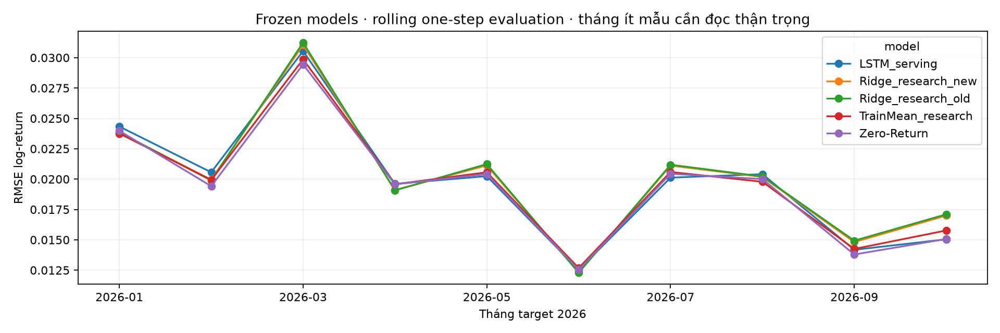
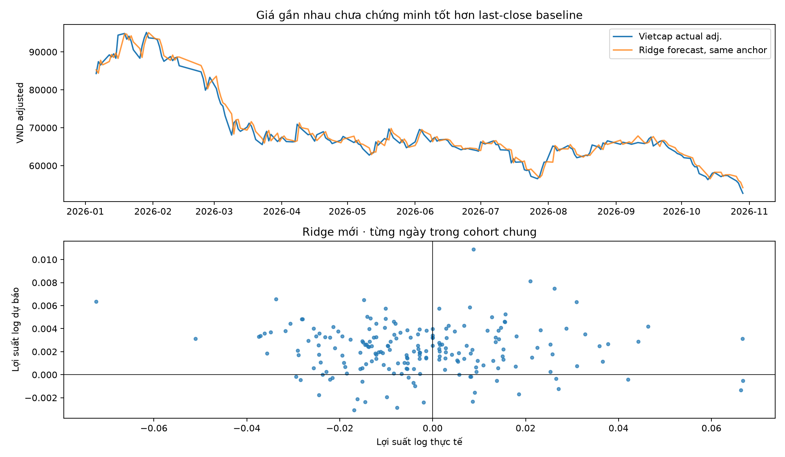
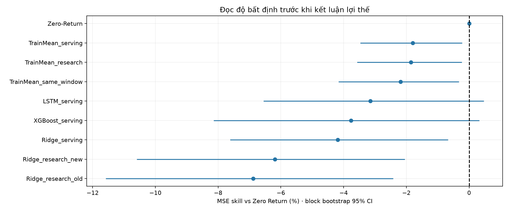

# Đánh giá model đóng băng trên 2026 — 20261030T014012158951Z

## Phạm vi
Weights, scaler, cấu hình và baseline constants được khóa lúc **2026-10-30T01:40:12.159695+00:00**, trước request dữ liệu 2026. Không refit, không chọn model theo điểm 2026. Dùng origin từ 2026-01-01 và target trước 2026-10-30; chỉ dữ liệu phiên đã kết thúc tới 29/10/2026. Cohort chung có **200** origin–target pairs; từ 2026-01-05 tới 2026-10-28, target cuối 2026-10-29.

Đây là **temporal out-of-sample được mở mới trong workflow nhưng đánh giá hồi cứu**, không phải các forecast đã ghi trước khi thị trường diễn ra. Model được train/đánh giá các giai đoạn cũ vào tháng 10/2026; source adjusted history hiện tại không được chứng nhận point-in-time. Sau lượt này, khoảng 2026 này đã được xem và không được gọi là holdout chưa mở cho các lần tune tiếp.

Model dự báo một quan sát dương-volume kế tiếp, sau khi có OHLCV của origin; rolling context được cập nhật bằng giá đã quan sát tại mỗi origin. Không phải dự báo cả đường giá năm 2026 từ cuối 2025, cũng không chứng nhận phiên HOSE kế tiếp.

## So sánh cùng ngày và cùng nhãn Vietcap

| Model | Train đến | Return RMSE | Return MAE | Giá MAE (VND adj.) | MAPE (%) | Hit (%) | Balanced (%) | MSE skill vs Zero |
|---|---|---:|---:|---:|---:|---:|---:|---:|
| Zero-Return | baseline | 0.0201138 | 0.0153877 | 1082.1 | 1.54 | N/A | N/A | +0.00% |
| TrainMean_serving | 2022-12-31 | 0.0202938 | 0.0156427 | 1099.9 | 1.57 | 40.00 | 50.00 | -1.80% |
| TrainMean_research | 2023-12-31 | 0.0202995 | 0.0156495 | 1100.4 | 1.57 | 40.00 | 50.00 | -1.86% |
| TrainMean_same_window | 2023-12-31 | 0.0203321 | 0.0156877 | 1103.1 | 1.57 | 40.00 | 50.00 | -2.18% |
| LSTM_serving | 2022-12-31 | 0.0204281 | 0.0155226 | 1092.5 | 1.56 | 51.28 | 54.27 | -3.15% |
| XGBoost_serving | 2022-12-31 | 0.0204885 | 0.0157245 | 1106.2 | 1.58 | 43.59 | 47.65 | -3.76% |
| Ridge_serving | 2022-12-31 | 0.0205304 | 0.0155220 | 1090.7 | 1.56 | 46.15 | 50.43 | -4.19% |
| Ridge_research_new | 2023-12-31 | 0.0207272 | 0.0159076 | 1116.1 | 1.60 | 42.56 | 49.79 | -6.19% |
| Ridge_research_old | 2023-12-31 | 0.0207946 | 0.0159603 | 1119.5 | 1.60 | 42.05 | 48.72 | -6.88% |

MAE/RMSE giá dùng **cùng Close Vietcap tại origin** để quy đổi lợi suất mọi model, tránh lẫn khác thang adjusted price của Yahoo và Vietcap. Là VND đã điều chỉnh theo provider, **không phải giá khớp lệnh lịch sử**. MAPE là sai số phần trăm giá; không được gọi 100%-MAPE là xác suất dự báo đúng. Các trường native_predicted_close_adjusted giữ forecast theo nguồn gốc để tra cứu, không dùng xếp hạng giá giữa nguồn khác basis.

Mẫu số hit rate: 195 nhãn khác 0, 5 nhãn trung tính; 78 tăng và 117 giảm. Luôn đoán tăng đạt 40.00%, luôn giảm 60.00%, balanced accuracy 50%. Zero Return không phát hướng nên hit N/A. Đọc cùng độ phủ hướng, balanced accuracy và baseline.

## Ổn định và độ bất định
monthly_metrics.csv báo từng tháng và số mẫu; không suy ra ổn định từ một hit rate gộp. CI 95% của MSE skill trong metrics.csv dùng circular moving-block bootstrap, block 10 origin, 2000 lần, seed cố định. Đây là khoảng bất định mô tả với giả định phụ thuộc trong block, không bảo đảm thị trường tương lai và không điều chỉnh mọi bias phát triển.

## Kiểm tra nguồn và giới hạn so sánh
data_quality.json và các file source_comparison lưu độ phủ, nến lỗi, missing sessions và bất đồng Yahoo/Vietcap/KBS. Full-Vietcap cohort trong metrics.csv bổ sung kết quả research/baseline trên toàn bộ ngày nguồn, tránh chỉ nhìn giao của các nguồn và che ngày thiếu của Yahoo.

LSTM/Ridge/XGBoost serving dùng Yahoo, 16 features, train tới 2022; Ridge research dùng Vietcap, 6 features, train 2021–2023, validation2024 chọn window3y alpha100. Vì khác nguồn/train cutoff/features, chênh lệch cross-family **không cô lập riêng thuật toán**. So alpha100 với alpha10 research mới là đối chứng gần về regularization. TrainMean_research là mean expanding train cũ, không lấy mean của năm 2026.

input_shift.csv so phân bố sáu inputs Ridge với training gốc bằng quantile/PSI mô tả; không đặt ngưỡng drift phổ quát hoặc gọi sai số thay đổi là “quên”. Model OHLCV thiếu tin tức/kết quả kinh doanh, thanh khoản và biến cố mới; chưa có mô phỏng phí/slippage/khớp lệnh hoặc bảo đảm lợi nhuận. Không tự thay API/Streamlit/model phục vụ, không commit/push.

## Bằng chứng
protocol.json, model_snapshot.zip, source_snapshot.zip khóa trước data; acquisition.json/data_snapshot.zip lưu raw sources và hash; predictions.csv.gz, metrics.csv, monthly_metrics.csv và verification.json giữ forecast/metric có thể kiểm tra lại. ../holdout_exposures.json (tại reports/) ghi khoảng thời gian đã mở. Xem DECISION.md cho diễn giải ưu/nhược và hướng cải thiện.
