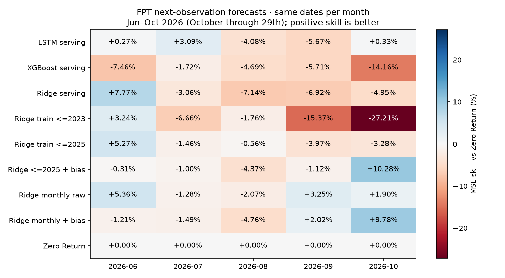
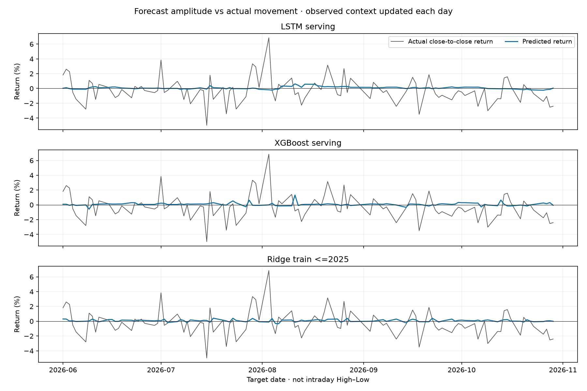

# FPT: cùng tập tháng 6–10/2026

Đọc lại forecast đã lưu; **không train hoặc tải nguồn mới**. Tất cả 17 strategy có đúng104 cặp origin/target chung. Target từ 2026-06-01 đến 2026-10-29, October chỉ đến29/10. Số phiên theo tháng: 6: 22; 7: 23; 8: 20; 9: 18; 10: 21. Ngày target xác định tháng; origin có thể là phiên cuối tháng trước. Primary common Yahoo/Vietcap: loại hai cặp không khớp trong tháng9 (xem audit nguồn cũ), không cho từng model tự chọn ngày. Chẩn đoán hồi cứu trên khoảng đã xem, không phải holdout mới hoặc forecast đã phát live.

## Cách đọc

- Mỗi origin đã biết OHLCV đến hết phiên t; dự báo close/return quan sát giao dịch kế tiếp. Không có thông tin t+1 trong features. **Không phải đứng đầu tháng6 rồi dự báo liên tục cả5 tháng mà không cập nhật giá thực tế.**
- Fixed weights/scalers chỉ học nhãn có target trước2026 so riêng với luồng monthly/bias/rolling dùng nhãn quá khứ đã chín. Không lấy shadow model train đến29/10 để chấm lại tháng6–9. Current adjusted history chưa point-in-time certified; khác nguồn/features/train cutoff làm so family chưa cô lập riêng thuật toán.
- Thực tế là reference Vietcap adjusted close trên cả origin và target; so biên độ **close-to-close**, không phải High–Low trong ngày. Source chéo KBS được đối chiếu ở study cũ.
- MAE/RMSE giá đo VND adjusted; RMSE return là log-return. `return_rmse_pp`/`return_mae_pp` so **simple return** ở đơn vị điểm phần trăm; `magnitude_mae_pp` so absolute return, phải đọc cùng đúng hướng (đoán+2% và thực tế−2% có cùng độ lớn nhưng sai hướng).
- Hit trên actual khác0; balanced accuracy trung bình recall tăng/giảm. Zero Return là abstention, Hit/Balanced N/A. `price_error_le_1pct_pct` = tỷ lệ abs(predicted_price/actual_price−1)≤0.01, tương tự2%; đây là tỷ lệ đạt ngưỡng đã định nghĩa, không xác suất forecast tiếp theo đúng. Không có một accuracy duy nhất cho hồi quy và MAPE≠1−accuracy.
- Độ lệch chuẩn return dự báo/thực tế cho biết model có co về0 quá mạnh; tỷ lệ thấp chỉ là mô tả biên độ, không tự chứng minh nên tăng độ nhạy. MSE skill cần hơn Zero Return trên cùng ngày. Không chọn model bằng tháng điểm đẹp.

## Kết quả gộp

| Model / strategy | RMSE log-return | MAE giá adj. VND | Hit % | Balanced % | Sai số giá ≤1% | ≤2% | MSE skill vs Zero % |
|---|---:|---:|---:|---:|---:|---:|---:|
| LSTM serving | 0.0168315 | 786.38 | 47.47 | 50.83 | 50.00% | 80.77% | -0.68% |
| XGBoost serving | 0.0172463 | 810.83 | 38.38 | 41.99 | 51.92% | 77.88% | -5.70% |
| Ridge serving | 0.0170783 | 787.96 | 45.45 | 49.17 | 47.12% | 80.77% | -3.65% |
| Ridge train <=2023 | 0.0174742 | 816.20 | 40.40 | 48.59 | 48.08% | 77.88% | -8.52% |
| Ridge train <=2025 | 0.0168589 | 781.62 | 50.51 | 55.13 | 50.00% | 80.77% | -1.01% |
| Ridge <=2025 + bias | 0.0167760 | 767.28 | 62.63 | 57.95 | 53.85% | 79.81% | -0.02% |
| Ridge monthly raw | 0.0167461 | 771.17 | 55.56 | 57.05 | 49.04% | 80.77% | +0.34% |
| Ridge monthly + bias | 0.0167832 | 767.21 | 57.58 | 53.78 | 51.92% | 79.81% | -0.10% |
| Zero Return | 0.0167746 | 773.51 | nan | nan | 52.88% | 80.77% | +0.00% |

Gộp từ mọi forecast, không lấy trung bình không trọng số RMSE/Hit từng tháng. `summary.csv` giữ đầy đủ17 strategy, recalls tăng/giảm, ngưỡng giá, return amplitude và block-bootstrap95% CI mô tả (10 origin,2.000 resamples,seed20261030). CI không điều chỉnh multiple testing/adaptive research. `monthly_metrics.csv` có đủ từng tháng.

## Nguồn và tái lập

`analysis.py`: phép tính; `scope.json`: hash input/source và phạm vi; `predictions.csv.gz`: các dự báo đã căn cùng ngày; `verification.json`: đối chiếu trực tiếp actual return/giá với raw Vietcap ZIP, đối soát N/pooled errors và8 hash canonical. Source studies: `reports/evaluation_2026/20261030T014012158951Z/` và `reports/recency_bias/20261030T022440928507Z/`. Không thay serving/API/Streamlit và không commit/push. Chạy lại script tạo ID phân tích mới, giữ lịch sử.

## Nhận xét từ kết quả thực thi

Trên cùng 104 phiên có 39 nhãn tăng, 60 giảm, 5 bằng 0 (99 nhãn để tính Hit). Luôn đoán giảm đạt 60,61% Hit và 50% balanced trong chính tập này; đây là class-prior tham chiếu mô tả, không chọn chiến lược giao dịch sau khi xem nhãn.

- LSTM RMSE 0,016831 so Zero 0,016775: gần baseline nhưng chưa hơn. Sai số giá ≤2% đạt 80,77%, đúng bằng Zero; tỷ lệ đạt ngưỡng cao không tự chứng minh tín hiệu ML. LSTM Hit 47,47%, balanced 50,83%.
- Static Ridge train nhãn tới cuối 2025: RMSE 0,016859. Static+bias: 0,016776; Hit 62,63%, balanced 57,95%. MAE giá cải thiện chút so Zero, RMSE vẫn nhỉnh hơn; không chốt bằng Hit. Causal bias dùng nhãn 2026 đã chín theo thời gian, khác với cố định hoàn toàn cả hậu xử lý.
- Monthly Ridge raw: RMSE 0,016746; MSE skill +0,34%, CI95% mô tả [−2,83%; +4,32%], vẫn chứa 0. Monthly tốt hơn Zero ở tháng 6, 9, 10, kém ở 7, 8. Không đủ để chốt model dựa trên đoạn được chọn này. Full-year comparison cũ vẫn được giữ, không thay bằng tháng đẹp hơn.
- Std simple return thực tế 1,666 điểm%; LSTM 0,164, XGBoost khoảng 0,211, Ridge static 0,153. Forecast point khá co về 0 và không bám các cú nhảy lớn. Nhưng mean có điều kiện vốn có thể biến động ít hơn actual nhiều nhiễu: **không tự nhân biên độ forecast cho bằng thực tế** để cải thiện hình vẽ.

Các metric mô tả được tính từ nhãn lịch sử hiện có; không phải xác suất dự báo tương lai đúng. Muốn dự báo cả tháng từ đầu tháng hoặc dự báo High–Low cần protocol/target riêng và baseline cùng horizon, không lấy điểm one-step ở đây làm đại diện.
