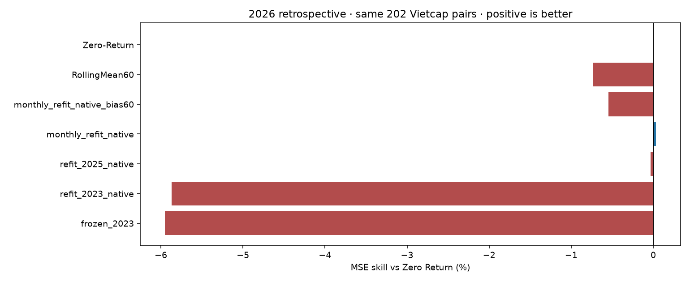
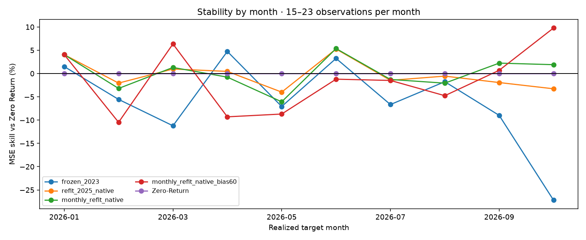

# Quyết định sau đối chứng recency/bias — 30/10/2026

**Giữ model serving hiện tại; thử ứng viên trong shadow.** Recency cải thiện bản Ridge cũ, nhưng chưa có lợi thế hồi quy thuyết phục so Zero Return. Đây là kết quả trên 2026 **đã xem**, không chọn champion bằng bảng này. API/Streamlit không thay đổi.

## Cùng 202 cặp origin/target Vietcap, đến29/10

| Phương án | RMSE log-return | MAE giá adjusted (VND) | Hit / 197 nhãn khác0 | Balanced accuracy | MSE skill vs Zero |
|---|---:|---:|---:|---:|---:|
| Ridge cũ, train đến2023 | 0,0207058 | 1.114,18 | 43,15% | 49,96% | −5,953% |
| Refit đến cuối2025 | 0,0201191 | 1.080,94 | 50,76% | 54,20% | −0,033% |
| Refit mô phỏng theo tháng | 0,0201124 | 1.074,00 | 52,79% | 54,52% | +0,034% |
| Cuối2025 + bias từ nhãn quá khứ | 0,0201116 | 1.064,12 | 60,91% | 56,62% | +0,041% |
| Theo tháng + bias | 0,0201704 | 1.063,57 | 57,87% | 54,25% | −0,545% |
| Zero Return | 0,0201157 | 1.081,70 | N/A | N/A | 0% |

Rebuild đúng 693 cặp cũ từ snapshot mới tái lập forecast cũ tới sai số số học; revision không giải thích lợi ích ở lượt này. Mở thêm coverage cùng cutoff2023 giúp rất ít. Refit đến2025 giảm RMSE **2,83%** so bản cũ, mô phỏng tháng giảm **2,87%**; không được diễn giải thành tăng2,83 điểm phần trăm accuracy hoặc hơn Zero2,83%.

MSE skill của static+bias chỉ+0,041%; block-bootstrap95% CI mô tả **[−4,28%; +3,80%]**. Monthly raw+0,034%, CI[−2,54%; +2,51%]. Lợi thế nhỏ và bất định, lại được xem trong workflow hồi cứu thích nghi.

Luôn đoán giảm đạt **59,39%** hit trong cùng197 nhãn; balanced50%. Vì vậy hit60,91% chưa phải mức chắc chắn cao. Chưa tính phí giao dịch, slippage, khả năng thực thi hay P&L; bài toán hiện tại là supervised next-observation regression.

## Trade-off cần giữ trong báo cáo

- Monthly raw vượt Zero ở5/10 tháng so bản cũ3/10; tháng tệ nhất MSE skill giảm từ−27,21% xuống−6,08%. Có cải thiện độ ổn định mô tả, chưa chứng minh tương lai.
- Bias giảm mean error upward của monthly từ0,002701 xuống0,000641 log-return, cải thiện MAE giá nhưng tăng RMSE. Trên cùng182 ngày đủ20 residual, RMSE monthly raw0,0197825 → monthly+bias0,0198480. Không ghép bias vào mặc định rồi nói mọi chỉ số đều tốt hơn.
- Static+bias: interval80% thực nghiệm coverage82,39% trên142 ngày đủ60 residual, mean width0,04602 log-return (khoảng4,60 điểm% log-return). Monthly+bias:83,10%, width0,04613. Coverage đẹp có thể đi cùng khoảng rộng; không có bảo đảm coverage forward.
- Cohort phụ200 cặp và các control khác được giữ trong `metrics.csv`, không bỏ kết quả xấu. So sánh warm-up cùng ngày ở `matched_warmup_comparison.csv`.

## Đã thực hiện

13 fit mới; 11 strategy ×2 cohort; reload5 luồng raw model, recompute3 luồng calibration, kiểm tra13 scaler/Ridge bằng thống kê train và normal equations, mọi metrics và8 hash canonical. Không retrain khi verify.82 unit tests đạt. Source/package versions, dữ liệu khóa, cutoff và model hashes được lưu; weights nghiên cứu tách khỏi serving.

Bundle shadow refit riêng tới target29/10, cùng6 features/alpha100/window3y, ghi raw và calibrated cạnh baseline. Calibration chuyển từ luồng lỗi monthly, **cố định** tới lần rebuild thủ công; không phải model được chọn do thắng evaluation. Một forecast pending phát09:25 ngày30/10, chưa có outcome; nếu target30/10 thì không được chấm full-session. Đọc `docs/FORWARD_SHADOW.md` trước khi phát tiếp sau EOD với CSV mới.

Ưu tiên tiếp là thu bằng chứng thật trên các phiên mới, theo dõi RMSE/MAE/bias/coverage và baseline trên cùng ngày. Chưa mở rộng grid hoặc thêm model phức tạp để tối ưu tiếp trên khoảng2026 đã xem. **Không commit/push** các thay đổi local.

## Biểu đồ đối chiếu

Khoảng bất định theo block-bootstrap và biểu đồ interval có trong phần 10 của `notebooks/05_training_journey_fpt.ipynb`. Kiểm tra hoàn tất ở `completion_checks.json`.
