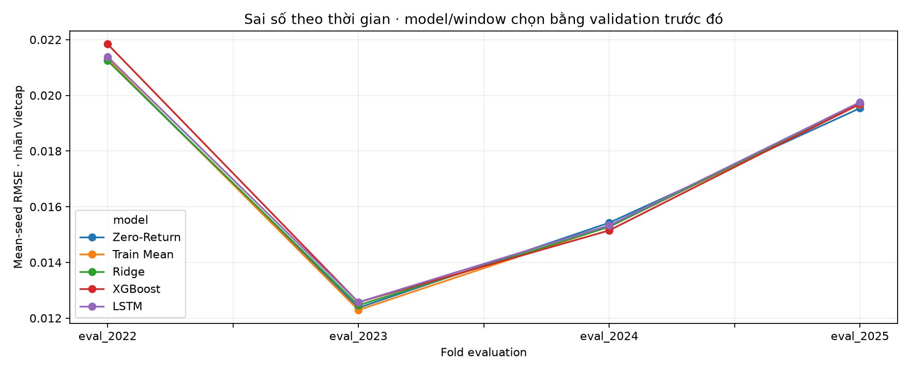
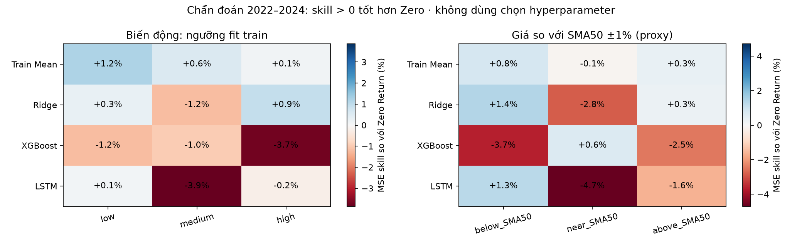
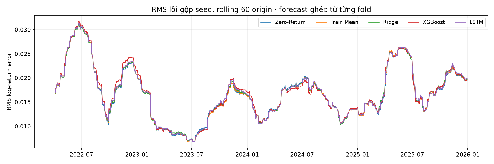

# Phân tích lỗi trước tối ưu Ridge — 20261030T010848752516Z

Forecast được lấy từ study window trước, lựa chọn model/window đã khóa bằng validation. Chưa có model mới được fit khi tạo báo cáo này. Chỉ chẩn đoán; không loại các ngày sai nhiều hoặc đưa nhãn evaluation vào chọn alpha.

## Theo thời gian

Sai số tuyệt đối thay đổi theo mức biến động của nhãn; RMSE cao không tự chứng minh model kém hơn baseline. 2022–2024 là phần chính; 2025 đã xem, chỉ báo riêng như chẩn đoán.

## Theo mức biến động và vị trí so với SMA50
Ngưỡng 1/3 và 2/3 của Volatility_20 được fit bằng **expanding common train origins của từng fold**, rồi áp cố định cho evaluation. Volatility tại origin chỉ dùng giá hiện tại/quá khứ. Trend là proxy Close/SMA50, band ±1%; không phải nhãn thị trường chính thức hoặc bằng chứng “đi ngang” thực sự. Các features này chỉ dùng phân tích, model vẫn giữ sáu features lợi suất.

| Mức biến động | N origin | Mean-seed RMSE Ridge | MSE skill vs Zero | Tỷ trọng squared loss Ridge |
|---|---:|---:|---:|---:|
| low | 308 | 0.0123332 | +0.27% | 23.0% |
| medium | 178 | 0.0156441 | -1.19% | 21.4% |
| high | 243 | 0.0216023 | +0.91% | 55.6% |

Nhóm high-vol có 243/729 origin (33.3%) nhưng chiếm 55.6% squared loss của Ridge. Đây là mô tả phân bố lỗi; chưa chứng minh nguyên nhân hoặc khả năng dự báo trước các ngày khó.

## Cách tính và giới hạn
RMSE trong bảng nhóm lấy mean qua các seed sau khi tính trong từng nhóm; N là số origin duy nhất. Tỷ trọng loss dùng mean squared loss qua seed tại mỗi origin, tránh đếm một ngày ba lần. Rolling plot dùng sqrt của mean loss gộp seed qua 60 origin, khác mean-seed RMSE trong bảng. Giữ cả nhóm nhỏ và đánh dấu small_segment nếu N<20; không điền nhóm thiếu thành 0. Các fold đã được xem nhiều lần, không phải ước lượng ngoài mẫu không thiên lệch hoặc phân tích nhân quả.

`error_segments.csv`, `error_by_fold_seed.csv`, `regime_thresholds.json`, `diagnostic_predictions.csv.gz` giữ số liệu gốc; `diagnostic_verification.json` kiểm tra threshold train-only, forecast nguồn và loss shares. Grid alpha/window trong config đã định trước khi tính các nhóm lỗi; không thêm feature hoặc nới grid theo điểm evaluation.
