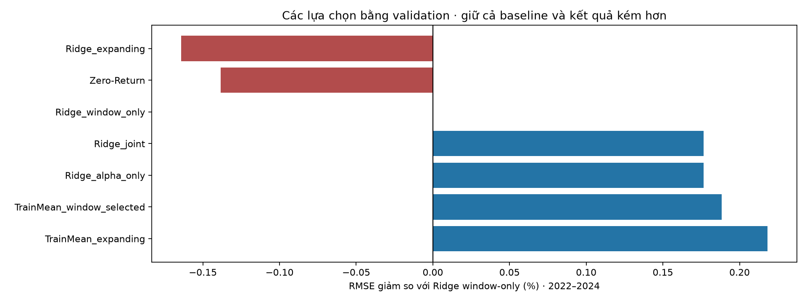
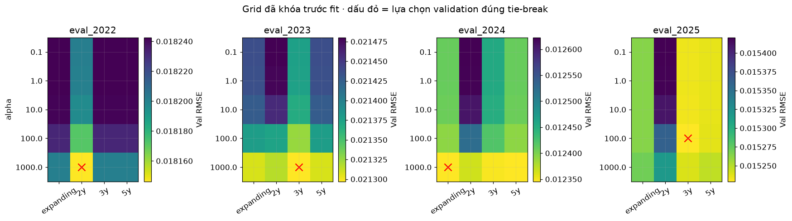

# Ridge regularization × training window — 20261030T011109863274Z

## Thiết kế và đối chứng
Chỉ đổi alpha trong [0.1, 1, 10, 100, 1000] và window expanding/2y/3y/5y; giữ nguồn Vietcap, sáu features lợi suất, target và ngày validation/evaluation. Không tải giá 2026. Protocol chẩn đoán/grid được lưu trước phân tích; protocol fit được lưu sau ERROR_ANALYSIS.md và trước fit đầu tiên. Evaluation 2022–2025 đã được xem nhiều lần: nghiên cứu thích nghi hồi cứu, không phải kiểm định ngoài mẫu mới.

80 điều kiện, **48 fit mới**, 32 điều kiện reused. 60 models duy nhất gồm 12 alpha10 cũ và 48 mới. Alpha10 tái lập đúng mọi control cũ. Scaler chỉ fit training vectors. Ridge là thuật toán xác định; không gán seed SD=0 hay dùng seed giả để tạo confidence interval.

Alpha-only giữ window đã chọn ở lượt trước rồi chọn alpha bằng validation. Joint chọn cả alpha/window bằng validation. Tie ưu tiên alpha10, rồi thứ tự window/config; tuyệt đối không dùng evaluation chọn cấu hình. Alpha/n được lưu vì objective Ridge dùng tổng squared error; cùng alpha có hiệu lực khác khi N train đổi. Đây là lựa chọn regularization/window, không phải thêm features.

## Evaluation chính 2022–2024
Mean-fold không trọng số trên cùng nhãn/cohort. Dương trong cột giảm là tốt hơn control; không suy ra significance.

| Strategy | Mean-fold RMSE | MAE | RMSE giảm so với Ridge window-only | Fold vượt Zero |
|---|---:|---:|---:|---:|
| Ridge_alpha_only | 0.0162983 | 0.0114394 | +0.18% | 2/3 |
| Ridge_expanding | 0.0163539 | 0.0114334 | -0.16% | 1/3 |
| Ridge_joint | 0.0162983 | 0.0114394 | +0.18% | 2/3 |
| Ridge_window_only | 0.0163271 | 0.0114415 | +0.00% | 2/3 |
| TrainMean_expanding | 0.0162915 | 0.0114529 | +0.22% | 2/3 |
| TrainMean_window_selected | 0.0162964 | 0.0114593 | +0.19% | 2/3 |
| Zero-Return | 0.0163497 | 0.0114552 | -0.14% | 0/3 |




## Năm 2025 và giới hạn
2025 tách riêng trong strategy_metrics.csv; không gộp vào bảng chính, không chọn lại cấu hình sau khi thấy điểm. Grid boundary được gắn cờ trong validation_selection.csv; chọn alpha ở biên grid không chứng minh alpha đó là tối ưu toàn cục. Error segmentation chỉ là mô tả, không chứng minh nhân quả, không dùng xóa ngày biến động mạnh.

Không tự promote model hoặc sửa API/Streamlit. Xem DECISION.md cho diễn giải sau khi kiểm chứng. Giữ nguyên canonical data/model và không commit/push.

## Bằng chứng
ERROR_ANALYSIS.md, protocol.json, diagnostic_protocol.json, source_snapshot.zip, cohort_counts.csv, metrics.csv, predictions.csv.gz, strategy_metrics.csv, strategy_predictions.csv.gz, validation_selection.csv, primary_summary.csv, selected_error_segments.csv, diagnostic_verification.json và verification.json.

```powershell
python -m src.models.ridge_refinement --config configs/ridge_refinement_v1.json
python -m src.models.ridge_refinement_report --study reports/ridge_refinement/20261030T011109863274Z
```
Mỗi lượt fit mới tạo ID mới; không ghi đè nghiên cứu cũ. Notebook 05 tổng hợp các giai đoạn riêng theo đúng nhãn và cohort.
