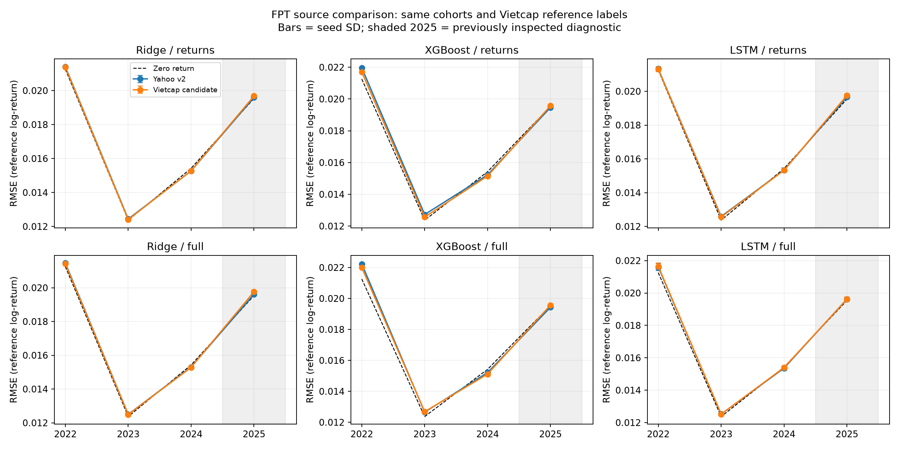

# Đối chứng nguồn dữ liệu FPT — 20261029T142732805710Z

Đây là nghiên cứu hồi cứu để đo tác động đổi nguồn và feature, **không phải chứng minh accuracy chắc chắn tăng**. Snapshot/model serving v2 được giữ nguyên; không tải hoặc đánh giá giá 2026, không tự promote.

## 1. Thiết kế khóa trước training

- Hai nguồn: Yahoo v2 đã khóa và Vietcap ứng viên v3 từ [audit](../../data_audits/20261029T135735663765Z/REPORT.md). Raw và toàn bộ features/labels được khóa trong [input_snapshot.zip](input_snapshot.zip), không tải lại mạng trong training.
- Có **1791 origin/target pairs chung**, cùng yêu cầu 60 quan sát context. Cả train, validation, evaluation dùng cùng origin **và** target date cho hai nguồn. Không dùng số mẫu có nhãn thêm của Vietcap làm lợi thế về kích thước tập train.
- Nhãn train là nhãn native mỗi nguồn. Validation/early stopping và evaluation dùng **cùng một nhãn Vietcap cố định**. Vì vậy mọi RMSE/MAE trong nghiên cứu so được trên cùng mục tiêu; không so trực tiếp với RMSE của nghiên cứu cũ chấm theo nhãn Yahoo.
- Native context dài 30 quan sát có thể bao phủ các ngày lịch khác nhau giữa hai nguồn; một số dòng chỉ nguồn v3 có vẫn có thể vào rolling features/context. Tác động nguồn bao gồm chất lượng giá/nhãn và độ đầy đủ lịch sử context, không chỉ một hệ số đổi giá. Chưa thử lợi ích tăng thêm labeled training rows của v3.
- Ridge alpha 10, XGBoost depth 2 / 150 cây, LSTM 32 units / Dense 8 / dropout 0,2, lookback 30. Seed 42, 123, 2026 cho XGBoost/LSTM; Ridge xác định chạy một lần. Hai nhóm returns (6) và full (16). Tổng **112 model**; cấu hình đầy đủ trong [protocol.json](protocol.json), source chính xác trong [source_snapshot.zip](source_snapshot.zip).
- LSTM feature scaler chỉ fit hợp các vị trí context thực sự được train dùng, không qua cutoff; target scaler fit native train labels. Ridge scaler chỉ fit vector train. Val labels chung được transform bằng target scaler của train; không fit scaler lên validation.
- Nến Yahoo lỗi và các dòng zero-volume bị loại theo cùng feature builder. Cờ Vietcap/KBS 14/03/2019 được giữ nguyên, không xóa sau khi xem điểm. Corporate actions, lịch HOSE và tính point-in-time chưa được chứng nhận; Vietcap là **nhãn tham chiếu**, không được coi là ground truth của sàn.

| Fold | Train mỗi nguồn | Validation | Evaluation |
| --- | ---: | ---: | ---: |
| eval_2022 | 604 | 205 | 242 |
| eval_2023 | 810 | 242 | 244 |
| eval_2024 | 1053 | 244 | 243 |
| eval_2025 | 1298 | 243 | 248 |

## 2. So sánh chính: evaluation 2022–2024

Tính mean RMSE qua seed trong từng fold rồi lấy trung bình không trọng số ba fold. Dấu **+** ở cột thay đổi = RMSE Vietcap giảm so với Yahoo, dấu **−** = tăng. Seed SD chỉ phản ánh biến động khi train, không phải confidence interval của lợi thế giao dịch. Ridge không có seed SD vì chỉ chạy một lần.

| Model / features | Yahoo RMSE | Vietcap RMSE | Thay đổi RMSE | Seed SD Yahoo / Vietcap |
| --- | ---: | ---: | ---: | ---: |
| LSTM / full | 0.0164958 | 0.0165224 | -0.16% | 0.0001239 / 0.0000926 |
| Ridge / full | 0.0164233 | 0.0163950 | +0.17% | N/A |
| XGBoost / full | 0.0166997 | 0.0165955 | +0.62% | 0.0000340 / 0.0000158 |
| LSTM / returns | 0.0164172 | 0.0163951 | +0.13% | 0.0001011 / 0.0000706 |
| Ridge / returns | 0.0163719 | 0.0163539 | +0.11% | N/A |
| XGBoost / returns | 0.0166373 | 0.0164722 | +0.99% | 0.0000477 / 0.0000375 |

Baseline trên cùng nhãn/cohort: Zero Return mean-fold RMSE **0.0163497**; Train Mean từ native Vietcap train **0.0162915**. Xem [primary_summary.csv](primary_summary.csv) để biết worst fold và số fold có MSE skill dương; cải thiện so với Yahoo chưa có nghĩa vượt baseline.

## 3. Stress diagnostic 2025 — báo cáo riêng

Năm 2025 đã được nhìn trong phát triển và audit đã phát hiện nhiều bất đồng Yahoo. Đây là kiểm tra chẩn đoán đã biết vấn đề, không phải holdout mới. Không gộp 2025 vào bảng trung bình chính hoặc chọn model phục vụ từ điểm này.

| Model / features | Yahoo RMSE | Vietcap RMSE | Thay đổi RMSE |
| --- | ---: | ---: | ---: |
| LSTM / full | 0.0196268 | 0.0196135 | +0.07% |
| Ridge / full | 0.0196158 | 0.0197670 | -0.77% |
| XGBoost / full | 0.0194301 | 0.0195714 | -0.73% |
| LSTM / returns | 0.0196643 | 0.0197568 | -0.47% |
| Ridge / returns | 0.0196048 | 0.0196823 | -0.40% |
| XGBoost / returns | 0.0194646 | 0.0195757 | -0.57% |



## 4. Kiểm chứng và giới hạn

Mọi candidate được kiểm tra cùng ngày origin/target và cùng reference labels; RMSE/MAE/hit rate được tính lại từ prediction export. Baseline Train Mean chỉ dùng nhãn train native; Return Persistence dùng Log_Return tại origin của nguồn tương ứng. Zero Return không phát hướng nên hit rate N/A. Cần đọc balanced accuracy và tỷ lệ lớp tăng/giảm trước khi diễn giải hit rate.

Đã nạp lại toàn bộ 112 model, kiểm tra 224 bộ prediction validation/evaluation và thống kê scaler train-only. Xem [verification.json](verification.json), [reload_verification.json](reload_verification.json). Hash 8 file canonical data/model pointers trước và sau trùng nhau.

Các fold dùng kiến trúc/features đã được phát triển trước, có chồng lấn lịch sử train/validation/evaluation giữa các năm. Không dùng seed như các thị trường độc lập, không diễn giải seed SD thành bằng chứng thống kê ngoài mẫu. Chưa thử phí giao dịch, corporate actions point-in-time, drift live hoặc forward holdout mới. Chưa thay model hoặc API/Streamlit.

## 5. Bằng chứng để team đối chiếu

- [metrics.csv](metrics.csv), [predictions.csv.gz](predictions.csv.gz): toàn bộ kết quả và từng forecast, gồm reference label lẫn native label.
- [paired_fold_comparison.csv](paired_fold_comparison.csv), [paired_seed_comparison.csv](paired_seed_comparison.csv): đối chiếu từng fold/seed; không bỏ lượt kém.
- [seed_stability.csv](seed_stability.csv), [splits.csv](splits.csv), [cohort.csv](cohort.csv), [data_quality.json](data_quality.json).
- [lstm_history.json](lstm_history.json), [manifest.json](manifest.json): epochs, artifact hashes, runtime, cấu hình. Weights nghiên cứu lưu local dưới models/research/, không đè serving weights.

```powershell
python -m src.models.source_comparison --config configs/source_comparison_v1.json
python -m src.models.source_comparison_report --study reports/source_comparison/20261029T142732805710Z --reload-artifacts
```

Lệnh train mới tạo ID riêng. Report/metrics có thể kiểm tra từ file Git; kiểm tra nạp lại cần weights local hoặc tái train. Mỗi lần thử tiếp phải giữ protocol, source snapshot, nhãn đánh giá và cohort để biết thay đổi đến từ đâu.
